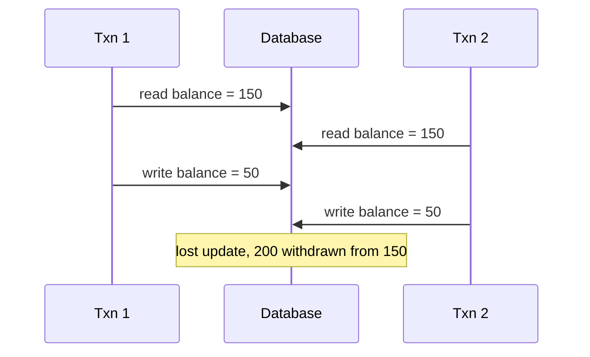

# ACID Transactions

## The problem it solves

A bank transfer is two writes: subtract $100 from Alice, add $100 to Bob. If the server crashes between them, $100 vanishes. If two transfers from Alice run at the same moment, each reads her $150 balance, each decides there's enough, and both subtract $100, leaving her at $50 after spending $200. Without transactions, you'd have to handle every crash point and every interleaving by hand.

A transaction groups operations so they succeed or fail together and don't see each other's half-finished work.

## How it works

- **Atomicity:** all of the transaction's writes happen or none do. On failure or `ROLLBACK`, the database undoes partial work (using an undo log or by never publishing uncommitted versions).
- **Consistency:** the transaction moves the database from one valid state to another, respecting constraints (foreign keys, `CHECK balance >= 0`, unique indexes). This is mostly the application's job, with the database enforcing declared constraints.
- **Isolation:** concurrent transactions don't interfere; how strictly depends on the isolation level.
- **Durability:** once committed, data survives crashes, because the write-ahead log is flushed to disk (and often replicated) before the commit returns.

```sql
BEGIN;
  UPDATE accounts SET balance = balance - 100 WHERE id = 'alice' AND balance >= 100;
  -- application checks that 1 row was updated, otherwise ROLLBACK
  UPDATE accounts SET balance = balance + 100 WHERE id = 'bob';
COMMIT;
```

**Isolation levels and the anomalies each prevents** (from the SQL standard, plus snapshot isolation, which most databases implement):

| Level | Dirty read | Non-repeatable read | Phantom read | Lost update | Write skew |
|---|---|---|---|---|---|
| Read uncommitted | possible | possible | possible | possible | possible |
| Read committed | prevented | possible | possible | possible | possible |
| Repeatable read / snapshot isolation | prevented | prevented | depends on DB | prevented in Postgres, not always elsewhere | possible |
| Serializable | prevented | prevented | prevented | prevented | prevented |

The anomalies:

- **Dirty read:** T1 reads T2's uncommitted write; T2 rolls back; T1 acted on data that never existed.
- **Non-repeatable read:** T1 reads a row twice and gets different values because T2 committed in between.
- **Phantom read:** T1 runs `SELECT ... WHERE room = 5` twice and new rows appear because T2 inserted matching rows.
- **Lost update:** T1 and T2 both read a counter as 10, both write 11; one increment is lost.
- **Write skew:** two doctors are on call; each transaction checks "at least one other doctor is on call," sees yes, and removes itself. Both commit and nobody is on call. Each touched a different row, so row locks didn't conflict.

**How isolation is implemented:**

- **Locking (two-phase locking):** transactions take shared locks to read and exclusive locks to write, held until commit. Correct but can block and deadlock.
- **MVCC:** each transaction reads a consistent snapshot of committed versions; writers create new versions instead of overwriting. Readers don't block writers. Postgres, MySQL InnoDB and Oracle use it.
- **Serializable Snapshot Isolation (Postgres `SERIALIZABLE`):** snapshot reads plus tracking of read/write dependencies, aborting a transaction if a dangerous pattern appears. The application must retry aborted transactions.

Defaults: Postgres and Oracle default to read committed; MySQL InnoDB defaults to repeatable read.



**Fixes for lost update at weaker levels:** atomic updates (`SET balance = balance - 100 WHERE balance >= 100`), `SELECT ... FOR UPDATE` to lock the row, or optimistic version checks.

## Worked example

Alice has $150. Two $100 withdrawals run concurrently under each approach.

| Approach | T1 | T2 | Final balance | Correct? |
|---|---|---|---|---|
| Read committed, read then write | reads 150, writes 50 | reads 150, writes 50 | 50 | No: $200 withdrawn |
| `SELECT ... FOR UPDATE` | locks, reads 150, writes 50, commits | waits, then reads 50, rejects | 50 | Yes: $100 withdrawn |
| Atomic conditional update | updates 1 row (150 → 50) | `balance >= 100` false, 0 rows | 50 | Yes |
| Serializable | commits | aborted with serialization error, retries, sees 50, rejects | 50 | Yes |

## Trade-offs

- **Pros:** dramatically simpler application code; correctness under crashes and concurrency; constraints enforced in one place.
- **Cons:** stronger isolation costs throughput (locking, aborts, retries); transactions spanning shards or services need two-phase commit or sagas; long transactions hold locks and bloat MVCC versions.
- **Alternatives:** single-object atomic operations (conditional writes in DynamoDB, Redis `INCR`), which cover many cases without multi-row transactions; sagas for cross-service workflows; optimistic concurrency for low-contention updates.

## When to use it (and when not)

- **Use it** for money movement, inventory and booking, order creation with line items, anything with invariants across rows. Interview questions: payment system, ticketing and hotel booking, e-commerce checkout, digital wallet, auction bidding.
- **Not needed** for independent single-row writes like logging events or updating a last-seen timestamp, and impractical across microservices, where sagas fit better.

## In an interview

Say: "Booking runs in one Postgres transaction: `SELECT ... FOR UPDATE` on the seat row, check it's free, insert the booking, mark the seat taken, commit, so two users can't both get it." Be ready to name the isolation level you'd use and the anomaly it prevents, and to explain what changes when the data spans shards.

## Common follow-up questions

### Which isolation level would you choose?
Read committed is fine for most reads and simple writes if you use atomic updates or row locks where races matter. Use serializable for logic with invariants across rows (write skew risks) and be prepared to retry aborted transactions.

### What is write skew and how do you prevent it?
Two transactions read overlapping data, each makes a decision based on it, and each writes a different row, together breaking an invariant. Prevent it with serializable isolation, by locking the rows read with `FOR UPDATE`, or by materializing the conflict into a single row both must update.

### How is durability actually achieved?
The database appends changes to a write-ahead log and fsyncs it before acknowledging the commit. After a crash, it replays the log. Many setups also wait for a replica to confirm, so a lost machine doesn't lose committed data.

### Can you have ACID transactions in a distributed database?
Yes. Spanner, CockroachDB and others provide distributed transactions using consensus per shard plus two-phase commit across shards. It works, but cross-shard transactions cost extra round trips, so design keys to keep most transactions on one shard.
