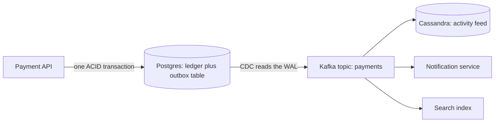

# ACID vs BASE

## The problem it solves

Two families of databases make opposite promises. Traditional relational databases promise **ACID**: a transaction happens completely or not at all, and you never see half-done work. Many distributed NoSQL stores promise **BASE**: they stay available and fast under partitions and huge scale, but different replicas can disagree for a while.

Neither is "better." The real design question is *which data paths need which guarantees*. Charging a card twice is a disaster; showing 1,041 likes instead of 1,043 for a few seconds is not. Interviewers want to see you choose per path, not per company.

## How it works

**ACID, in practice:**

| Letter | Meaning | What it buys you |
|---|---|---|
| **Atomicity** | All writes in a transaction commit, or none do | No half-transferred money after a crash |
| **Consistency** | Each transaction moves the database between states that satisfy its constraints (foreign keys, uniqueness, checks) | The database refuses invalid data |
| **Isolation** | Concurrent transactions don't see each other's partial work, to a degree set by the isolation level | No lost updates or double-booking, depending on level |
| **Durability** | Once committed, data survives crashes (write-ahead log, fsync, replication) | An acknowledged write is not lost |

Isolation is the subtle one: Read Committed, Repeatable Read/Snapshot and Serializable allow different anomalies. See **ACID Transactions** for the details. Note that the "C" in ACID is not the "C" in **CAP Theorem**; CAP's consistency means linearizability across replicas.

**BASE:**

- **Basically Available:** the system answers requests even when some nodes or links fail, possibly with stale data.
- **Soft state:** replica state can change without new input, as replication catches up.
- **Eventually consistent:** if writes stop, all replicas converge to the same value. See **Consistency** for the spectrum in between (read-your-writes, monotonic reads, causal).

| | ACID | BASE |
|---|---|---|
| Priority | Correctness | Availability and scale |
| Under a partition | May reject writes (CP) | Keeps accepting writes (AP) |
| Reads | Latest committed value | Possibly stale |
| Conflicts | Prevented by locks or validation | Resolved later: last-write-wins, CRDTs, app merge |
| Scaling writes | Harder; single primary or consensus | Easy; any replica can accept |
| Typical stores | Postgres, MySQL, Spanner | **Cassandra**, DynamoDB (default reads), Riak |

**Real systems mix both.** A payments company keeps its **ledger** in a SQL database with serializable transactions, and its activity feed in a wide-column store. The bridge between them is asynchronous and reliable:

- **Outbox:** the service writes the business row *and* an event row in the same local transaction. Either both exist or neither does.
- **Change Data Capture:** a connector (e.g. Debezium) tails the database log and publishes outbox rows to Kafka. No dual write, no lost events. See **Change Data Capture**.
- **Saga:** when a business operation spans services, each step is a local ACID transaction, and failures run compensating steps instead of a global rollback. See **Saga**.

So you get ACID inside each service's source of truth, and BASE between services and in the derived read models.

**Tunable consistency.** Many BASE stores let you pick per query. Cassandra with replication factor 3 can write and read at `QUORUM` (2 of 3), and since 2 + 2 > 3 every read overlaps the latest write (see **Quorum**). DynamoDB offers strongly consistent reads at roughly twice the read cost of eventually consistent ones. Kafka producers choose `acks=all` with `min.insync.replicas=2` for durability or `acks=1` for latency. Tuning per path is often better than switching databases.

## Worked example

An e-commerce site, path by path:

| Data path | Guarantee | Why | Implementation |
|---|---|---|---|
| Payment capture and ledger | ACID, serializable or careful row locking | Money must balance; double charges are unacceptable | Postgres transaction with an idempotency key; outbox event |
| Inventory decrement at checkout | ACID on the item row | Overselling the last unit costs refunds and trust | `UPDATE stock SET qty = qty - 1 WHERE sku = ? AND qty > 0`, check rows affected |
| Inventory shown on product pages | BASE, seconds stale | "Only 3 left" being briefly wrong is fine | Cached, updated from Kafka events |
| Likes on a review | BASE, counters | Lost or delayed increments barely matter | Cassandra counter or Redis `INCR`, flushed periodically |
| View counts | BASE, approximate | Nobody audits views per second | Aggregate in a stream processor, write every 10 s |

The checkout flow: reserve stock (ACID), charge payment via the payment service (its own ACID transaction), and if the charge fails, release the reservation (saga compensation). The order-created event goes through the outbox to Kafka, and the feed, email and analytics consumers apply it eventually.

Rough numbers to sanity-check the split: a site with 10M daily product page views but 100k orders a day has ~116 page views per second on average (10,000,000 / 86,400) and ~1.2 orders per second. Only the small ACID path needs strict guarantees; the high-volume path can be cached and eventually consistent.

## Trade-offs

- **ACID costs:** coordination (locks, consensus) adds latency and limits write throughput; distributed transactions across regions pay cross-region round trips; under partition the minority side refuses writes.
- **BASE costs:** application code must handle stale reads, conflicts and duplicates; bugs show up as rare, hard-to-reproduce anomalies; reasoning is harder for every new engineer.
- **Mixing costs:** you need the outbox/CDC plumbing, idempotent consumers, and monitoring of replication lag between the stores.
- **Tunable consistency** is flexible but easy to misconfigure: a `QUORUM` write paired with a `ONE` read gives no overlap guarantee.

## When to use it (and when not)

- **Use ACID** for anything with invariants across rows or entities: balances, inventory, bookings, uniqueness (usernames), state machines where an illegal transition is costly.
- **Use BASE** for high-volume, loss-tolerant or merge-friendly data: feeds, counters, telemetry, caches, presence, recommendations, search indexes.
- **Don't** reach for BASE just because traffic is "big"; check whether the strongly consistent path is actually large. Don't run cross-service distributed transactions (**Two-Phase Commit**) when a saga with compensations will do.

## In an interview

Say: "I'll choose consistency per data path. The ledger and inventory reservation are ACID in Postgres, because their invariants can't be broken even briefly. Everything downstream, the activity feed, search, counters, is eventually consistent, fed from an outbox through CDC into Kafka, with idempotent consumers. If the interviewer asks about multi-region, I'd keep money in a single-writer or consensus-backed store and let the read models be AP." Then name the business consequence of staleness for each path.

## Common follow-up questions

### Is ACID consistency the same as CAP consistency?
No. ACID consistency means transactions preserve application invariants. CAP consistency means linearizability: every read sees the latest write across all replicas. A single-node Postgres is ACID but CAP doesn't really apply to it.

### Can a NoSQL database be ACID?
Some are, within limits. MongoDB supports multi-document transactions, DynamoDB has transactional APIs across items, and distributed SQL databases like Spanner and CockroachDB are fully ACID. The cost shows up as latency and throughput limits on those operations.

### How do you prevent overselling with an eventually consistent store?
Don't make the decrement eventually consistent. Route the reservation to a single owner of that SKU: a conditional update in a SQL row, a conditional write in DynamoDB, or a Cassandra lightweight transaction. Keep the displayed stock eventually consistent.

### What is the dual-write problem?
Writing to the database and then publishing to Kafka in application code: if the process crashes between the two, one happens without the other. The outbox pattern fixes it by making the event part of the database transaction and publishing it from the log.

### How does the UI cope with eventual consistency?
Read-your-writes for the author (route their reads to the primary or show the optimistic local value), version numbers to ignore older updates, and honest copy like "processing" for asynchronous operations.

### Does Kafka give ACID?
Kafka transactions give atomic writes across partitions and exactly-once read-process-write within Kafka, and consumers with `isolation.level=read_committed` skip aborted data. They don't give isolation for arbitrary queries, and they don't cover external databases unless the sink is idempotent or transactional itself.
