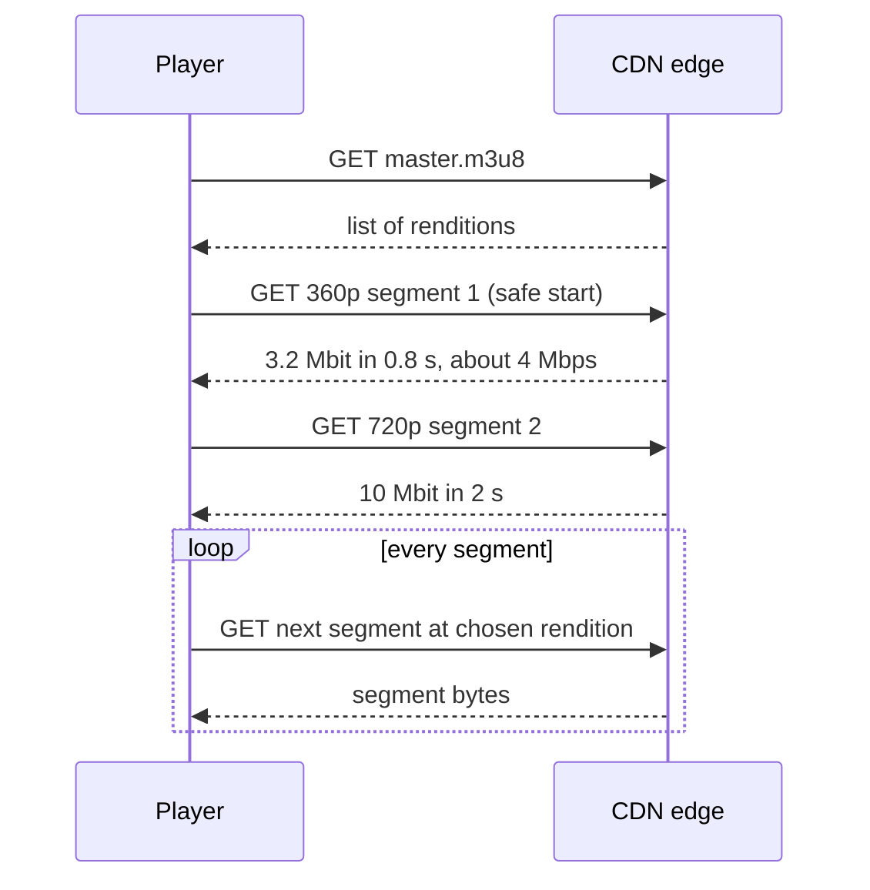

# Adaptive Bitrate Streaming

## The problem it solves

You serve one video to a phone on a train with 1 Mbps and a fiber-connected TV with 100 Mbps. A single 1080p file at 5 Mbps stalls constantly on the phone; a single 360p file looks blurry on the TV. Bandwidth also changes mid-video: the train enters a tunnel, someone else on the Wi-Fi starts a download. Viewers abandon videos that rebuffer, so stalls are the most damaging failure.

Adaptive bitrate (ABR) streaming encodes each video at several qualities, cuts every version into short aligned segments, and lets the player choose the quality for each segment based on current network conditions.

## How it works

**1. Encode a bitrate ladder.** Transcode the source into several **renditions**, for example 240p at 400 kbps, 360p at 800 kbps, 720p at 2.5 Mbps, 1080p at 5 Mbps. Encoders force a **keyframe** at fixed intervals (e.g. every 2 s) in every rendition, so segments line up at the same timestamps across qualities.

**2. Segment and package.** Cut each rendition into **segments** of 2–6 s, each starting at a keyframe, and write **manifests**. In HLS, a master playlist lists the renditions and each media playlist lists one rendition's segments:

```
#EXTM3U
#EXT-X-STREAM-INF:BANDWIDTH=800000,RESOLUTION=640x360
360p/index.m3u8
#EXT-X-STREAM-INF:BANDWIDTH=2500000,RESOLUTION=1280x720
720p/index.m3u8
#EXT-X-STREAM-INF:BANDWIDTH=5000000,RESOLUTION=1920x1080
1080p/index.m3u8
```

DASH uses an XML `.mpd` manifest with the same information. CMAF lets one set of fragmented MP4 segment files serve both HLS and DASH.

**3. Serve over plain HTTP from a CDN.** Segments are immutable files, so they cache perfectly at edges with long TTLs. No special streaming server is needed.

**4. The player adapts.** It fetches the master playlist, picks a starting rendition, then downloads segments one by one into a buffer, choosing the rendition for each next segment:

- **Throughput-based:** measure how fast recent segments downloaded and pick the highest bitrate below a safety margin (e.g. 80%) of that estimate. Reacts quickly, but noisy networks cause jumpy choices.
- **Buffer-based (e.g. BOLA):** choose quality from how many seconds are buffered. A low buffer means drop quality to avoid a stall; a full buffer means step up. More stable.
- Real players blend both, start low for a fast first frame, and limit how often they switch, since visible quality flapping annoys viewers.



**Segment length trade-off:** shorter segments start faster and adapt faster, but mean more HTTP requests, more manifest entries and slightly worse compression (more keyframes). Live streaming uses short segments or low-latency HLS/CMAF chunks to cut delay.

## Worked example

Ladder: 800 kbps, 2.5 Mbps, 5 Mbps. Segments are 4 s, so a segment's size is bitrate × 4 s (800 kbps → 3.2 Mbit, 2.5 Mbps → 10 Mbit). The player picks the highest bitrate ≤ 80% of the last measured throughput. Buffer after a segment = buffer before − download time + 4 s (if the download outlasts the buffer, playback stalls).

| Seg | Last measured | 80% budget | Chosen | Actual network | Download time | Buffer after | Note |
|---|---|---|---|---|---|---|---|
| 1 | none | | 800 kbps | 4 Mbps | 3.2 / 4 = 0.8 s | 0 + 4 = 4.0 s | safe start |
| 2 | 4 Mbps | 3.2 Mbps | 2.5 Mbps | 5 Mbps | 10 / 5 = 2.0 s | 4.0 − 2.0 + 4 = 6.0 s | step up |
| 3 | 5 Mbps | 4.0 Mbps | 2.5 Mbps | 1.25 Mbps | 10 / 1.25 = 8.0 s | 6.0 − 8.0 → **2 s stall**, then 4.0 s | tunnel |
| 4 | 1.25 Mbps | 1.0 Mbps | 800 kbps | 1.25 Mbps | 3.2 / 1.25 = 2.56 s | 4.0 − 2.56 + 4 = 5.44 s | step down |
| 5 | 1.25 Mbps | 1.0 Mbps | 800 kbps | 5 Mbps | 3.2 / 5 = 0.64 s | 5.44 − 0.64 + 4 = 8.8 s | recovering |
| 6 | 5 Mbps | 4.0 Mbps | 2.5 Mbps | 5 Mbps | 10 / 5 = 2.0 s | 8.8 − 2.0 + 4 = 10.8 s | back up |

The stall in segment 3 is why players don't rely on throughput alone: throughput is measured after the fact. A player that also watches the buffer and aborts or downgrades a segment that is downloading too slowly would have switched mid-download and likely avoided the stall.

## Trade-offs

- **Pros:** smooth playback across wildly different networks; uses ordinary HTTP and CDNs (cheap, cacheable, firewall-friendly); quality switches without interrupting playback.
- **Cons:** storage and transcoding multiply with every rendition (often 5–10 copies per video); latency for live streams is several segments behind real time; quality visibly changes; the ABR algorithm needs careful tuning.
- **Alternatives:** **progressive download** of a single MP4 (simple, fine for short clips, no adaptation); **WebRTC** for sub-second interactive video (calls, live auctions), at higher server cost; **per-title encoding** (Netflix tunes the ladder to each video's complexity) to save storage and bandwidth.

## When to use it (and when not)

- **Use it** in "design YouTube" or "design Netflix", live streaming (Twitch), video on social feeds, and any long-form video delivered to varied devices.
- **Don't use it** for real-time two-way video (Zoom-style calls need WebRTC with sub-second latency), or for tiny clips where a single small file is simpler.

## In an interview

Say: "Each upload is transcoded into a ladder of renditions, cut into 4-second keyframe-aligned segments with HLS and DASH manifests, and served from the CDN; the player measures throughput and buffer level and picks the rendition for each next segment." Be ready to explain why segments must start on keyframes, the segment-length trade-off, and how the player avoids stalls.

## Common follow-up questions

### Why must segments be aligned across renditions?
The player switches quality at segment boundaries. If segment 7 of 720p and segment 7 of 1080p covered different time ranges, a switch would skip or repeat video. Forcing keyframes at the same timestamps in every rendition makes any boundary a clean switch point.

### How does the player start quickly?
It starts with a low or medium rendition so the first segment downloads fast, begins playback after one or two segments, then steps up as it measures throughput. Short initial segments and CDN-cached manifests help further.

### How does live streaming differ?
The encoder produces segments in real time and the manifest is a rolling window that the player re-fetches. Latency is roughly a few segment durations, so live services use 1–2 s segments or low-latency HLS/CMAF partial segments, at the cost of more requests and less buffer to absorb network dips.

### How do you reduce storage for the long tail of rarely watched videos?
Transcode only a few common renditions at upload and create others on demand if a video becomes popular, or keep fewer renditions for old, rarely watched content. Popular videos justify a full ladder and per-title optimization.
