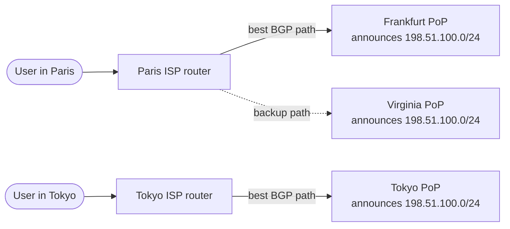

# Anycast

## The problem it solves

You run servers in 30 cities and want every user to reach the closest one. With DNS-based routing, you hand out a different IP per city, guess the user's location from their resolver, and wait out cached TTLs whenever a site fails. A user on a distant public resolver can be sent to the wrong continent, and failover takes a minute or more.

Anycast takes a different approach: **announce the same IP address from every location** and let the internet's routing system deliver each packet to the nearest site in network terms. There is one address to configure, routing follows the user's real network path, and when a site withdraws its route, traffic shifts as fast as BGP converges, typically seconds to tens of seconds.

## How it works

1. You own an IP prefix, for example `198.51.100.0/24`.
2. Every PoP announces that same prefix to its upstream networks using **BGP**.
3. Each router on the internet picks the best path to the prefix according to its BGP policy, which usually weighs the operator's own preferences and then AS-path length.
4. A user's packets therefore go to whichever PoP is "closest" from their ISP's point of view.
5. If a PoP fails or is overloaded, it **withdraws** its announcement and routers choose the next best path.

**Contrast with unicast and DNS routing:** unicast means one IP equals one location. Geo-DNS gives different unicast IPs to different users. Anycast gives everyone the same IP, and the network decides.

**Where it is used:**

- **DNS servers.** The root servers and large public resolvers (like 1.1.1.1 and 8.8.8.8) are anycast, so each address is really many machines worldwide.
- **CDNs and DDoS protection.** Attack traffic is spread across every PoP instead of concentrating on one, and each PoP absorbs only the share coming from networks nearest to it.
- **Global load balancer front doors.** Some cloud global load balancers expose a single anycast IP and then forward to backend regions.

**The TCP question.** Anycast is natural for UDP request-response like DNS, where one packet goes out and one comes back. For TCP, all packets of one connection must reach the same PoP. In practice routes are stable for the life of most connections, so this works, but a route change mid-connection can send packets to a PoP that knows nothing about the connection, which resets it. Operators manage this by keeping routes stable and, in some designs, forwarding stray packets between PoPs.

**"Nearest" is network-nearest.** BGP picks paths by policy and AS-path length, not physical distance or measured latency. A user can be routed to a farther PoP because of peering arrangements. Operators tune this with BGP communities, selective announcements and AS-path prepending.

## Worked example

Five PoPs announce one anycast IP for a DNS service, each with 200 Gbps of capacity. A DDoS sends 500 Gbps of traffic from botnets spread worldwide.

| Setup | Traffic per site | Outcome |
|---|---|---|
| Unicast, one site with 200 Gbps | 500 Gbps | Link saturated, service down for everyone |
| Anycast, attack spread evenly over 5 sites | 500 / 5 = 100 Gbps each | Each site runs at 50%, service stays up |
| Anycast, 300 Gbps of the attack lands near one site | 300 Gbps there, 50 Gbps at each other site | That site is saturated; it withdraws or filters, and its legitimate users shift to the next nearest site |

Total capacity is 5 × 200 = 1,000 Gbps, so even the full attack fits, as long as it isn't too concentrated.

## Trade-offs

- **Pros:** one IP for the whole world; routing follows real network topology; fast failover by route withdrawal; natural DDoS dilution; no reliance on resolver location or TTLs.
- **Cons:** requires owning an IP prefix and running BGP with upstream providers; you don't control exactly which PoP a user reaches; route changes can break long TCP sessions; debugging which site a user hit is harder.
- **Alternatives:** geo-DNS (no BGP needed, precise control per region, slower failover); global L7 load balancers from a cloud provider, which often use anycast internally and hide the BGP work from you.

## When to use it (and when not)

- **Use it** when you design DNS infrastructure, a CDN, edge networks, DDoS mitigation, or a global entry point for a multi-region service (global chat or video edge, "how do users reach the nearest data center").
- **Don't build it yourself** for a typical application. Use a CDN or a cloud global load balancer that provides it. It is also a weak fit for long-lived stateful connections that can't tolerate an occasional reset, unless the provider handles that.

## In an interview

Say: "The edge uses a single anycast IP announced from every PoP, so BGP routes each user to a nearby site, and if a PoP fails it withdraws the route and traffic moves to the next site within seconds." Then be ready to compare anycast with geo-DNS and explain what happens to TCP connections during a route change.

## Common follow-up questions

### How is anycast different from geo-DNS?
Geo-DNS returns different IPs based on the resolver's estimated location and depends on TTLs for changes. Anycast returns the same IP to everyone and lets BGP deliver packets to a nearby site. Anycast fails over faster and follows the real network path, while geo-DNS gives finer control.

### Does anycast work with TCP?
Mostly, yes. Routes between a user and a PoP are usually stable for the duration of a connection. A route change mid-connection can reset it, which is acceptable for short HTTP requests and handled with reconnects for long ones.

### How does an overloaded PoP shed traffic?
It can withdraw its announcement entirely, announce it less attractively (for example with AS-path prepending) so some networks prefer other sites, or stop announcing to specific peers. These are coarse controls, which is why anycast balances traffic roughly, not precisely.

### Why do DNS root servers use anycast?
There are 13 root server identities, but each is served by many anycast instances worldwide. This gives resilience against outages and attacks and keeps root lookups fast everywhere, without adding new identities.
