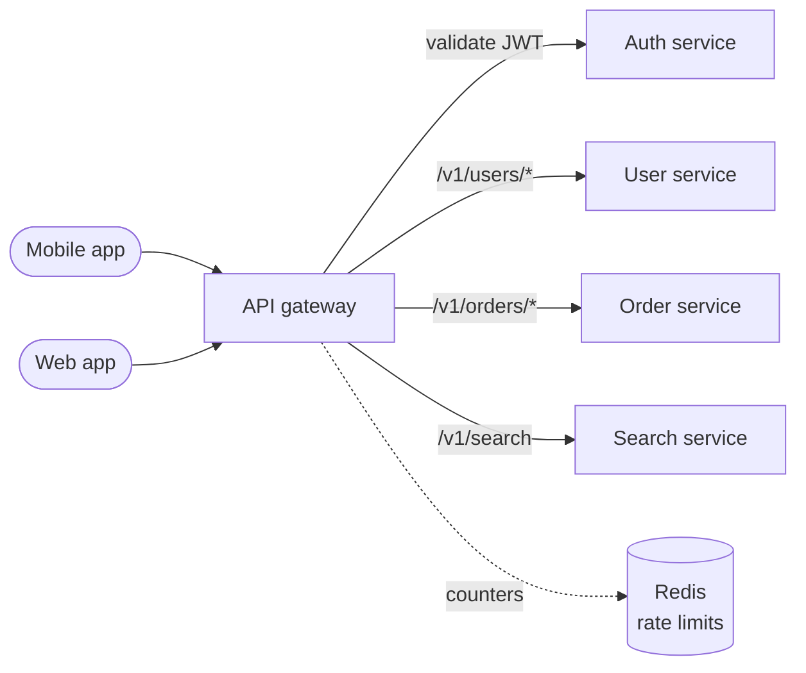

# API Gateway

## The problem it solves

You split a monolith into 12 services: users, orders, payments, search, and so on. Now the mobile app must know 12 hostnames, and each service has to implement token validation, rate limiting, CORS, request logging and TLS on its own. Twelve teams implement auth slightly differently, one forgets rate limiting, and changing an internal URL breaks every shipped app version.

An API gateway is a single entry point in front of your services. Clients call one host, and the gateway handles the cross-cutting work once, then routes each request to the right backend.

## How it works



For each request the gateway runs a pipeline of steps:

1. **TLS termination** and basic request validation (size limits, malformed requests).
2. **Authentication:** validate the JWT signature and expiry locally, or call an auth service for opaque tokens or API keys. Attach the user ID as a trusted internal header.
3. **Rate limiting and quotas** per API key, user or IP, typically with counters in Redis.
4. **Routing** by path, method, host or header to a backend service, often through service discovery.
5. **Transformation:** version mapping (`/v1` vs `/v2`), protocol translation (REST outside, gRPC inside), header rewriting.
6. **Resilience:** timeouts, retries for idempotent requests, circuit breakers.
7. **Observability:** access logs, metrics and a trace ID injected into every request.

Some gateways also **aggregate**: one client call fans out to several services and merges the results. The **backend-for-frontend (BFF)** pattern takes this further with a separate gateway per client type (mobile, web) shaped to that client's screens.

```yaml
routes:
  - path: /v1/orders/**
    service: order-service
    auth: jwt
    rate_limit: { per: user, limit: 100, window: 60s }
    timeout: 2s
  - path: /v1/public/products/**
    service: catalog-service
    auth: none
    cache_ttl: 30s
```

Examples include Kong, AWS API Gateway, Apigee, and Envoy or Nginx configured as a gateway.

**Gateway vs load balancer vs service mesh.** A load balancer spreads traffic across instances of one service. A gateway understands API concerns (identity, quotas, versions) and routes across many services at the edge. A service mesh handles service-to-service (east-west) traffic inside the cluster. Real systems often use all three: load balancer, then gateway, then mesh.

## Worked example

A mobile home screen needs the profile, the last 3 orders, and recommendations. Mobile round trip time is 150 ms; each backend call inside the data center takes about 20 ms.

| Approach | Client round trips | Approximate latency |
|---|---|---|
| Client calls 3 services directly, one after another | 3 | 3 × (150 + 20) = 510 ms |
| Client calls 3 services in parallel | 3 at once | 150 + 20 = 170 ms, but 3 connections and 3 auth checks |
| Gateway aggregation endpoint, parallel fan-out inside | 1 | 150 + 20 + small merge time ≈ 175 ms |

Aggregation matches parallel client calls on latency while the app makes one request, auth runs once, and internal services can change without an app release.

## Trade-offs

- **Pros:** one place for auth, rate limiting, TLS and logging; clients are decoupled from internal topology; versioning and protocol translation at the edge.
- **Cons:** an extra network hop (usually a few ms); a critical component that must be highly available and scaled; can become a bottleneck for team velocity if every route change needs a central team; business logic creeping into the gateway makes it a new monolith.
- **Alternatives:** a plain L7 load balancer with auth in each service (fine for a few services); a service mesh for internal traffic; GraphQL as an aggregation layer.

## When to use it (and when not)

- **Use it** for public APIs with keys and quotas, microservice backends serving mobile and web clients, and as the natural home for a rate limiter in the "design a rate limiter" question. It appears in most e-commerce, ride-sharing and food-delivery designs.
- **Skip it** for a monolith behind a load balancer, for purely internal service-to-service calls (use a mesh or client libraries), or for high-throughput streaming paths where an extra parsing hop matters (video bytes should come from a CDN).

## In an interview

Say: "All client traffic enters through an API gateway that terminates TLS, validates the JWT, applies per-user rate limits, and routes by path to the right service, so individual services only handle business logic." Then be ready to explain how the gateway avoids being a single point of failure, where rate-limit state lives, and how it differs from a load balancer.

## Common follow-up questions

### Isn't the gateway a single point of failure?
It is a single logical entry point, not a single machine. Run many stateless gateway instances behind a load balancer across availability zones, and keep shared state like rate-limit counters in a replicated store.

### Where should authorization happen, in the gateway or the service?
The gateway handles authentication and coarse checks (valid token, has the right scope). Fine-grained authorization, such as "can this user edit this order," belongs in the owning service, because only it knows the data.

### How does the gateway find backend services?
It reads a service registry or uses DNS names that resolve to healthy instances, often through Kubernetes services or a mesh. Static IPs in gateway config break as soon as instances scale.

### What should never go in the gateway?
Business logic and data access. Once the gateway knows how to compute order totals, every feature change touches it and it becomes a shared bottleneck.
