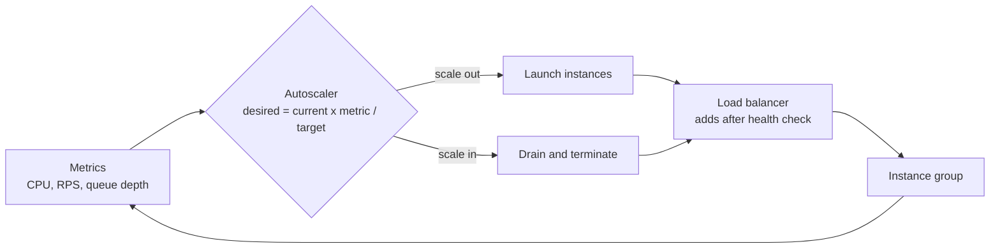

# Autoscaling

## The problem it solves

Your API needs 40 servers at the evening peak and 8 at 4 a.m. If you run 40 all the time, you pay for roughly twice the capacity you use over a day. If you run 20, you fall over every evening. And traffic isn't fully predictable: a marketing push or a viral post can triple load in ten minutes, faster than anyone can provision by hand.

Autoscaling adds and removes capacity automatically based on measured load, so you run close to what you need: enough headroom for spikes, without paying for idle machines all night.

## How it works

An autoscaler is a control loop:

1. **Measure** a metric across the group: average CPU, requests per second per instance, queue depth, or p95 latency.
2. **Compare** it to a target, such as 60% CPU or 500 requests/s per instance.
3. **Compute** the desired instance count, clamped between a minimum and maximum.
4. **Act**: launch or terminate instances (VMs, containers, pods), register them with the load balancer once healthy.
5. **Wait** for a cooldown or stabilization window before acting again, so the loop doesn't oscillate.



**Target tracking** is the most common policy. The Kubernetes Horizontal Pod Autoscaler uses essentially this formula:

```
desired = ceil(current_replicas * current_metric / target_metric)
```

**Other policies:**

- **Step scaling:** add 2 instances if CPU > 70%, add 5 if > 85%.
- **Scheduled scaling:** raise the minimum to 30 at 17:00 every weekday, ahead of a known peak.
- **Predictive scaling:** forecast from historical patterns and scale before the load arrives.
- **Queue-based:** for workers, scale on backlog per worker (e.g. keep 100 messages per worker), which reflects real demand better than CPU.

**Horizontal vs vertical.** Horizontal scaling adds instances and is what autoscaling usually means; it requires a stateless tier. Vertical scaling resizes an instance (more CPU or memory) and often needs a restart, so it suits databases and is rarely automatic.

**Scaling the right thing.** The app tier is easy to autoscale; databases are not. Scaling 40 app servers against one database that is already at its limit just moves the bottleneck. Connection pools also multiply: 40 instances × 20 connections each is 800 database connections.

**Lag and headroom.** New capacity is not instant. A VM may take a couple of minutes to boot and warm up, a container tens of seconds. The target metric (60%, not 90%) is the headroom that covers the gap while new instances start.

**Scale-in safely.** Remove instances slowly (longer stabilization window than scale-out), drain connections first, and never go below a minimum that survives losing an availability zone.

## Worked example

Target 60% CPU, min 4, max 50. Each instance handles 1,000 requests/s at 100% CPU, so 600 requests/s at target.

| Time | Load (req/s) | Instances | Avg CPU | Desired = ceil(n × CPU / 60) | Action |
|---|---|---|---|---|---|
| 18:00 | 6,000 | 10 | 60% | 10 | none |
| 18:05 | 9,000 | 10 | 90% | ceil(10 × 90 / 60) = 15 | launch 5 |
| 18:08 | 9,000 | 15 | 60% | 15 | none |
| 18:20 | 12,000 | 15 | 80% | ceil(15 × 80 / 60) = 20 | launch 5 |
| 02:00 | 2,400 | 20 | 12% | ceil(20 × 12 / 60) = 4 | scale in gradually to 4 |

At 18:05 the existing 10 instances run at 90% for the ~3 minutes it takes new ones to come up, which is exactly why the target is 60%, not 85%.

## Trade-offs

- **Pros:** lower cost during quiet periods; absorbs growth and spikes without manual work; replaces failed instances automatically.
- **Cons:** reaction lag, so sudden spikes still need headroom or queues; requires stateless services and fast startup; can oscillate if tuned badly; can scale up a cost explosion during an attack or a bug-induced retry storm (set a maximum); downstream systems may not scale with it.
- **Alternatives:** fixed over-provisioning (simple, predictable, expensive); queues to absorb bursts at a steady processing rate; serverless functions, which scale per request but with cold starts and per-invocation pricing.

## When to use it (and when not)

- **Use it** for stateless web and API tiers with daily cycles, worker pools draining queues (video transcoding, notification fan-out), and event-driven spikes (ticket sales, flash sales, live events).
- **Be careful** with stateful tiers (databases, Kafka brokers, cache clusters), where adding a node means rebalancing data. Scale those deliberately and pre-provision for known events.
- **Not enough alone** for flash crowds that arrive in seconds (a ticket on-sale at 10:00): pre-scale on a schedule and put a virtual waiting room or queue in front.

## In an interview

Say: "The API tier is stateless and autoscales on requests per instance with a target of about 60% of capacity, so there's headroom while new instances boot; for the known 10 a.m. sale I'd pre-scale on a schedule." Then be ready to explain the scaling metric you'd choose, what limits the speed of scale-out, and what stops the database from becoming the new bottleneck.

## Common follow-up questions

### Which metric should you scale on?
The one closest to real demand for that tier. CPU works for compute-bound services; requests per instance or latency for I/O-bound APIs; queue backlog per worker for consumers. Memory is usually a poor signal because it rarely drops when load does.

### How do you prevent flapping?
Use a stabilization window or cooldown, scale in more slowly than you scale out, and leave a gap between scale-out and scale-in thresholds. Kubernetes HPA, for example, looks at recommendations over a recent window before scaling down.

### What if traffic spikes faster than instances can boot?
Keep more headroom, use scheduled or predictive scaling before known events, keep warm pools of pre-initialized instances, and protect the system with queues, rate limiting and load shedding for the minutes until capacity arrives.

### Can you autoscale a database?
Read replicas and some managed or serverless databases can scale with load, but write capacity on a single primary scales mainly vertically. Horizontal write scaling requires sharding, which is a planned operation rather than a reactive one.
