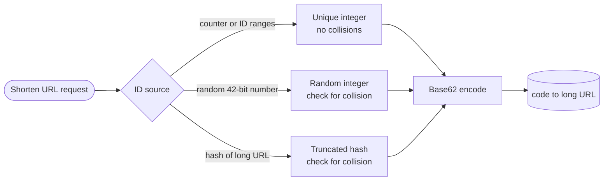

# Base62 Encoding

## The problem it solves

A URL shortener stores each link under a numeric ID from a database sequence or ID generator. The billionth link has ID 1,000,000,000, ten digits long, which makes `sho.rt/1000000000` not very short. Hex makes it 8 characters. Base64 makes it shorter but includes `+` and `/`, which have special meaning in URLs and need escaping. People also read, type and share these codes, so they should contain only letters and digits.

**Base62** writes a number using 62 symbols, the digits `0–9`, lowercase `a–z` and uppercase `A–Z`. Each character carries log2(62) ≈ 5.95 bits, so 1,000,000,000 becomes a 6-character code like `15FTGg`, using only URL-safe characters.

## How it works

Base62 is ordinary positional notation, like decimal or binary, with base 62. The alphabet maps each digit value to a character. A common ordering is:

```
ALPHABET = "0123456789abcdefghijklmnopqrstuvwxyzABCDEFGHIJKLMNOPQRSTUVWXYZ"
#           0........9 10......................35 36......................61
```

**Encoding** uses repeated division: divide by 62, the remainder is the next digit from the right, repeat with the quotient until it reaches 0.

**Decoding** reverses it: for each character from the left, `n = n * 62 + index(char)`.

```
def encode(n):
    if n == 0:
        return ALPHABET[0]
    out = []
    while n > 0:
        n, r = divmod(n, 62)
        out.append(ALPHABET[r])
    return "".join(reversed(out))

def decode(s):
    n = 0
    for ch in s:
        n = n * 62 + ALPHABET.index(ch)
    return n
```

Any service using the codes must agree on the same alphabet order; different libraries use different orders, so `encode(125)` can differ between them.

**Capacity by length:**

| Length | Distinct codes (62^L) |
|---|---|
| 5 | 916,132,832 (~0.9 billion) |
| 6 | 56,800,235,584 (~56.8 billion) |
| 7 | 3,521,614,606,208 (~3.5 trillion) |
| 8 | 218,340,105,584,896 (~218 trillion) |

**Where the number comes from** matters more than the encoding itself:



- **Counter:** a database sequence, or a key generation service that hands each app server a block of IDs (e.g. 1,000 at a time) so servers don't coordinate per request. Unique by construction, but sequential codes are guessable and reveal volume. Scramble the number first with a reversible permutation (for example a small block cipher or multiplication by an odd constant modulo 2^k) so neighbors don't look related.
- **Random:** pick a random number below 62^7 and insert with a uniqueness constraint, retrying on conflict.
- **Hash:** base62-encode the first bits of a hash of the long URL; the same URL maps to the same code, but truncation means collisions must be detected and resolved.

**Base62 vs base64:** base64 uses 64 symbols including `+` and `/` (or `-` and `_` in the URL-safe variant) and works on bytes in 3-byte groups with padding. Base62 encodes a number and avoids all punctuation, at a slightly lower 5.95 bits per character versus 6.

## Worked example

Encode 1,000,000,000 by repeated division:

| Step | n | n ÷ 62 | Remainder | Character |
|---|---|---|---|---|
| 1 | 1,000,000,000 | 16,129,032 | 16 | g |
| 2 | 16,129,032 | 260,145 | 42 | G |
| 3 | 260,145 | 4,195 | 55 | T |
| 4 | 4,195 | 67 | 41 | F |
| 5 | 67 | 1 | 5 | 5 |
| 6 | 1 | 0 | 1 | 1 |

Reading the characters from the last step back to the first gives **`15FTGg`**. Check by decoding: 1×62^5 + 5×62^4 + 41×62^3 + 55×62^2 + 42×62 + 16 = 916,132,832 + 73,881,680 + 9,771,448 + 211,420 + 2,604 + 16 = 1,000,000,000.

Sizing: a shortener creating 100 million links per month makes 1.2 billion a year. Six characters (56.8 billion codes) last about 56.8 / 1.2 ≈ 47 years; seven characters (3.5 trillion) last far longer and leave room for random IDs with few collisions. With random 7-character codes and 1 billion already used, a new code collides with probability about 1,000,000,000 / 3,521,614,606,208 ≈ 0.03%, so an occasional retry handles it.

## Trade-offs

- **Pros:** short, URL-safe, human-friendly codes; trivial, reversible arithmetic with no lookup table; compact storage-free mapping from integer to string.
- **Cons:** encoding alone gives no secrecy, so sequential IDs produce guessable codes unless scrambled; case-sensitive codes are error-prone when read aloud and some systems treat URLs case-insensitively; ambiguous characters (`0`/`O`, `1`/`l`/`I`) cause typos.
- **Alternatives:** **base64url** when encoding raw bytes (tokens, hashes); **base58** (removes `0`, `O`, `I`, `l`; used in Bitcoin addresses) for codes humans copy; **Crockford base32** for case-insensitive codes; **hex** when readability doesn't matter.

## When to use it (and when not)

- **Use it** for "design a URL shortener" (TinyURL, bit.ly), short share links and invite codes, compact public IDs for resources ("design Pastebin"), and shortening Snowflake-style 64-bit IDs (any 64-bit value fits in 11 base62 characters).
- **Not appropriate** as a security measure: if codes must be unguessable, generate them from a secure random source with enough bits. For binary data, use base64url.

## In an interview

Say: "A key generation service hands out ID ranges, each server takes the next integer, scrambles it with a reversible permutation, and base62-encodes it; 7 characters give 3.5 trillion codes, so we never run out and never collide." Be ready to encode a number by hand, size the code length, and discuss counter vs random vs hash approaches.

## Common follow-up questions

### How long should short codes be?
Estimate total links over the system's lifetime and pick the length where 62^L comfortably exceeds it: 6 characters give about 56.8 billion and 7 give about 3.5 trillion. With random codes, leave extra room so collision retries stay rare.

### Why not just base62-encode an auto-increment ID?
It works and never collides, but codes become sequential, so anyone can enumerate links and estimate your traffic. Apply a reversible scramble to the integer first, or use random IDs, if links shouldn't be discoverable.

### How do you handle collisions with hash-based codes?
Insert with a uniqueness constraint on the code; if it's taken by a different URL, append a counter or salt to the input and rehash, or take the next bits of the hash. If it's taken by the same URL, return the existing code.

### Why not use base64?
Standard base64 includes `+`, `/` and `=` padding, which need escaping in URLs, and the URL-safe variant still has `-` and `_` that look odd and can be stripped when copied. Base62 keeps codes purely alphanumeric for a negligible loss in density.
