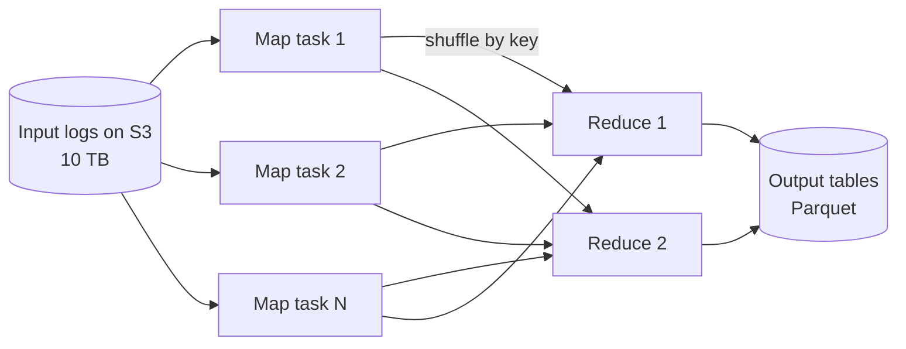

# Batch Processing

## The problem it solves

A video platform needs a daily report of watch time per video and per country, computed from 10 TB of yesterday's playback logs. Running that as a SQL query against the production database would hammer it for hours. Reading 10 TB on one machine at 200 MB/s takes 10,000,000 MB / 200 MB/s = 50,000 seconds, about 14 hours, and any crash means starting over.

**Batch processing** runs large computations over a bounded dataset, periodically, by splitting the data across many machines that work in parallel and recovering from failures by re-running only the failed pieces. MapReduce introduced the model; Apache Spark is the common engine today, reading from object storage like S3 or HDFS and writing results back.

## How it works

**The MapReduce model:**

1. **Split** the input into chunks (e.g. 128 MB file blocks). Each chunk goes to one map task, scheduled near the data where possible.
2. **Map:** each task reads its records and emits key-value pairs: `(video_id, seconds_watched)`.
3. **Shuffle:** pairs are partitioned by key (`hash(key) mod R`) and sent across the network so all values for one key land on the same reducer, sorted by key.
4. **Reduce:** each reducer combines values per key (`sum`) and writes output files.
5. **Fault tolerance:** tasks are deterministic and inputs are immutable, so a failed or slow task is simply re-run on another machine. Slow stragglers can get speculative duplicate copies, and the first to finish wins.



**Spark** generalizes this into a graph of stages. It keeps intermediate data in memory where possible instead of writing to disk between every step, tracks lineage so lost partitions can be recomputed, and offers DataFrames and SQL. A typical job:

```
logs = spark.read.parquet("s3://logs/playback/date=2026-10-31/")
(logs.filter("seconds > 0")
     .groupBy("video_id", "country")
     .agg(sum("seconds").alias("watch_seconds"))
     .write.mode("overwrite")
     .parquet("s3://reports/watch_time/date=2026-10-31/"))
```

**Practices that matter:**

- **Partition data by date** (`date=2026-10-31/`) so a daily job reads only one day.
- **Columnar formats** (Parquet, ORC) let jobs read only needed columns and compress well.
- **Idempotent outputs:** write to a date partition and overwrite it, so re-running a failed job doesn't double-count.
- **Combiners / map-side aggregation** pre-sum within each map task to shrink the shuffle, usually the most expensive step.
- **Data skew:** one key with huge volume (a viral video) makes one reducer take hours. Salt hot keys or use skew-join handling.
- **Orchestration:** a scheduler such as Airflow runs jobs in dependency order (logs landed → aggregate → load into warehouse) with retries and backfills.

## Worked example

Word count over three lines, two map tasks, two reducers (keys a–m to reducer 1, n–z to reducer 2):

| Stage | Data |
|---|---|
| Map 1 input | "the cat", "the dog" |
| Map 1 output (with combiner) | (the, 2), (cat, 1), (dog, 1) |
| Map 2 input | "the cat sat" |
| Map 2 output | (the, 1), (cat, 1), (sat, 1) |
| Reducer 1 receives (a–m) | cat: [1, 1], dog: [1] |
| Reducer 2 receives (n–z) | sat: [1], the: [2, 1] |
| Output | cat 2, dog 1, sat 1, the 3 |

Scaling the 10 TB job: 10 TB in 128 MB blocks is about 10,000,000 / 128 ≈ 78,000 map tasks. On 100 machines each reading 200 MB/s, the scan takes 10,000,000 / (100 × 200) = 500 seconds, a bit over 8 minutes, versus about 14 hours on one machine (ignoring shuffle and scheduling overhead, which add real time).

## Trade-offs

- **Pros:** high throughput and cost-efficient for huge datasets (can use cheap spot instances); simple failure recovery by re-running tasks; easy to reprocess history after fixing a bug; results are deterministic and auditable.
- **Cons:** high latency, since results are only as fresh as the last run; shuffles are expensive; skew and small files hurt performance; jobs that run longer than their schedule interval pile up.
- **Alternatives:** **stream processing** for second-level freshness; a **data warehouse** (BigQuery, Snowflake, Redshift) running SQL over columnar storage, which often replaces hand-written Spark for analytics; **incremental processing** that only handles new partitions.

## When to use it (and when not)

- **Use it** for daily reports and billing, building search indexes ("design a web crawler" or search ranking), training data and ML feature generation, recommendation model training, deduplication and reconciliation jobs (comparing a payment ledger with bank statements), and backfills.
- **Not right** for anything users need to see within seconds (fraud blocking, live dashboards, trending topics), or for small data a single database query handles.

## In an interview

Say: "Raw events land in S3 partitioned by hour; a nightly Spark job aggregates them into Parquet tables that overwrite the day's partition, so reruns are idempotent, and Airflow handles dependencies and backfills." Be ready to explain map, shuffle and reduce, how failures are recovered, handling skew, and when you'd switch to streaming.

## Common follow-up questions

### Why is the shuffle the expensive part?
It moves data across the network and usually spills to disk, and every reducer must wait for all mappers to finish. Reduce it by filtering and projecting early, pre-aggregating on the map side, and choosing partition keys that avoid moving data twice.

### How does a batch job recover from a machine failure?
Inputs are immutable and tasks deterministic, so the scheduler re-runs only the tasks that were on the failed machine. Spark can recompute lost partitions from lineage; MapReduce re-reads map outputs or reruns the maps.

### How do you handle one key with far more data than the rest?
Add a random salt to the hot key so its records spread over several reducers, aggregate partially, then combine the partial results by the original key. For joins, broadcast the small side or split the hot key out and handle it separately.

### How do you combine batch and streaming results?
The lambda architecture runs both: streaming gives fast approximate numbers, and batch recomputes accurate ones later and overwrites them. The kappa architecture keeps only streaming and replays the log when you need to recompute.
