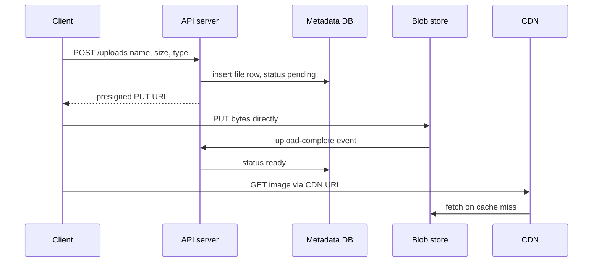

# Blob Storage

## The problem it solves

Users upload photos, videos and documents: 2 million files a day at an average of 3 MB, about 6 TB of new data daily. Putting those bytes in Postgres as `BYTEA` columns bloats the database, slows backups and replication, and makes every app server stream large payloads through its database connections. Storing them on app servers' local disks ties each file to one machine that can die.

Blob (object) storage such as Amazon S3, Google Cloud Storage or Azure Blob Storage stores large immutable files cheaply and durably, at practically unlimited scale, behind a simple HTTP API. You keep the bytes there and keep only the **metadata** (owner, size, content type, object key, status) in your database.

## How it works

**The model.** Objects live in **buckets** and are addressed by a **key**, such as `uploads/user42/2026/11/9f2c1a.jpg`. Keys look like paths, but the namespace is flat; "folders" are just key prefixes. An object is written as a whole and is effectively immutable: to change it you upload a new version.

**The API** is small:

```
PUT    /bucket/key          upload an object (single PUT up to 5 GB on S3)
GET    /bucket/key          download, with Range headers for partial reads
HEAD   /bucket/key          metadata only
DELETE /bucket/key
GET    /bucket?prefix=uploads/user42/    list keys by prefix
```

**Durability and availability.** Providers replicate each object across multiple devices and facilities. S3 Standard is designed for 99.999999999% (eleven nines) durability across multiple availability zones. Since 2020, S3 provides strong read-after-write consistency for PUTs and DELETEs.

**Standard pattern: metadata in the DB, bytes in the blob store, delivery through a CDN.**



Key points:

- **Clients upload and download directly** to the blob store using presigned URLs, so large bytes never pass through app servers.
- **The database row is the index**: queries like "all photos of user 42, newest first" run against metadata, never by listing the bucket.
- **Events on upload** (S3 event notifications to a queue) trigger processing such as thumbnails, virus scans or video transcoding, which write new derived objects.
- **A CDN** sits in front for reads of popular content.

**Storage classes and lifecycle.** The same API offers cheaper tiers for infrequently accessed data (S3 Standard-IA, Glacier) with retrieval fees or delays. Lifecycle rules move or delete objects by age automatically.

**Key design.** Use generated, unguessable keys (UUIDs or content hashes) rather than user-supplied filenames. This avoids collisions and path tricks and allows deduplication when keys are content hashes.

## Worked example

Photo app: 2M uploads per day, 3 MB average, kept indefinitely.

| Quantity | Calculation | Result |
|---|---|---|
| New data per day | 2,000,000 × 3 MB | 6 TB |
| New data per year | 6 TB × 365 | ~2.2 PB |
| Metadata per file | ~500 bytes | 2M × 500 B = 1 GB/day |
| Metadata per year | 1 GB × 365 | ~365 GB, fits a sharded or even single SQL cluster |

The bytes are about 6,000 times larger than the metadata, which is why they go to a store priced and built for bulk data, while the small, queryable metadata stays in a database.

## Trade-offs

- **Pros:** effectively unlimited capacity; very high durability; low cost per GB with cheaper archival tiers; offloads bandwidth from your servers; integrates with CDNs and event-driven processing.
- **Cons:** higher per-request latency than local disk (tens of milliseconds to first byte); no in-place edits or appends; listing is slow and not a query engine; per-request and egress charges add up; keeping DB metadata and objects consistent needs care (orphaned objects, rows pointing to missing files).
- **Alternatives:** a distributed file system (HDFS, CephFS) when you need POSIX-like semantics; block storage volumes for a database's own disks; storing tiny blobs (a few KB) directly in the database when that's simpler.

## When to use it (and when not)

- **Use it** for user uploads (Instagram, Dropbox, Google Drive), video files and segments (YouTube), backups and logs, data lake files (Parquet), ML datasets and model artifacts, and static website assets.
- **Don't use it** for small records you query or update frequently, data needing transactions, or low-latency random writes like a database's working files.

## In an interview

Say: "Media goes to S3 under UUID keys, uploaded directly by the client with a presigned URL, and the database stores only the metadata and object key; reads go through a CDN with S3 as the origin." Then be ready to explain how you keep metadata and objects in sync, how large uploads work, and how lifecycle rules control cost.

## Common follow-up questions

### Why not store files in the database?
Large binaries bloat the database, slowing backups, replication and cache efficiency, and they force file traffic through database connections and app servers. Databases are expensive per GB compared with object storage.

### How do you avoid orphaned objects or dangling metadata?
Create the metadata row as `pending` before the upload and mark it `ready` from the storage event. A periodic job deletes objects with no ready row and rows stuck in pending past a timeout, and lifecycle rules can clean up incomplete multipart uploads.

### How do you serve private files?
Keep the bucket private and issue short-lived presigned GET URLs, or use a CDN that checks signed URLs or cookies. The app checks permissions before handing out the URL.

### How do you deduplicate identical uploads?
Hash the file content (e.g. SHA-256) and use the hash as the object key. If an object with that key exists, skip the upload and just add a metadata row pointing to it, with reference counting before any delete.
