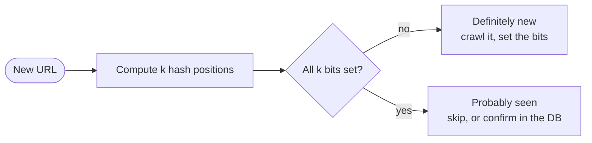

# Bloom Filter

## The problem it solves

A web crawler has seen 10B URLs and must check every newly discovered link: "have I already crawled this?" A hash set of 10B URLs at ~80 bytes each plus overhead needs roughly a terabyte of RAM. Checking a database on disk for every link adds a lookup to a path that runs hundreds of thousands of times per second. Most answers are "no, never seen it", and you pay full price for each of them.

A Bloom filter answers set membership in about 10 bits per item, about 12 GB for those 10B URLs at a 1% error rate. It can say "definitely not present" or "probably present", and it never misses an item that was added.

## How it works

1. Allocate a **bit array of m bits**, all 0, and choose **k independent hash functions**, each mapping an item to a position in [0, m).
2. **Add(x):** compute the k positions and set each bit to 1.
3. **MightContain(x):** compute the same k positions. If **any bit is 0**, x was **definitely never added**. If all are 1, x was **probably** added; other items may have set those bits, which is a false positive.
4. There are **no false negatives**, because adding x always sets all of x's bits and bits are never cleared.
5. You **can't delete**: clearing a bit could erase other items. A **counting Bloom filter** replaces each bit with a small counter (typically 4 bits) to support deletes, at 4× the memory.



**Sizing.** For n items and a target false-positive rate p:

```
m = -n * ln(p) / (ln 2)^2        # bits
k = (m / n) * ln 2               # hash functions
p ≈ (1 - e^(-k*n/m))^k           # resulting false-positive rate
```

| Target p | Bits per item | k | Memory for 1B items |
|---|---|---|---|
| 1% | 9.6 | 7 | ~1.2 GB |
| 0.1% | 14.4 | 10 | ~1.8 GB |

Each 10× reduction in p costs only ~4.8 more bits per item. In practice you don't need k truly independent hash functions: compute two hashes h1 and h2 and use `h1 + i × h2` for i = 0..k−1 (double hashing), which performs about as well.

If you add more than n items, p climbs steadily. Scalable Bloom filters add a new, larger filter when the current one fills up and check all of them.

## Worked example

A tiny filter: m = 10 bits, k = 2 hash functions.

| Step | Operation | Hash positions | Bits 0–9 after | Answer |
|---|---|---|---|---|
| 0 | start | | 0000000000 | |
| 1 | add "cat" | 1, 7 | 0100000100 | |
| 2 | add "dog" | 3, 7 | 0101000100 | |
| 3 | query "eel" | 4, 7 | unchanged | bit 4 is 0 → **definitely not present** |
| 4 | query "dog" | 3, 7 | unchanged | both 1 → probably present (correct) |
| 5 | query "cow" | 1, 3 | unchanged | both 1 → probably present (**false positive**: set by cat and dog) |

The formula predicts p ≈ (1 − e^(−2×2/10))² = (1 − 0.670)² ≈ 0.109, about 11% with only 2 items in 10 bits. Real filters use ~10 bits per item, which brings that down to ~1%.

## Trade-offs

- **Pros:** tiny memory (bits per item, independent of item size); O(k) add and lookup; no false negatives; filters with the same m and hashes can be merged with bitwise OR.
- **Cons:** false positives, which grow as the filter fills; no deletes (without counting filters); can't list or count the items; must be sized up front.
- **Alternatives:** **cuckoo filters** (support deletes, similar or better space at low error rates); **exact hash sets** when the set fits in memory; **HyperLogLog** if you only need "how many distinct items", not "is x in the set"; a database lookup when correctness requires an exact answer and volume is low.

## When to use it (and when not)

- **Use it** as a cheap pre-check in front of an expensive lookup when most answers are "no": web crawler URL dedupe, LSM-tree databases (Cassandra, RocksDB and HBase keep a Bloom filter per SSTable so reads skip files that can't contain a key), "username taken?" fast path, avoiding recommending already-seen items, CDN "cache only on second request" (one-hit-wonder filtering), malicious URL lists in browsers.
- **Don't use it** when a false positive is unacceptable and there's no exact fallback (a payment dedupe that would wrongly reject a real payment), when you need deletes or enumeration, or when the set is small enough to hold exactly.

## In an interview

Say: "I'll put a Bloom filter in front of the URL table: about 10 bits per URL gives a 1% false-positive rate, so 10B URLs fit in ~12 GB of RAM, and a false positive just means we skip a URL we never crawled." Be ready to explain why there are no false negatives, how m and k are chosen, and what a false positive costs in your system.

## Common follow-up questions

### Why can't a Bloom filter have false negatives?
Adding an item sets all k of its bits, and bits are only ever set, never cleared. So a later lookup of that item finds all k bits at 1. Only items that were never added can find a 0.

### How do you delete from a Bloom filter?
A plain filter can't. Use a counting Bloom filter, which increments counters on add and decrements on delete, at about 4× the memory, or a cuckoo filter. Alternatively rebuild the filter periodically from the source of truth.

### What happens when you insert more items than planned?
The false-positive rate rises because more bits are set; at twice the planned items, a filter sized for 1% is closer to 15%. Monitor the fill ratio and rebuild with a larger m, or use a scalable Bloom filter that chains new filters.

### How does a database like Cassandra use Bloom filters?
Each SSTable on disk has a Bloom filter of its partition keys held in memory. A read checks the filters first and opens only the SSTables that might contain the key, which saves disk reads for keys that live in just one or two of many files.
