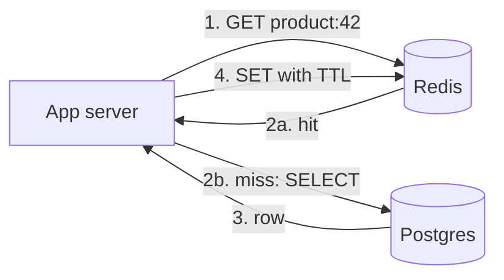

# Caching

## The problem it solves

Your product page reads from Postgres. A query takes ~5 ms on a warm database, and the box can serve maybe 5,000 such queries per second before latency climbs. Then traffic grows to 50,000 reads per second, and 95% of those reads are for the same few thousand popular products. You are paying the database to compute the same answer over and over.

A cache keeps recently or frequently used results in fast memory (Redis, Memcached, or the application's own heap), so repeated reads are answered in well under a millisecond without touching the database. With a 95% hit rate, the database sees only 2,500 of those 50,000 reads per second.

## How it works

A cache is a key-value store that sits in front of a slower source of truth. The design questions are: who populates it, what happens on writes, what gets evicted, and how stale data gets removed.



**Read and write strategies:**

- **Cache-aside (lazy loading):** the application checks the cache, and on a miss reads the database and fills the cache. The most common pattern. Only requested data gets cached, and a cache outage degrades to slower reads instead of failures.
- **Read-through:** the same flow, but the cache library or service loads from the database itself. The application talks only to the cache.
- **Write-through:** every write goes to the cache and the database synchronously. The cache is always fresh, but writes are slower and you cache data nobody may read.
- **Write-back (write-behind):** writes go to the cache and are flushed to the database later in batches. Very fast writes, but you lose data if the cache dies before flushing.
- **Write-around:** writes go straight to the database and the cache entry is deleted (or left to expire). Good when written data is rarely re-read soon.

```
def get_product(id):
    v = redis.get(f"product:{id}")
    if v is not None:
        return v
    v = db.query("SELECT ... WHERE id = %s", id)
    redis.set(f"product:{id}", v, ex=300)   # 5-minute TTL
    return v

def update_product(id, fields):
    db.update(id, fields)
    redis.delete(f"product:{id}")           # invalidate, don't overwrite
```

**Eviction** happens when memory is full. **LRU** evicts the least recently used key, a good default. **LFU** evicts the least frequently used, better when a stable set of items is always popular. **TTL** expiry removes keys after a fixed time regardless of memory pressure. Redis supports LRU and LFU eviction through its `maxmemory-policy` setting (using approximate algorithms) alongside per-key TTLs.

**Invalidation.** Deleting the key on write is safer than overwriting it, because two concurrent writers can otherwise leave an old value in the cache. A TTL is the safety net that bounds how long any stale value can survive.

**Stampede protection.** When a hot key expires, thousands of requests can miss at once and all hit the database. Fixes: a per-key lock so only one request recomputes while others wait or serve the stale value; adding random jitter to TTLs so keys don't expire together; or refreshing popular keys early in the background before they expire.

## Worked example

50,000 reads/s for products, cache-aside with a 5-minute TTL. Database capacity is ~5,000 queries/s.

| Hit rate | Reads reaching Postgres | Status |
|---|---|---|
| 0% (no cache) | 50,000/s | Overloaded 10× |
| 80% | 10,000/s | Still overloaded 2× |
| 95% | 2,500/s | Comfortable, 50% headroom |
| 99% | 500/s | Plenty of headroom |

Going from 95% to 99% hit rate cuts database load by another 5×, which is why small hit-rate improvements matter so much. Average latency at 95% with 0.5 ms hits and 5 ms misses is 0.95 × 0.5 + 0.05 × 5 = 0.725 ms.

## Trade-offs

- **Pros:** large drop in latency and database load; cheap to add; absorbs read spikes.
- **Cons:** stale data between a write and invalidation; another system to run and size; cold-start or mass-expiry stampedes; a single very hot key can overload one cache node.
- **Alternatives:** read replicas (fresher data, but still disk-bound queries); a CDN for public, cacheable responses; materialized views or precomputed tables when the expensive part is the computation, not the lookup.

## When to use it (and when not)

- **Use it** for read-heavy data with locality: user profiles, product pages, feeds (news feed design), URL shortener redirects, session data, leaderboard reads, and computed results that are expensive to rebuild.
- **Avoid it** when every read must see the latest write (account balances during a transfer, inventory at checkout), when data is write-heavy and rarely re-read, or when access is uniformly random so the hit rate would be low.

## In an interview

Say: "Reads outnumber writes about 100 to 1, so I'll put a Redis cache-aside layer in front of the database with a TTL of a few minutes, and delete the key on every write." Then be ready to explain your hit-rate estimate, what happens on a cache miss storm, how you handle hot keys, and how stale a read is allowed to be.

## Common follow-up questions

### Why delete the cache entry on write instead of updating it?
If two writers update the database in one order but write the cache in the other, the cache ends up holding the older value indefinitely. Deleting forces the next reader to load the current row. A small race still exists (a reader can repopulate with a value read just before the write), which the TTL bounds.

### How do you handle a hot key that overwhelms one Redis node?
Cache it in each application server's local memory for a few seconds, or replicate it under several keys (`product:42#1..8`) and read a random copy. Redis read replicas also spread read load for that shard.

### What happens if the cache cluster goes down?
With cache-aside, reads fall through to the database, which may not survive the full load. Protect it with request coalescing, rate limiting, and circuit breakers, and warm the cache gradually after recovery instead of letting all traffic miss at once.

### How do you pick the TTL?
Ask how stale the data may be: seconds for prices or stock levels, minutes for profiles, hours for rarely changing reference data. Shorter TTLs mean fresher data but lower hit rates, and adding a few percent of random jitter avoids synchronized expiry.
