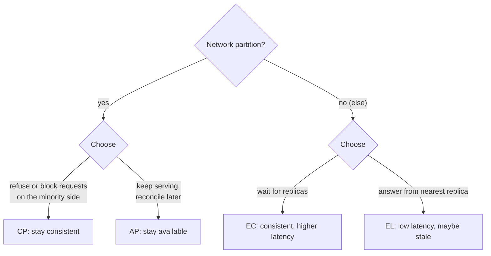

# CAP / PACELC

## The problem it solves

You run a database replicated across two data centers, us-east and eu-west. The link between them goes down for 10 minutes. A user in Europe tries to update their shipping address. The eu-west replica has two options: accept the write, knowing us-east can't see it and may serve the old address or accept a conflicting change, or refuse the write until the link is back. There's no third option that gives both.

The CAP theorem names this choice, so you make it on purpose per feature instead of discovering it during an outage. PACELC extends it to the normal case, when there's no partition but you still trade latency against consistency.

## How it works

**CAP** (Brewer's conjecture, proven by Gilbert and Lynch in 2002) is about three properties:

- **Consistency (C):** linearizability. Every read sees the most recent completed write, as if there were one copy of the data.
- **Availability (A):** every request to a non-failed node gets a non-error response, without waiting indefinitely.
- **Partition tolerance (P):** the system keeps operating when messages between nodes are lost or delayed.

The theorem: **when a network partition happens, a system must choose between C and A.** Partitions are not optional in a distributed system, so "CA" isn't a real choice across machines. The actual question is what each side of a partition does.

**CP behavior:** nodes that can't reach a majority stop accepting writes (and linearizable reads). Examples: etcd, ZooKeeper, Spanner, CockroachDB, and HBase. Users on the minority side see errors or timeouts, but nobody sees inconsistent data.

**AP behavior:** every reachable node keeps accepting reads and writes, and replicas reconcile after the partition with last-writer-wins, merges or CRDTs. Examples: Cassandra and Riak at low consistency levels, DNS, and multi-leader setups. Users stay productive, but may read stale data or create conflicts.

**PACELC** (Daniel Abadi): *if* Partition, choose Availability or Consistency; *Else*, choose Latency or Consistency. Partitions are rare, but the latency trade-off applies to every request. Keeping replicas consistent means waiting for cross-replica coordination on writes (or reads); skipping it means faster answers that may be stale.

- **PA/EL:** Dynamo-style stores like Cassandra with default settings: available under partition, low latency normally.
- **PC/EC:** Spanner, etcd, ZooKeeper: consistent always, paying latency for quorum round trips.
- **PA/EC or PC/EL** combinations exist too, and many databases are tunable per query (Cassandra's `ONE` vs `QUORUM`, DynamoDB's eventually vs strongly consistent reads).

Real systems often choose per operation, not per database: the same app can need CP for payments and AP for a like counter.

## Worked example

Inventory for a concert: 1 ticket left. Replicas in us-east and eu-west; the link between them is down.

| Time | us-east | eu-west | CP outcome | AP outcome |
|---|---|---|---|---|
| 12:00 | 1 left | 1 left | | |
| 12:01 | Alice buys | | Succeeds only if us-east holds the majority or is the leader for this item | Succeeds |
| 12:02 | | Bob buys | Rejected: eu-west can't reach the majority | Succeeds |
| 12:15 | partition heals | | 0 left, one buyer | −1 left: one ticket sold twice, refund needed |

Now the PACELC side, with no partition: a CP write needs a round trip to a majority. If replicas are across the Atlantic (~80 ms round trip), each consistent write costs at least ~80 ms, while an EL write acknowledged locally takes a few milliseconds.

## Trade-offs

- **Choosing CP:** correct data and simpler reasoning; but unavailability on the minority side during partitions and higher latency all the time.
- **Choosing AP:** always writable and fast; but stale reads, conflicts and reconciliation logic in the application.
- **Common misconceptions:** CAP's "consistency" is linearizability, not ACID's "C"; CAP says nothing about behavior when there's no partition (that's PACELC's point); and "AP" doesn't mean "no consistency," just weaker guarantees during partitions.

## When to use it (and when not)

- **Use CAP/PACELC reasoning** whenever you replicate data across nodes or regions and must say what happens on failure. Interview questions: ticket booking and hotel reservations (CP for inventory), payment systems (CP), shopping cart (AP, the classic Dynamo case), social feeds and likes (AP/EL), distributed key-value store (tunable).
- **Don't overuse it:** for a single-region database with synchronous failover, the more relevant discussions are isolation levels and replication lag, not CAP.

## In an interview

Say: "Seat inventory is CP: if a region can't reach the quorum, it rejects bookings rather than double-sell. The feed is AP and EL: serving slightly stale posts is fine, so reads come from the nearest replica." Be ready to define consistency precisely as linearizability, explain PACELC's latency side, and describe how an AP system reconciles after a partition.

## Common follow-up questions

### Why can't a distributed system be CA?
Because partitions will happen eventually: switches fail, links drop, and long GC pauses look like partitions. When one occurs, the system must either refuse some requests or risk inconsistency. "CA" only describes a single-node system.

### Is Cassandra AP or CP?
It's tunable. With consistency level `ONE` it behaves as AP and EL; with `QUORUM` reads and writes, a partitioned minority can't serve those requests, so it behaves closer to CP for those operations, though it still lacks full linearizability without lightweight transactions.

### Does choosing CP mean the whole system goes down during a partition?
No. The side with a majority keeps working; only nodes that can't reach a majority refuse requests. Clients routed to the majority side see no outage.

### How does an AP system fix conflicts after a partition?
It reconciles divergent versions with last-writer-wins timestamps, version vectors that detect concurrent writes and keep both, CRDTs that merge automatically, or application-level rules such as "merge the two carts."
