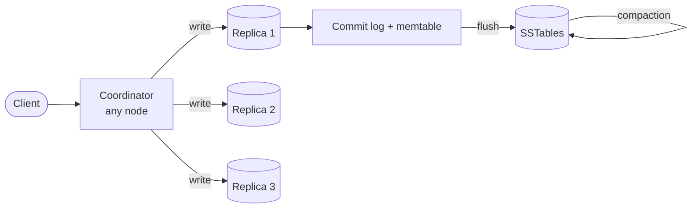

# Cassandra

## The problem it solves

A messaging app stores every message ever sent: billions of writes per day, petabytes over time, users on every continent, and no tolerance for an outage when one machine or even one data center fails. A single Postgres primary tops out on write throughput and storage, and sharding it by hand means building routing, rebalancing and failover yourself. A primary-replica setup also has a primary that every write depends on.

Cassandra is a distributed wide-column database designed for this shape of workload: very high write throughput, linear horizontal scaling by adding nodes, no single primary (every node can accept any request), multi-datacenter replication, and consistency you tune per query.

## How it works

**The ring.** Nodes form a ring of token ranges. A row's **partition key** is hashed (Murmur3) to a token, and the node owning that range stores it. Each node holds many small ranges (**virtual nodes**), so data and load spread evenly and a new node takes ranges from many peers. Nodes discover each other and share state via **gossip**. There is no leader: the node a client contacts acts as the **coordinator** for that request.

**Replication.** With replication factor RF = 3, each partition is stored on 3 nodes (the owner plus the next distinct nodes on the ring, placed on different racks with `NetworkTopologyStrategy`, and RF can be set per data center).

**Data model: partition key and clustering key.** A table's primary key has two parts:

```sql
CREATE TABLE messages (
  conversation_id uuid,
  sent_at         timeuuid,
  sender_id       uuid,
  body            text,
  PRIMARY KEY ((conversation_id), sent_at)
) WITH CLUSTERING ORDER BY (sent_at DESC);

SELECT * FROM messages WHERE conversation_id = ? LIMIT 50;   -- newest 50
```

- The **partition key** (`conversation_id`) decides which nodes store the data. All rows with the same partition key live together.
- The **clustering key** (`sent_at`) sorts rows *within* the partition on disk, so "latest 50 messages in this conversation" is one sequential read.

You design tables **per query**: queries must specify the partition key, there are no joins, and data is denormalized into multiple tables when you need different access patterns. Keep partitions bounded (a common rule of thumb is under ~100 MB), for example by adding a time bucket to the partition key.

**Write path (LSM tree).**
1. Append the write to the **commit log** on disk (for durability).
2. Insert it into the **memtable**, a sorted in-memory structure. Acknowledge.
3. When the memtable fills, flush it to disk as an immutable, sorted **SSTable**.
4. **Compaction** merges SSTables in the background, keeping the newest version of each cell and dropping deleted data.

No read-before-write and only sequential disk I/O make writes very cheap. Updates and deletes are just new writes: a delete writes a **tombstone**, which is removed during compaction after `gc_grace_seconds` (10 days by default).

**Read path.** Check the memtable, then the SSTables that might hold the partition. A per-SSTable **Bloom filter** skips files that can't contain the key, and partition indexes find the offset. Results from multiple SSTables are merged, newest timestamp wins. Reads cost more than writes, which is why compaction strategy matters: size-tiered (write-heavy), leveled (read-heavy) and time-window (time-series with TTLs).

**Tunable consistency.** Each query picks how many of the RF replicas must respond:

| Level | Replicas that must respond (RF = 3) | Effect |
|---|---|---|
| ONE | 1 | Fastest, may read stale data |
| QUORUM | 2 | With QUORUM writes and reads, R + W = 4 > 3, so reads see the latest acknowledged write |
| LOCAL_QUORUM | 2 in the local DC | Strong within a DC, no cross-DC latency |
| ALL | 3 | Fails if any replica is down |

Replicas converge through **hinted handoff** (the coordinator stores writes for a down replica and replays them), **read repair** (fix stale replicas noticed during reads) and periodic **anti-entropy repair** (Merkle tree comparison). Conflicts resolve by **last write wins** using cell timestamps. **Lightweight transactions** (`INSERT ... IF NOT EXISTS`) use Paxos for compare-and-set, at several times the latency of a normal write.



## Worked example

RF = 3 with replicas R1, R2, R3 for the key `user:42`. Writes and reads use QUORUM (2 of 3).

| Time | Event | R1 | R2 | R3 | Result |
|---|---|---|---|---|---|
| t1 | Write v1 at QUORUM, all 3 ack | v1 | v1 | v1 | success |
| t2 | R3 goes down; write v2 at QUORUM | v2 | v2 | down (hint stored) | success: 2 acks |
| t3 | Read at QUORUM from R1, R2 | v2 | v2 | down | returns v2 |
| t4 | R3 restarts after its hint expired (it was down too long); read at ONE is served by R3 | v2 | v2 | v1 | **stale v1** |
| t5 | Read at QUORUM from R2, R3 | v2 | v2 | v1 → v2 | v2 wins by timestamp; read repair fixes R3 |

Any 2 replicas you read overlap with the 2 that acknowledged the write, which is why QUORUM + QUORUM gives read-your-writes. With ONE + ONE (1 + 1 ≤ 3) there's no overlap guarantee, as t4 shows. If two of three replicas were down, QUORUM operations would fail rather than return stale data.

## Trade-offs

- **Pros:** very high write throughput; linear scaling by adding nodes; no single point of failure; active-active multi-datacenter; tunable consistency per query; good fit for time-series and append-heavy data with TTLs.
- **Cons:** queries must follow the partition key (no joins, limited secondary indexes, no ad hoc queries); data modeled per query, so denormalization and duplicated writes; last-write-wins can silently drop concurrent updates; tombstones and large partitions hurt reads; repairs and compaction need operational care; no multi-partition transactions.
- **Alternatives:** **DynamoDB** (managed, similar partition/sort key model); **ScyllaDB** (Cassandra-compatible, rewritten in C++); **HBase/Bigtable** (strongly consistent, range-partitioned, single master per region); **Postgres/MySQL with sharding** when you need transactions and flexible queries; **Spanner/CockroachDB** for horizontally scalable SQL with strong consistency.

## When to use it (and when not)

- **Use it** for chat message history (Discord famously ran its messages on Cassandra before moving to ScyllaDB), Twitter-style tweet and timeline storage, activity feeds, IoT and metrics time series, user event logs, and any write-heavy, key-based workload that must survive data center failures.
- **Avoid it** for financial ledgers and inventory that need transactions across rows, for workloads dominated by ad hoc queries or aggregations (use a SQL database or an OLAP store), and for small datasets where its operational overhead isn't justified.

## In an interview

Say: "Messages go in Cassandra with partition key `conversation_id` (plus a time bucket so partitions stay bounded) and clustering key `sent_at` descending, so loading a conversation is one sequential read; we write and read at LOCAL_QUORUM with RF 3 per data center." Be ready to explain the LSM write path, why reads are costlier than writes, how QUORUM gives overlap, and how you'd model a second access pattern.

## Common follow-up questions

### Why are writes so fast in Cassandra?
A write is a sequential commit log append plus an in-memory insert, with no read-before-write and no in-place updates. Disk work happens later in large sequential flushes and compactions. Any replica can accept writes, so there's no single primary bottleneck.

### What's the difference between the partition key and the clustering key?
The partition key is hashed to decide which nodes store the data and must be given in queries. The clustering key orders rows within a partition on disk, enabling efficient range scans and sorted results, like the newest messages first.

### How do you handle a query that doesn't use the partition key?
Create another table keyed for that query and write to both (denormalization), optionally with a logged batch to keep them in sync. Secondary indexes and materialized views exist but have significant performance and consistency caveats at scale.

### What happens if two clients update the same cell concurrently?
Each write carries a timestamp, and the higher timestamp wins on every replica. That's simple and convergent, but one update is silently lost, and clock skew can pick the "wrong" winner. Use lightweight transactions or design idempotent, append-only data (new rows instead of updates) when this matters.

### Why are tombstones a problem?
Deletes write markers that reads must scan past until compaction removes them after `gc_grace_seconds`. Queue-like patterns (insert then delete many rows in one partition) build up huge numbers of tombstones and make reads slow or fail. Use TTLs with time-window compaction or time-bucketed partitions instead.
