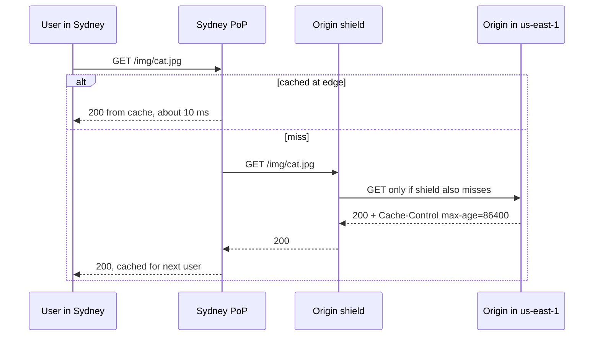

# CDN

## The problem it solves

Your video and image files live in one region, say us-east-1. A user in Sydney requests a 2 MB image. The round trip across the Pacific is around 200 ms, and fetching a file over a new TCP and TLS connection takes several round trips, so the image takes close to a second to start arriving. Meanwhile every request, from every country, hits your origin servers, and you pay for every byte leaving them.

A content delivery network (CDN) keeps copies of your content on servers in many locations (points of presence, or PoPs) close to users. The Sydney user fetches from a PoP in Sydney a few milliseconds away, and your origin serves each file roughly once per PoP instead of once per user.

## How it works

1. You point a hostname such as `cdn.example.com` at the CDN, usually with a DNS CNAME record.
2. The CDN routes each user to a nearby PoP using geo-DNS or anycast.
3. The PoP checks its cache. On a **hit**, it returns the file immediately.
4. On a **miss**, it fetches from the **origin** (your servers or a blob store like S3), stores the file, and returns it.
5. The file stays cached until its TTL expires, it is evicted, or you purge it.



**Cache control.** The origin tells the CDN how long to keep content with HTTP headers:

```
Cache-Control: public, max-age=31536000, immutable   # versioned static assets
Cache-Control: public, max-age=60, s-maxage=300      # browser 60 s, CDN 5 min
Cache-Control: private, no-store                     # per-user data, never cache at CDN
```

**Cache keys.** The CDN identifies cached objects by URL plus selected headers or cookies. Including too much (every cookie or query parameter) fragments the cache and destroys the hit rate.

**Invalidation.** Two options: purge a path through the CDN API (takes seconds to minutes to propagate to all PoPs), or use **versioned URLs** like `/app.3f9a2c.js` so new content gets a new URL and old copies simply age out. Versioning is the reliable approach for static assets.

**Origin shield.** A middle cache tier between the edges and the origin. Without it, a new file can miss in every PoP at once, sending one request per PoP to the origin. With a shield, edge misses collapse into one origin fetch.

**Push vs pull.** Pull CDNs (the norm) fetch on first request. Push means you upload content to the CDN ahead of time, useful for large files you know will be requested, like a game patch.

## Worked example

A site serves 10,000 image requests per second worldwide, average 200 KB, from 50 PoPs.

| Setup | Origin requests/s | Origin egress | Sydney latency |
|---|---|---|---|
| No CDN | 10,000 | 10,000 × 200 KB = 2 GB/s | ~200 ms per round trip |
| CDN, 95% edge hit rate | 500 | 500 × 200 KB = 100 MB/s | ~10 ms on hits |
| CDN, 95% edge hit + shield at 80% hit | 100 | 20 MB/s | ~10 ms on hits |

With the shield, only 20% of the 500 edge misses reach the origin: 0.2 × 500 = 100 requests/s. The origin fleet and its egress bill shrink by roughly 100× compared with no CDN.

## Trade-offs

- **Pros:** lower latency for distant users; offloads bandwidth and requests from the origin; absorbs traffic spikes and many DDoS attacks; TLS terminates near the user.
- **Cons:** stale content until TTL or purge; hard to cache personalized responses; extra cost per GB; debugging is harder because responses come from many places.
- **Alternatives:** serving from multiple regions yourself (more control, much more operational work); browser caching alone (helps repeat visits only); edge compute for personalized content close to users.

## When to use it (and when not)

- **Use it** for static assets (JS, CSS, fonts), images and thumbnails (Instagram, news feed), video segments (YouTube, Netflix streaming), software downloads, and public API responses that many users share.
- **Skip it** for per-user, frequently changing data (a bank balance, a chat inbox), write traffic, and internal service-to-service calls. For a small single-region audience it adds cost without much benefit.

## In an interview

Say: "Media is immutable after upload, so I'll serve it through a CDN with versioned URLs and long max-age headers, with the blob store as the origin behind an origin shield." Then be ready to explain cache hit rates, how you invalidate or version content, how users reach the nearest PoP, and what stays uncacheable.

## Common follow-up questions

### How does a user get routed to the nearest PoP?
Either geo-DNS returns the IP of a PoP near the user's resolver, or the CDN uses anycast so the same IP is announced from every PoP and BGP routes the user to a nearby one. Many CDNs combine both.

### How do you update a file that is cached for a year?
Don't change it in place. Publish it under a new URL that includes a content hash or version, and update the HTML that references it. The old file stays cached but nobody requests it anymore.

### Can a CDN cache API responses?
Yes, if the response is the same for many users and you set `Cache-Control` accordingly, for example a public trending list cached for 30 seconds. Responses that depend on the user's identity should be marked `private` or bypass the CDN.

### What is the long-tail problem for CDNs?
Rarely requested content (old videos, unpopular images) misses at most PoPs because it gets evicted before a second request arrives. Origin shields and tiered caching help, but the origin still has to serve much of the long tail.
