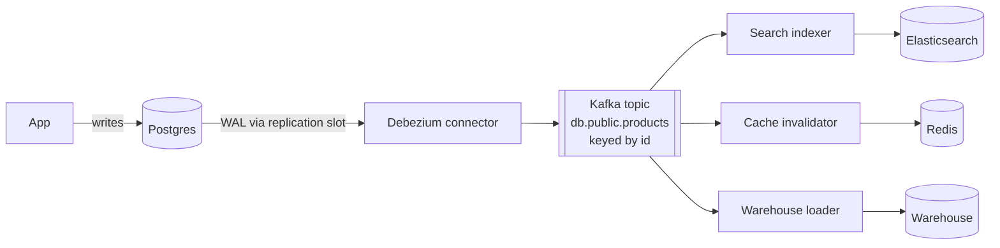

# Change Data Capture

## The problem it solves

Product data lives in Postgres, but search runs on Elasticsearch, the cache is Redis, and analytics lives in a warehouse. The obvious approach is **dual writes**: the application writes to Postgres and then to Elasticsearch. When the process crashes between the two, or Elasticsearch times out, the systems silently diverge. Two concurrent updates can also reach the two systems in different orders, leaving search showing the old price forever. Nightly full re-syncs fix drift, but a 50-million-row table copy is slow and the data is up to a day stale.

**Change data capture (CDC)** reads every committed change from the database's own replication log and streams it, in commit order, to other systems. The database stays the single source of truth, and every consumer eventually sees exactly what was committed.

## How it works

Databases already write every change to a log before applying it, for crash recovery and replication: the **WAL** in Postgres, the **binlog** in MySQL, the **oplog** or change streams in MongoDB. A CDC connector reads that log the way a replica would.

1. **Initial snapshot.** The connector copies the existing table contents, recording the log position at which the snapshot is consistent.
2. **Stream changes.** It then tails the log from that position and emits one event per inserted, updated or deleted row.
3. **Publish.** Events go to a durable log, typically one Kafka topic per table, keyed by primary key so changes to the same row stay in order.
4. **Track position.** The connector stores the last log position it published (in Postgres via a replication slot, plus its own offsets), so after a restart it resumes without gaps.
5. **Consumers** apply events to their targets: index documents, invalidate cache keys, load warehouse tables.



A Debezium-style change event carries the row before and after, the operation, and source metadata:

```
{
  "op": "u",                       // c=create, u=update, d=delete, r=snapshot read
  "before": {"id": 7, "price": 20},
  "after":  {"id": 7, "price": 18},
  "source": {"table": "products", "lsn": 2391044, "ts_ms": 1761990000000}
}
```

**Practical details:**

- **Postgres setup:** `wal_level = logical` and a replication slot. A slot keeps WAL until the consumer confirms it, so a stalled connector makes WAL pile up and can fill the disk. Monitor slot lag.
- **Deletes and compaction:** a delete emits a delete event and, for Kafka log compaction, a tombstone (null value) for the key.
- **Schema changes:** column additions flow through; consumers should tolerate new fields. A schema registry helps.
- **Delivery:** at-least-once. After a crash some events are re-sent, so consumers apply idempotently (upsert by primary key, or compare the LSN or version and ignore older events).
- **Transactional outbox:** to publish *business events* rather than raw rows, the app inserts into an `outbox` table in the same transaction as its write, and CDC streams the outbox table. This gives reliable event publishing without dual writes.

## Worked example

Two updates to product 7 race. With dual writes, the app threads write to Postgres and Elasticsearch separately:

| Time | Thread A (price → 18) | Thread B (price → 15) | Postgres | Elasticsearch |
|---|---|---|---|---|
| t1 | write Postgres | | 18 | 20 |
| t2 | | write Postgres | 15 | 20 |
| t3 | | write Elasticsearch | 15 | 15 |
| t4 | write Elasticsearch (delayed) | | 15 | **18** (wrong, permanently) |

With CDC, the WAL records commit order (LSN 100 for 18, LSN 101 for 15). Both events go to the same Kafka partition because they share key 7, and the indexer applies them in order: Elasticsearch ends at 15. If the indexer crashes after applying LSN 101 but before committing its offset, it re-reads both; applying "18 at LSN 100" and then "15 at LSN 101" again still ends at 15, and an LSN check would skip them entirely.

Replacing nightly re-syncs: a 50,000,000-row table copied at 20,000 rows/s takes 2,500 seconds (about 42 minutes) per night and is up to 24 hours stale. With 2 million changed rows a day, CDC handles 2,000,000 / 86,400 ≈ 23 events/s on average, with seconds of lag.

## Trade-offs

- **Pros:** no dual-write inconsistency; captures every committed change, including ones made by scripts and other apps; preserves per-row order; low overhead on the source compared with polling queries; low latency.
- **Cons:** events describe rows, not business intent, and expose your internal schema to consumers (the outbox pattern helps); operational complexity (connectors, Kafka, slot monitoring); targets are eventually consistent; schema migrations need care.
- **Alternatives:** **dual writes** (simple but inconsistent under failures); **polling** with `updated_at > last_seen` (misses hard deletes and same-timestamp updates); **database triggers** writing to a change table (adds load to the write path); **event sourcing**, where events are the source of truth in the first place.

## When to use it (and when not)

- **Use it** to keep search indexes, caches and read replicas in sync ("design product search", "design Yelp"), to feed a data warehouse or lake, to invalidate caches reliably, to publish domain events via an outbox, and to migrate between databases with near-zero downtime.
- **Not needed** when one database serves all reads, or when a periodic batch export is fresh enough.

## In an interview

Say: "Instead of dual-writing to Postgres and Elasticsearch, I'll run Debezium on the Postgres WAL into Kafka keyed by product ID; the indexer upserts documents idempotently, so search is a few seconds behind but never permanently wrong." Be ready to explain how CDC reads the log, ordering, at-least-once delivery, initial snapshots, and the outbox pattern.

## Common follow-up questions

### Why not just write to both the database and the search index?
The two writes aren't atomic: a crash or timeout between them leaves the systems out of sync, and concurrent updates can land in different orders. CDC derives the second write from the database's commit log, so it reflects exactly what committed, in order.

### What happens if the CDC connector is down for an hour?
It resumes from its saved log position and catches up, because the replication slot retained the WAL. The risk is disk usage on the database while WAL accumulates, so alert on slot lag and cap retention.

### What's the transactional outbox pattern?
The service writes its business change and an event row into an outbox table in the same transaction. CDC (or a poller) publishes outbox rows to the broker. The event is published if and only if the transaction committed.

### How do consumers handle duplicate events?
Make the apply step idempotent: upsert by primary key and ignore events with an LSN or version older than what's already stored. Then replaying events after a crash produces the same final state.
