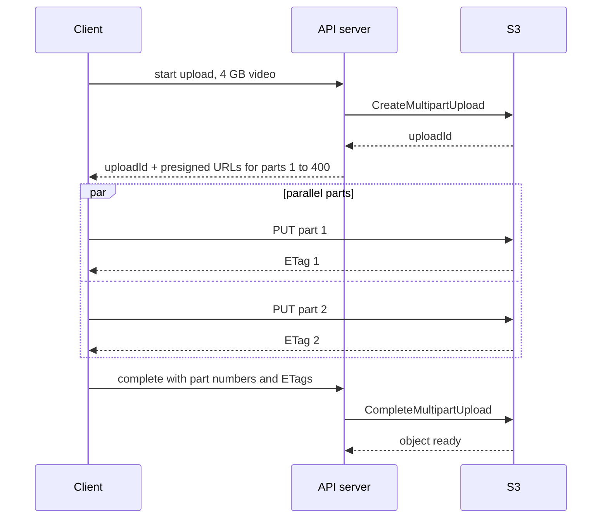

# Chunking / Multipart Upload

## The problem it solves

A user uploads a 4 GB video over a phone connection at 5 MB/s. As a single request, that takes over 13 minutes, and if the connection drops at 95%, the whole upload starts again from zero. One TCP stream also rarely uses all available bandwidth. And when a user edits one paragraph of a 200 MB file in a sync app, re-uploading the entire file wastes bandwidth and time.

Chunking splits a file into pieces that are uploaded, retried, and stored independently. Uploads become **resumable** (retry only the failed piece), **parallel** (several pieces at once), and, with content-based chunks, **deduplicated** (only changed or new pieces are sent).

## How it works

**Multipart upload to blob storage** (the S3 model):

1. **Initiate:** the server calls `CreateMultipartUpload` and gets an `uploadId`.
2. **Split:** the client cuts the file into parts. On S3, parts must be 5 MB to 5 GB each (except the last), with at most 10,000 parts per upload.
3. **Upload parts:** each part is a separate `UploadPart` request (often via a presigned URL per part), in parallel, in any order. S3 returns an `ETag` per part.
4. **Retry failures:** only the failed parts are re-sent.
5. **Complete:** the client or server sends `CompleteMultipartUpload` with the list of part numbers and ETags, and S3 assembles them into one object.
6. **Abort or clean up:** incomplete uploads keep their parts (and keep costing storage) until aborted; a lifecycle rule should abort them after a few days.



**Resumable uploads.** The client keeps track of which parts succeeded (or asks the server, e.g. S3's `ListParts`). After a crash or network change, it resumes with the missing parts. Google Cloud Storage and the open tus protocol offer resumable uploads by byte offset instead of numbered parts.

**Integrity.** Send a checksum per chunk (e.g. MD5 or SHA-256) so the server rejects corrupted parts, and verify a whole-file hash after assembly.

**Content-defined chunking for sync and dedup.** File sync systems store files as a list of chunk hashes rather than one blob:

- **Fixed-size chunks** (e.g. 4 MB) are simple: hash each chunk, upload only chunks the server doesn't have. But inserting one byte near the start shifts every later boundary, so every chunk looks new.
- **Content-defined chunking** picks boundaries with a rolling hash (Rabin fingerprints or similar): cut wherever the hash of the last ~48 bytes matches a pattern. Boundaries follow the content, so an insert changes only the chunks around it.

```
file_manifest = [sha256(c) for c in chunks(file)]
missing = server.which_missing(file_manifest)     # dedup check
for h in missing:
    upload(chunk_by_hash[h])
server.commit(file_id, version + 1, file_manifest)
```

Chunks are stored in blob storage keyed by hash, and identical chunks across files or users are stored once.

## Worked example

4 GB (4,000 MB) video, 10 MB parts, so 400 parts. Connection 5 MB/s total; drops once at 80% done.

| Approach | Data sent | Time |
|---|---|---|
| Single PUT, fails at 80%, restarts | 3,200 MB wasted + 4,000 MB | 7,200 MB ÷ 5 MB/s = 1,440 s (24 min) |
| Multipart, resume after drop | 4,000 MB + at most the parts in flight (say 4 × 10 MB) | 4,040 MB ÷ 5 MB/s ≈ 808 s (13.5 min) |

Sync dedup: a 200 MB document in 4 MB chunks is 50 chunks. The user edits one paragraph in the middle.

| Chunking | Chunks that change | Data uploaded |
|---|---|---|
| Fixed 4 MB, edit inserts text (shifts later bytes) | the edited chunk and every chunk after it, ~25 | ~100 MB |
| Content-defined, average 4 MB | 1 to 2 | ~4 to 8 MB |

## Trade-offs

- **Pros:** resumable after failures; parallel throughput; per-chunk integrity checks; dedup and delta sync save bandwidth and storage; very large files become possible (S3's single PUT limit is 5 GB, multipart objects can reach 5 TB).
- **Cons:** more client and server logic; per-request overhead for small chunks; incomplete uploads leave orphaned parts; a chunk manifest is extra metadata to store and keep consistent; dedup across users can leak information (a user can test whether a file exists) unless scoped per user.
- **Alternatives:** single PUT for small files (under ~100 MB on reliable networks); streaming uploads with byte-offset resume (tus); rsync-style delta encoding computed against the previous version.

## When to use it (and when not)

- **Use it** for video uploads (YouTube), large file sync with delta updates (Dropbox, Google Drive), backups, dataset uploads, and any mobile upload where connections drop.
- **Skip it** for small files like profile photos or chat images, where a single presigned PUT is simpler and the overhead of chunking outweighs the benefit.

## In an interview

Say: "Large files use S3 multipart upload: the client splits them into 10 MB parts, uploads them in parallel with presigned URLs, retries only failed parts, and we call complete with the ETags; for sync, files are stored as content-defined chunks keyed by hash so edits only upload changed chunks." Then be ready to explain how resume works, how you pick chunk size, and how dedup and manifests are stored.

## Common follow-up questions

### How do you choose the chunk size?
Balance per-request overhead against retry cost and parallelism. 5–16 MB parts are common for uploads; S3 needs at least 5 MB per part and allows at most 10,000 parts, so a 100 GB file needs parts of at least about 10 MB. Sync systems often use chunks around a few MB.

### How does the client resume after the app restarts?
It persists the upload ID and completed part numbers locally, or asks the server which parts exist (`ListParts`). Then it uploads only the missing parts and completes the upload.

### Why content-defined chunking instead of fixed-size?
With fixed chunks, an insertion shifts all later boundaries, so every following chunk hashes differently. Content-defined boundaries are chosen by a rolling hash of the data itself, so they re-align right after the edit and unchanged regions keep their hashes.

### What happens to parts of an abandoned upload?
They stay stored and billed until the upload is aborted. Set a lifecycle rule to abort incomplete multipart uploads after a few days, and track upload sessions server-side.
