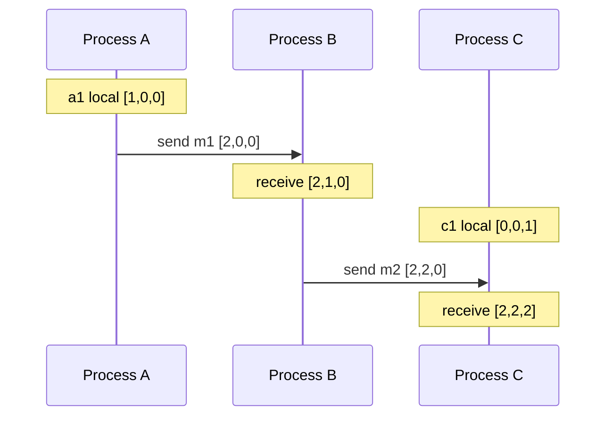

# Clocks & Time

## The problem it solves

Every server has its own quartz clock, and quartz drifts. A typical drift is tens of parts per million, which is a few seconds per day if nothing corrects it. Even with NTP, two machines in different data centers can disagree by milliseconds, and much more during a network hiccup or a VM pause. Now imagine last-write-wins: server A writes `x=1` at its local 10:00:00.105, and 50 ms later server B writes `x=2`, but B's clock is 100 ms behind, so it stamps 10:00:00.055. The database keeps `x=1`, the older write, and silently drops the newer one.

Wall-clock timestamps can't reliably order events across machines. This concept covers how clocks are synced, how far you can trust them, and the **logical clocks** that order events without trusting wall time at all.

## How it works

**Physical clocks and NTP.** NTP estimates a server's offset from a more accurate time source. The client records four timestamps: t1 (request sent, client clock), t2 (request received, server clock), t3 (reply sent, server clock), t4 (reply received, client clock).

```
round_trip = (t4 - t1) - (t3 - t2)
offset     = ((t2 - t1) + (t3 - t4)) / 2
```

The offset estimate assumes the network delay is symmetric, so accuracy is bounded by about half the round trip. The client then slews (speeds up or slows down) its clock gradually rather than jumping, because time going backwards breaks software. Two clocks also exist on most OSes: the **wall clock** (can jump on sync) and a **monotonic clock** (only moves forward). Use monotonic for measuring durations and timeouts.

**Lamport clocks.** Each process keeps a counter `L`.

1. Before each local event or send: `L = L + 1`, and attach `L` to the message.
2. On receive of a message with timestamp `m`: `L = max(L, m) + 1`.

If event a happened before b, then L(a) < L(b). The reverse is not true: L(a) < L(b) doesn't prove a caused b. Ties are broken by process ID to get a total order.

**Vector clocks.** Each process keeps a vector with one counter per process.

1. On a local event or send: increment your own entry, attach the vector.
2. On receive: take the element-wise max with the incoming vector, then increment your own entry.

Compare vectors V and W: V ≤ W if every entry of V ≤ W's entry. If V ≤ W, V happened before W. If neither is ≤ the other, the events are **concurrent**, which is exactly what you need to detect conflicting writes (Dynamo-style stores used version vectors for this).



**Hybrid logical clocks (HLC).** A timestamp is `(physical_ms, logical_counter)`. It stays close to wall time, so humans can read it and you can query "as of 10:00", but it still preserves causality like a Lamport clock when clocks are slightly off. CockroachDB uses HLC.

**TrueTime.** Google Spanner uses GPS receivers and atomic clocks in each data center, and its API returns an interval `[earliest, latest]` instead of a point, with uncertainty usually a few milliseconds. On commit, Spanner **waits out the uncertainty** ("commit wait") before making the write visible, so a later transaction anywhere is guaranteed a larger timestamp. That gives externally consistent transactions ordered by real time.

## Worked example

Lamport clocks, two processes:

| Event | Process | Rule | L |
|---|---|---|---|
| a: local event | P1 | 0+1 | 1 |
| b: send m to P2 | P1 | 1+1 | 2 (m carries 2) |
| c: local event | P2 | 0+1 | 1 |
| d: receive m | P2 | max(1, 2)+1 | 3 |
| e: local event | P1 | 2+1 | 3 |

d and e both have L=3 but are concurrent. Lamport can't tell you that; vector clocks can.

Vector clocks, three processes [A, B, C], following the diagram:

| Event | Vector |
|---|---|
| A local a1 | [1,0,0] |
| A sends m1 | [2,0,0] |
| B receives m1: max([0,0,0],[2,0,0]) then B+1 | [2,1,0] |
| C local c1 | [0,0,1] |
| B sends m2 | [2,2,0] |
| C receives m2: max([0,0,1],[2,2,0]) then C+1 | [2,2,2] |

Compare [2,1,0] (B's receive) with [0,0,1] (c1): 2 > 0 but 0 < 1, so neither dominates. They're concurrent. Compare [1,0,0] with [2,2,2]: every entry is ≤, so a1 happened before C's receive.

## Trade-offs

- **Pros:** NTP is free and good to a few ms on a LAN; Lamport clocks are tiny (one integer) and give a consistent total order; vector clocks detect true concurrency; HLC combines readability with causality; TrueTime gives real-time ordering globally.
- **Cons:** NTP can't give hard bounds and fails silently during network issues; Lamport clocks can't detect concurrency; vector clocks grow with the number of participants; TrueTime needs special hardware and adds commit latency equal to the uncertainty.
- **Alternatives:** avoid needing time order at all with a **single leader or sequencer** that assigns increasing IDs; use **consensus** for an agreed log order; generate IDs with Snowflake-style timestamps where approximate order is enough.

## When to use it (and when not)

- **Use logical or vector clocks** for conflict detection in multi-leader or leaderless replication ("design a key-value store"), causal ordering in chat and collaborative apps, and distributed tracing. Use HLC or TrueTime-like ideas for globally distributed databases with snapshot reads.
- **Don't rely on wall clocks** for ordering writes across machines, for leases without a safety margin, or for measuring timeouts (use the monotonic clock). Wall time is fine for logs, display, and coarse things like TTLs measured in minutes.

## In an interview

Say: "I won't order writes by server wall clocks since skew can be tens of milliseconds; I'll use version vectors to detect concurrent writes and resolve them, or route writes through a single leader per key." Be ready to work a small vector clock example and explain why last-write-wins with skewed clocks loses data.

## Common follow-up questions

### What's the difference between Lamport clocks and vector clocks?
A Lamport clock is one counter per process, and if a happened before b then L(a) < L(b), but a smaller timestamp doesn't prove causality. A vector clock keeps a counter per process, so comparing two vectors tells you whether one happened before the other or they're concurrent. The price is size proportional to the number of processes.

### Why does Spanner wait during commit?
TrueTime returns an uncertainty interval, so Spanner picks a commit timestamp at the top of the interval and waits until that time has definitely passed everywhere. After that, any transaction that starts later is guaranteed to get a larger timestamp, so timestamp order matches real-time order.

### How do Snowflake IDs deal with clock skew?
They embed a millisecond timestamp, a machine ID and a sequence number, so IDs are unique even with skew, and roughly time-ordered. If the clock moves backwards, a typical generator refuses to issue IDs until it catches up, to avoid duplicates.

### Why use a monotonic clock for timeouts?
The wall clock can jump forwards or backwards when NTP corrects it or an operator changes it, which can make a timeout fire instantly or never. The monotonic clock only moves forward at a steady rate, so elapsed time is correct.
