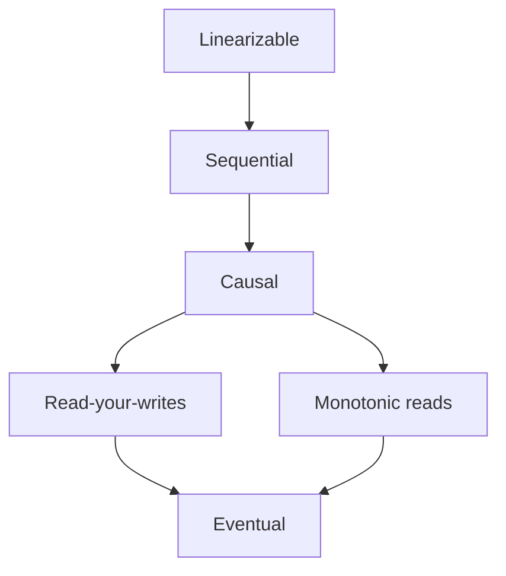

# Consistency Models

## The problem it solves

With data replicated across nodes, "what will a read return?" stops having an obvious answer. A user posts a comment and refreshes: is it there? Two users look at the same document: do they see the same version? A reply arrives: can someone see the reply before the question it answers? Without naming the guarantee, teams discover the answer through bug reports.

A consistency model is a contract between the data store and the application about which values a read may return. Stronger models are easier to program against; weaker ones are faster and more available.

## How it works

From strongest to weakest, each with the anomaly it allows or prevents.

**Linearizable (strong).** Every operation appears to happen instantly at some point between its start and finish, in one global order that respects real time. Once a write completes, every later read, from anyone, sees it. *Anomaly prevented:* Alice changes a password and tells Bob over the phone; Bob's login must use the new one. Requires coordination, such as consensus or quorum reads and writes. Examples: etcd, ZooKeeper writes, Spanner.

**Sequential.** All clients see operations in the same order, and each client's operations appear in the order it issued them, but that order needn't match real time. *Anomaly allowed:* Alice's write completes, then Bob reads and gets the old value, as long as everyone agrees on the same order.

**Causal.** Operations that are causally related (one could have influenced the other) are seen in that order by everyone; concurrent operations may be seen in different orders. *Anomaly prevented:* "Is anyone free for lunch?" followed by the reply "Yes, me!" Nobody sees the reply without the question. *Anomaly allowed:* two unrelated posts appear in different orders for different users.

**Session guarantees** (per client, often combined):

- **Read-your-writes:** after you write, your reads reflect it. *Anomaly prevented:* you update your bio, refresh, and see the old one because the read hit a lagging replica.
- **Monotonic reads:** once you've seen a value, you never see an older one. *Anomaly prevented:* a comment appears on one refresh and vanishes on the next because the second read hit a staler replica.
- **Monotonic writes:** your writes are applied in the order you made them. *Anomaly prevented:* "set price to 10" then "set price to 12" ends up as 10 on some replica.
- **Writes-follow-reads:** a write made after reading a value is ordered after that value.

**Eventual.** If writes stop, all replicas eventually converge to the same value. No promise about what you read in the meantime. *Anomaly allowed:* everything above. A like count can show 100, then 98, then 103.



Arrows point from stronger to weaker: a stronger model gives every guarantee of the ones below it.

**How systems provide them:**

```
read-your-writes: after a write, remember its log position (LSN) in the session;
                  route reads to the leader, or to a replica with replayed_lsn >= that LSN
monotonic reads:  pin each user to one replica (hash user_id), or track the highest
                  version seen and reject older responses
causal:           attach dependencies or vector clocks to writes; a replica shows a
                  write only after its dependencies are visible
linearizable:     single leader with quorum-confirmed reads, or consensus (Raft)
```

## Worked example

A leader L and replicas R1 (lag 50 ms) and R2 (lag 500 ms). At t = 0, Alice changes her status from "away" to "online." Reads are routed randomly.

| Time | Reader | Replica | Value | Allowed under |
|---|---|---|---|---|
| 10 ms | Alice | R2 | away | Eventual only (violates read-your-writes) |
| 100 ms | Bob | R1 | online | All models |
| 200 ms | Bob | R2 | away | Eventual or read-your-writes (violates monotonic reads for Bob) |
| 600 ms | Anyone | any | online | All models |

Read 1 is a read-your-writes violation for Alice, and read 3 is a monotonic-reads violation for Bob. Under linearizability, every read after t = 0 completes must return "online," which rules out serving reads from R1 or R2 without checking that they're current.

## Trade-offs

- **Stronger models:** simpler application logic and fewer surprises, but more coordination, higher latency (especially across regions) and unavailability during partitions.
- **Weaker models:** low latency, high availability, scale across regions, but the application must tolerate stale and reordered data.
- **Middle ground:** most user-facing apps do well with eventual consistency plus read-your-writes and monotonic reads, which fix the anomalies users actually notice, at a fraction of the cost of linearizability.

## When to use it (and when not)

- **Linearizable:** locks, leader election, unique usernames, inventory and seat booking, account balances. Interview questions: ticketing, payments, distributed lock, rate limiter counters (sometimes).
- **Causal:** comment threads, chat, collaborative editing. Interview questions: WhatsApp, Slack, Google Docs.
- **Read-your-writes and monotonic reads:** profiles, settings, social posts. Interview questions: Twitter, Instagram.
- **Eventual:** like and view counters, analytics, recommendation inputs, DNS, CDN content.

## In an interview

Say: "The feed is eventually consistent, but I'll guarantee read-your-writes by reading a user's own recent posts from the leader for a few seconds after they post; seat reservations need linearizability, so they go through a single leader with a conditional write." Be ready to give an anomaly example for each model and explain how you'd implement the guarantee.

## Common follow-up questions

### What's the difference between linearizability and serializability?
Linearizability is about single operations on single objects appearing instantaneous in real-time order. Serializability is about transactions over many objects appearing to run one at a time, in some order. Strict serializability combines both, and Spanner provides it.

### How do you give read-your-writes across devices?
Session pinning doesn't help if the user switches from phone to laptop. Store the user's last write position or timestamp server-side (or in a token) and make any read for that user wait for, or route to, a replica at least that fresh.

### Is eventual consistency ever too weak for a counter?
For likes and views it's fine. For counters that enforce limits, such as rate limits, inventory or quotas, stale reads let users exceed the limit, so you need a single authoritative counter or atomic conditional updates.

### How does causal consistency work without a global clock?
Each write carries metadata about what it depends on, such as a vector clock or a list of dependency versions. A replica delays making a write visible until all its dependencies are visible there, so effects never appear before their causes.
