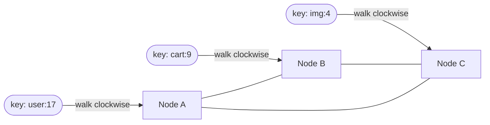

# Consistent Hashing

## The problem it solves

You have N cache or database nodes and need to decide which node stores each key. The obvious answer is `node = hash(key) mod N`. It spreads keys evenly, until N changes. Adding a fifth node to four changes the result of `mod N` for almost every key, so **~80% of keys move** (in general a fraction 1 − 1/(N+1) of them). For a cache, that's a near-total miss storm hitting the database at once. For a database, it's a massive data migration.

Consistent hashing assigns keys so that adding or removing a node moves only **~1/N of the keys**: just the ones that belong to the changed node.

## How it works

1. Imagine a **ring** of hash values from 0 to 2³² − 1, wrapping around.
2. Hash each **node** (e.g. `hash("cache-3")`) to a position on the ring.
3. Hash each **key** to a position on the ring.
4. A key belongs to the **first node clockwise** from its position.



**Adding a node** D between A and B: only keys that hashed between A and D move, from B to D. Every other key stays where it was. **Removing a node** B: only B's keys move, to the next node clockwise.

**Virtual nodes.** With just a few points on the ring, the arcs are uneven, so one node can own 40% of the keys. The fix is to place each physical node on the ring **many times** (e.g. 100–200 "virtual nodes": `hash("cache-3#0")`, `hash("cache-3#1")`, …). Many small arcs average out, so each node gets close to 1/N of the keys. Virtual nodes also let you give a bigger machine more points, so it gets a bigger share, and when a node dies its load spreads across *many* other nodes instead of landing on one neighbor.

**Lookup implementation:** keep the virtual node positions in a sorted array and binary-search for the first position ≥ hash(key), wrapping to index 0 at the end. That's O(log V) per lookup, where V is the number of virtual nodes.

```
ring = sorted((hash(f"{node}#{i}"), node) for node in nodes for i in range(150))

def owner(key):
    h = hash(key)
    i = bisect_left(ring, (h,))          # first virtual node clockwise
    return ring[i % len(ring)][1]        # wrap around
```

## Worked example

4 cache nodes, 1M keys, each node holds ~250k keys. Add a 5th node:

| Scheme | Keys that move | Effect |
|---|---|---|
| `hash mod N` (4 → 5) | ~800k (80%) | Almost every cached key misses at once; the database gets a stampede |
| Consistent hashing, 150 virtual nodes each | ~200k (≈ 1/5) | Only keys now owned by the new node miss; everything else stays warm |

The new node takes ~200k keys, roughly 50k from each existing node, because its virtual nodes are scattered around the ring.

## Trade-offs

- **Pros:** minimal key movement when the cluster changes; no central lookup table; works the same in every client that knows the node list.
- **Cons:** needs virtual nodes for even balance; every client must agree on the node list (membership changes need coordinating, e.g. via ZooKeeper or gossip); doesn't fix hot *keys*: one very popular key still lands on one node.
- **Alternatives:** **rendezvous (highest-random-weight) hashing**: for each key, score every node with `hash(key, node)` and pick the highest. Equally minimal movement and simpler, but O(N) per lookup. **Fixed hash slots** (Redis Cluster): 16,384 slots, `slot = CRC16(key) mod 16384`, and slots are assigned to nodes explicitly, so rebalancing means moving whole slots.

## When to use it (and when not)

- **Use it** for distributed caches (Memcached client libraries), partitioning in leaderless databases (Cassandra and DynamoDB use rings with virtual nodes), sticky load balancing (route a user's WebSocket or session to the same server), and sharding chat servers or stream partitions.
- **Not needed** when a central coordinator assigns ranges or slots explicitly (e.g. range-partitioned databases like Spanner or HBase, or Kafka's partition assignment). Those systems move data by reassigning ranges instead.

## In an interview

Say: "I'll shard with consistent hashing on the user ID, with ~150 virtual nodes per server, so adding or losing a node only remaps about 1/N of the keys instead of nearly all of them." Then be ready to explain the ring, why virtual nodes matter, and what happens to the keys when a node joins or dies. Mention replication if relevant: store each key on the next R distinct nodes clockwise, which is exactly how Dynamo-style stores replicate.

## Common follow-up questions

### What happens to a key's data when its node dies?
Requests for that key go to the next node clockwise. For a cache, that's a miss and the key is refetched from the database. For a store with replication factor R, the next node already holds a replica, so no data is lost and the system re-replicates to restore R copies.

### How do you handle a single hot key that overwhelms its node?
Consistent hashing balances keys, not traffic per key. Add replicas of the hot key (`key#1..n`, reading a random one), cache it locally in application servers, or put a CDN in front for public content.

### How does every client agree on where a key lives?
They share the same node list and hash function. Membership comes from a coordination service (ZooKeeper/etcd), a gossip protocol, or a config push. During a change, clients may briefly disagree, so the system should tolerate a few misdirected requests (retry, or forward to the right node).

### Why not use hash mod N and just rebuild everything on resize?
Because rebuilding is a big event: a cache would see near-100% misses at once, and a database would move almost all its data. Consistent hashing makes resizing routine and cheap, which matters with autoscaling and failures.
