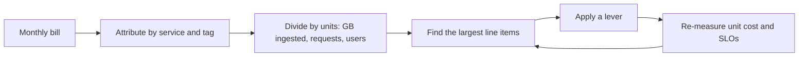

# Cost Optimization

## The problem it solves

A design that meets every latency and availability target can still be a bad design if it costs ten times what the business earns from it. In the cloud, every architectural choice shows up on a bill: an extra replica, a cross-zone hop, a debug log line at 50k requests per second. At principal level, interviewers expect you to treat cost as a first-class requirement, estimate it roughly, and know which levers move it without breaking reliability.

## How it works

**What drives the bill.**

| Driver | What to watch |
|---|---|
| Compute | Instance size vs actual utilization, idle capacity, always-on vs bursty |
| Storage tiers | Memory > local SSD > block storage > object storage > archive, each roughly an order of magnitude cheaper per GB per month |
| Replication factor | RF=3 means 3× the disk; multi-region doubles it again |
| Cross-AZ traffic | Often billed per GB in each direction (on AWS, roughly $0.01/GB each way, illustrative); Kafka replication and consumers can generate a lot |
| Cross-region egress | Several times more per GB than cross-AZ; internet egress more still |
| Managed-service premium | You pay more per unit for managed databases or streaming but save engineering time |
| People and operations | On-call, upgrades, incidents; often the largest cost and the easiest to forget |

**Unit economics.** Total spend is hard to reason about; spend per unit of value isn't. Pick a unit that tracks the business: cost per 1,000 requests, per monthly active user, per GB ingested, per order. Watch it as you grow: a healthy system's unit cost stays flat or falls with scale.

**Levers.**

- **Right-sizing:** most fleets run at 10-30% CPU. Match instance shape to the bottleneck (memory, network, disk).
- **Autoscaling:** scale stateless tiers with load; scale to near zero for batch and dev environments (see **Autoscaling**).
- **Spot / preemptible:** steep discounts for interruptible capacity; fine for stateless workers, batch jobs and CI, risky for brokers and databases.
- **Reserved capacity / savings plans:** commit to baseline usage for one or three years in exchange for a discount; cover the steady floor, autoscale the peaks on demand.
- **Tiered storage, retention and compaction:** keep recent data on fast disks and old data in object storage (see **Tiered Storage**); shorten retention to what consumers actually replay; use log compaction for topics where only the latest value per key matters.
- **Compression:** zstd or lz4 on Kafka producers shrinks network, disk and cross-AZ bytes at a small CPU cost; batching makes compression far more effective.
- **Caching:** a cache saves money when it offloads expensive reads (database capacity, per-request API fees). It *costs* money when the hit rate is low, the data is cheap to compute, or the cache cluster is larger than the database capacity it replaces. Measure the hit rate before adding one.
- **Batching:** fewer, larger requests reduce per-request overhead and per-request API charges (`linger.ms` and `batch.size` in Kafka producers; bulk writes to object storage).
- **Keep traffic in-zone:** zone-aware routing, and in Kafka rack-aware **follower fetching** (KIP-392, `client.rack`) so consumers read from a replica in their own zone.
- **Sample telemetry:** keep all errors and slow traces but sample routine traces at 1-10%; drop high-cardinality metric labels; set log levels and retention per service (see **Observability**).

## Worked example

An event pipeline ingests 50 MB/s on average: 50 × 86,400 = 4.32 TB/day, about 130 TB/month. Kafka runs with RF=3 across three AZs, 7-day retention, two consumer groups. All prices below are **rough and illustrative**, chosen to show the method, not current list prices.

Assumptions: broker instance $1,000/month, block storage $0.08/GB-month, object storage $0.023/GB-month, cross-AZ $0.02/GB (both directions combined).

**Before:**

| Item | Calculation | Monthly |
|---|---|---|
| 6 brokers | 6 × $1,000 | $6,000 |
| Disk | 4.32 TB × 7 days × 3 replicas = 90.7 TB × $0.08/GB | ~$7,260 |
| Cross-AZ: producers to leaders | 2/3 of 129.6 TB = 86.4 TB | |
| Cross-AZ: replication | 2 follower copies × 129.6 TB = 259.2 TB | |
| Cross-AZ: consumers | 2 groups × 2/3 × 129.6 TB = 172.8 TB | |
| Cross-AZ total | 518.4 TB × $0.02/GB | ~$10,370 |
| **Total** | | **~$23,600** |

Unit cost: $23,600 / 129,600 GB ≈ **$0.18 per GB ingested**.

**After** three levers: zstd compression (assume 4× on this JSON-like data), follower fetching for consumers, and tiered storage keeping 1 day on local disk and 7 days in object storage:

| Item | Calculation | Monthly |
|---|---|---|
| 4 brokers (less disk and network) | 4 × $1,000 | $4,000 |
| Local disk | 1.08 TB/day × 1 day × 3 = 3.24 TB × $0.08/GB | ~$260 |
| Object storage | 1.08 TB/day × 7 days = 7.56 TB × $0.023/GB | ~$170 |
| Cross-AZ | (86.4 + 259.2) TB / 4 = 86.4 TB × $0.02/GB | ~$1,730 |
| **Total** | | **~$6,160** |

Unit cost: $6,160 / 129,600 GB ≈ **$0.048 per GB**, about 74% lower. Note what was traded: producer CPU for compression, slightly higher latency for reads of old data from object storage, and consumers tied to their zone's replica.

## Trade-offs

- **Reliability:** RF=3 across zones, multi-region standby and headroom all cost money. Cutting RF to 2 or packing into one AZ is cheaper until the zone fails. Tie redundancy to the SLO, not to habit.
- **Latency:** caches and in-memory stores cost more per GB; tiered storage and spot capacity can add latency or interruptions.
- **Engineering time:** a month of engineer time to save $500/month is a bad trade; a week to save $50k/month is a great one.
- **Commitments:** reserved capacity lowers price but locks you in; over-committing wastes money if usage falls or the architecture changes.
- **Visibility:** sampling telemetry saves money but can hide the one trace you need during an incident.

## When to use it (and when not)

- **Use it** when unit cost is rising, when one line item dominates (cross-AZ traffic and logging are frequent surprises), at scale where small percentages are large numbers, and in any interview question that mentions petabytes or millions of users.
- **Don't** optimize before you have a design that works, or at the expense of correctness-critical redundancy. Early-stage products should spend on speed of iteration, not on shaving instance sizes.

## In an interview

Raise cost without being asked, once the core design is settled: "Let me sanity-check cost. At 4 TB a day with RF=3 and 7-day retention we hold about 90 TB on brokers, and cross-AZ replication is probably our biggest line item. I'd turn on zstd, use follower fetching so consumers read in-zone, and move data older than a day to tiered storage. That roughly quarters the per-GB cost while keeping RF=3 for durability." Quote a unit cost, name the biggest driver, pick levers that don't weaken the SLO, and state what you traded.

## Common follow-up questions

### What's usually the biggest surprise on a streaming bill?
Network: cross-AZ replication and consumer fetches, plus cross-region mirroring. Teams estimate disk carefully and forget that every byte crosses zone boundaries several times.

### When does a cache cost more than it saves?
When the hit rate is low, keys are rarely reused, the backing store is already cheap at that read rate, or the cache must be sized for the whole working set in memory. Compare the cache cluster cost with the database capacity it actually removes.

### Should we run Kafka ourselves or use a managed service?
Compare total cost: instances, storage and network plus the engineers needed for on-call, upgrades, rebalancing and incidents. Managed usually wins below a large scale or for small platform teams; self-managed can win at very large steady volumes with a strong team.

### How do you make teams care about cost?
Tag resources by owner, show each team its unit cost in a dashboard, set budgets with alerts, and review cost in design reviews alongside latency and availability.

### Is spot capacity safe for stream processing?
For stateless consumers that commit offsets, mostly yes: an interrupted worker's partitions are reassigned and work resumes from the last commit. For stateful jobs, use checkpoints and keep a baseline of on-demand capacity. Avoid spot for brokers and databases.

### How would you reduce observability cost?
Sample traces (keep errors and slow ones), drop unused metrics and high-cardinality labels, lower log levels, shorten hot retention and archive older logs to object storage.
