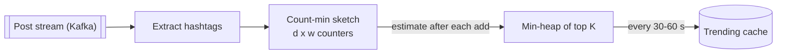

# Count-Min Sketch

## The problem it solves

A trending-topics service counts hashtags and phrases in a stream of ~20k posts per second, per region, over sliding windows. An exact hash map from every distinct term to its count grows with the number of distinct terms, which in a large stream runs into tens or hundreds of millions, most of them seen once. Multiply by regions and windows and you're holding many gigabytes of counters, most of which you never need: you only care about the few items with big counts.

A count-min sketch estimates the frequency of any item in a **fixed** amount of memory, chosen up front, no matter how many distinct items the stream contains. Its estimates can be too high but never too low.

## How it works

1. Allocate a grid of **d rows × w columns** of counters, all 0, and pick d independent hash functions, one per row.
2. **Add(x, c = 1):** for each row i, increment `counter[i][hash_i(x) mod w]` by c.
3. **Estimate(x):** look up the same d cells and return the **minimum**.
4. Other items can collide into x's cells and inflate them, but nothing ever decrements them, so every cell is ≥ the true count. The minimum is the cell with the least collision noise.

```
def add(x, c=1):
    for i in range(d):
        table[i][hash(i, x) % w] += c

def estimate(x):
    return min(table[i][hash(i, x) % w] for i in range(d))
```

**Error bound.** With w = ⌈e/ε⌉ columns and d = ⌈ln(1/δ)⌉ rows, each estimate exceeds the true count by at most ε × N (N = total of all counts) with probability at least 1 − δ. For w = 2,000 and d = 5, that's 10,000 counters (~40 KB with 4-byte counters), error ≤ ~0.14% of N, with probability ~99%.

The error is relative to the **total** stream, so the sketch is accurate for heavy hitters and useless for rare items: an item seen 3 times in a stream of 10M might be reported as 10,000.

**Finding the top-K.** A sketch can't list its items, so keep a min-heap of the current top K alongside it. After each add, estimate the item; if it beats the heap's smallest entry (or is already in the heap), update the heap.



**Windows.** Keep one sketch per time bucket (e.g. per minute) and sum the last N buckets' estimates, or subtract an expired bucket's sketch cell by cell. Sketches with the same dimensions and hash functions can be added together, which also lets parallel workers merge results.

**Conservative update** is a common tweak: on add, only raise the cells that are currently at the minimum (up to min + c). It noticeably reduces overestimation, at the cost of losing the ability to subtract.

## Worked example

A toy sketch with d = 2 rows and w = 4 columns. Row 1 hashes a → 0, b → 2, c → 2 (b and c collide). Row 2 hashes a → 1, b → 3, c → 1 (a and c collide). The stream is a, a, b, c, a, c.

| After | Row 1 [0,1,2,3] | Row 2 [0,1,2,3] |
|---|---|---|
| a | [1,0,0,0] | [0,1,0,0] |
| a | [2,0,0,0] | [0,2,0,0] |
| b | [2,0,1,0] | [0,2,0,1] |
| c | [2,0,2,0] | [0,3,0,1] |
| a | [3,0,2,0] | [0,4,0,1] |
| c | [3,0,3,0] | [0,5,0,1] |

Estimates:

| Item | True count | Row 1 cell | Row 2 cell | Estimate (min) |
|---|---|---|---|---|
| a | 3 | 3 | 5 | **3** (exact) |
| b | 1 | 3 | 1 | **1** (exact) |
| c | 2 | 3 | 5 | **3** (over by 1) |

Each row alone overcounts something; taking the minimum fixes a and b because each has at least one collision-free row. c collides in both rows, so it's overestimated. More rows and wider rows make that less likely.

## Trade-offs

- **Pros:** fixed, small memory set by the accuracy you want; O(d) per add and query; mergeable across workers and time buckets; never undercounts.
- **Cons:** overestimates, with error proportional to the total stream size, so it's only reliable for frequent items; can't enumerate items (needs a heap or a candidate list for top-K); no deletes once you use conservative update.
- **Alternatives:** **exact hash map** when distinct items are few enough; **Misra-Gries / Space-Saving** (keep k counters and directly track heavy hitters, often more accurate for top-K); **HyperLogLog** for counting distinct items rather than frequencies; **Bloom filter** for membership only.

## When to use it (and when not)

- **Use it** for approximate frequencies in high-volume streams: Twitter trending hashtags, top searched queries for typeahead, heavy-hitter detection (top talkers in network traffic, abusive IPs), top-K most viewed videos or products, approximate counts in a stream processor such as Flink.
- **Don't use it** for billing, quotas or anything where an overcount has real cost, for low-frequency items, or when exact counts fit in memory or a database (a few million keys is often fine in Redis).

## In an interview

Say: "Per region and per minute I'll keep a count-min sketch, say 5 rows by 2,000 columns, which is about 40 KB and overcounts by at most ~0.14% of total traffic, plus a min-heap of the top 100; the sketch never undercounts, so real trends can't be missed." Be ready to explain why the minimum is taken, the error bound, and how the heap gives you the top-K.

## Common follow-up questions

### Why take the minimum across rows?
Collisions only add to a cell, so every cell is an overestimate. The smallest of the d cells has the least noise, and the chance that all d rows have a heavy collision falls exponentially with d.

### How do you choose w and d?
Width controls the size of the error (ε ≈ e/w as a fraction of the total count) and depth controls the probability of exceeding it (δ ≈ e^−d). For example, w = 2,000 and d = 5 gives ~0.14% error with ~99% confidence. Size it from the smallest count you need to measure accurately relative to the stream volume.

### How do you get the top-K items from the sketch?
The sketch itself only answers "how many times did I see x?". Maintain a size-K min-heap alongside it: after each add, estimate the item, and push it into the heap if its estimate exceeds the heap's minimum. Report the heap at the end of each window.

### How do you handle sliding windows?
Keep one sketch per small bucket (e.g. one minute) and combine the last N buckets by adding their cells, dropping the oldest as time moves. Because sketches with identical dimensions and hash functions add cell by cell, merging is cheap.
