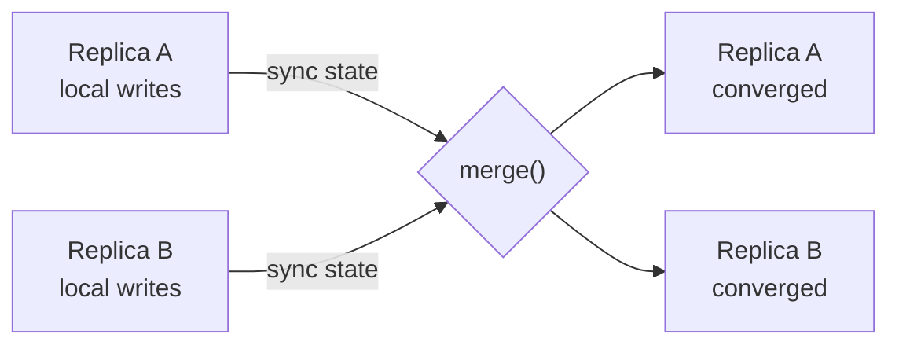

# CRDTs

## The problem it solves

Two users edit the same data on different replicas at the same time: a shopping cart on a phone that's offline and a laptop, or a counter replicated across three regions. When the replicas sync, which version wins? Last-write-wins by timestamp silently throws away one user's edit. Locking across regions adds 100+ ms per write and fails entirely when a replica is offline.

A **CRDT (conflict-free replicated data type)** is a data structure designed so that replicas can accept writes independently and then merge in any order, any number of times, and always converge to the same state. No coordination, no conflicts to resolve by hand.

## How it works

There are two families:

- **State-based (CvRDT):** replicas send their whole state, and a `merge` function combines two states. Merge must be **commutative** (a⊔b = b⊔a), **associative**, and **idempotent** (a⊔a = a), so duplicated or reordered syncs don't matter.
- **Operation-based (CmRDT):** replicas send operations; concurrent operations must commute, and the network must deliver each op exactly once (usually causally ordered). Delta-state CRDTs are a middle ground that send only the recently changed part of the state.



**The common types:**

- **G-Counter (grow-only counter).** A map of replica → count. Each replica increments only its own slot. Value = sum of slots. Merge = element-wise max.
- **PN-Counter.** Two G-Counters, P for increments and N for decrements. Value = sum(P) − sum(N). Needed because element-wise max can't express a decrease.
- **LWW-register (last-writer-wins).** Stores `(value, timestamp, replicaId)`. Merge keeps the higher timestamp, breaking ties by replica ID. Simple, but concurrent writes lose data by design.
- **OR-set (observed-remove set).** Each `add(x)` gets a unique tag. `remove(x)` removes only the tags it has *observed*. A concurrent add creates a tag the remove never saw, so **add wins** over a concurrent remove.
- **Sequence CRDTs for text** (RGA, Logoot/LSEQ, YATA used by Yjs, the list type in Automerge). Each character gets a unique, ordered ID (e.g. `(counter, replicaId)` plus a reference to the character it was inserted after). Inserts are placed by ID, so concurrent inserts at the same spot get a deterministic order. Deletes leave a **tombstone** so later inserts referencing that character still find their place.

```
# G-Counter
increment(self):  P[self_id] += 1
value():          sum(P.values())
merge(a, b):      {r: max(a.get(r,0), b.get(r,0)) for r in a | b}
```

## Worked example

**G-Counter** for page likes across three replicas:

| Step | A | B | C | Value |
|---|---|---|---|---|
| Start | {A:0,B:0,C:0} | same | same | 0 |
| A gets 3 likes, B gets 2 (offline from each other) | {A:3,B:0,C:0} | {A:0,B:2,C:0} | {A:0,B:0,C:0} | A sees 3, B sees 2 |
| A and B merge (element-wise max) | {A:3,B:2,C:0} | {A:3,B:2,C:0} | unchanged | 5 |
| C gets 4 likes, then merges with A | {A:3,B:2,C:4} | — | {A:3,B:2,C:4} | 9 |
| B merges again with A (duplicate data) | — | {A:3,B:2,C:4} | — | 9 |

The duplicate merge in the last step changes nothing, which is idempotence at work. Total = 3 + 2 + 4 = 9 likes, none lost.

**PN-Counter** for stock: P = {A:10, B:0}, N = {A:2, B:3}. Value = 10 − (2 + 3) = 5.

**OR-set** cart: both replicas start with `{milk#t1}`. Replica A removes milk (it observed tag t1, so it removes t1). Concurrently, replica B adds milk again, creating `milk#t2`. After merging, t1 is removed but t2 survives, so the cart contains milk. The user who re-added it isn't silently overruled.

**Sequence CRDT:** document "ab". User 1 inserts "X" after "a" with ID (5, u1); user 2 inserts "Y" after "a" with ID (5, u2). Both replicas order siblings by ID, so both converge to "aXYb" (or "aYXb", depending on the tie-break rule, but always the same on every replica).

## Trade-offs

- **Pros:** writes never block or wait on the network; works offline and across regions; merges are automatic and deterministic; no central server required.
- **Cons:** metadata grows (per-replica counters, tags, tombstones), so you need garbage collection; only certain semantics are expressible (you can't enforce "balance never below zero" without coordination); convergent doesn't mean what the user intended, e.g. two people fixing the same typo differently get both fixes interleaved.
- **Alternatives:** **operational transform** with a central server (Google Docs style); **LWW** on whole records if losing concurrent writes is acceptable; **consensus** (Raft, Paxos) when you need a single agreed order and invariants.

## When to use it (and when not)

- **Use it** for collaborative editors (Figma-style multiplayer, Notion-like docs with Yjs or Automerge), offline-first mobile apps, multi-region counters (likes, view counts), presence, and shopping carts. Riak and Redis Enterprise's active-active geo-replication offer CRDT-based types.
- **Not suitable** when an invariant needs global agreement: bank balances that must not go negative, seat reservations, unique usernames. Those need a single leader or consensus.

## In an interview

Say: "Each region keeps a PN-counter and they gossip state; merge is element-wise max, so replicas converge without coordination and duplicate syncs are harmless." For a doc editor: "I'd use a sequence CRDT like Yjs so clients can edit offline and merge peer-to-peer, at the cost of tombstone metadata." Be ready to explain why merge must be idempotent and commutative, and how tombstones get garbage collected.

## Common follow-up questions

### Why does the G-Counter use per-replica slots instead of one shared number?
If replicas each held one number and merged by max, two concurrent increments from 5 would both produce 6 and merge to 6, losing one. Per-replica slots mean each replica only ever increases its own entry, so max never discards real work.

### How do CRDTs compare with operational transform?
OT transforms operations against each other and usually relies on a central server to order them. CRDTs build the ordering into the data via unique IDs, so any replica can merge with any other without a server. OT keeps less metadata; CRDTs handle offline and peer-to-peer better.

### How do you stop tombstones growing forever?
A tombstone can be dropped once every replica has seen the delete, which requires knowing the set of replicas and tracking what each has acknowledged (for example with version vectors). Many systems compact periodically on a server that knows all clients are caught up.

### Can a CRDT enforce "inventory never goes below zero"?
Not on its own, because two replicas can each sell the last item without talking. You need coordination, or an escrow scheme that pre-allocates a quota of stock to each replica so each can sell only what it holds.
