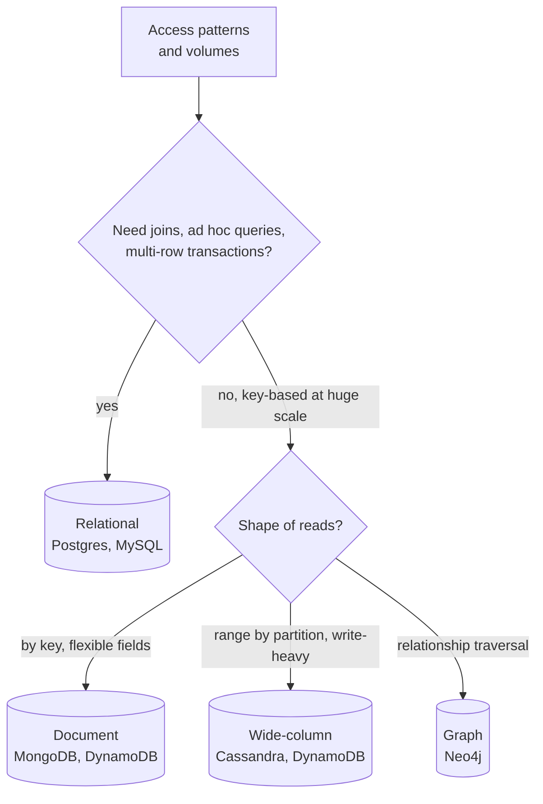

# Data Modeling

## The problem it solves

You start a messaging app by creating a `messages` table with an auto-increment ID and a `conversation_id` column, without thinking about how it will be read. Six months later you have 5 billion rows, the "load the latest 50 messages in this conversation" query scans a huge index across the whole table, and when you shard by message ID, every conversation's messages are scattered across all shards, so each page of history hits every shard.

Data modeling is deciding what entities you store, how they relate, what their keys are, and which database fits, starting from the **access patterns**: the exact queries the system must answer quickly. A good model makes the hot queries cheap; a bad one makes them impossible to scale without rewriting the data.

## How it works

1. **List the core entities** (User, Conversation, Message) and their relationships (one-to-many, many-to-many).
2. **List the access patterns with rough volumes**: "fetch last 50 messages of a conversation, 100k/s", "list a user's conversations by recent activity, 20k/s", "send a message, 10k/s".
3. **Choose the store** based on those patterns, consistency needs and scale.
4. **Choose keys and indexes** so each hot query hits one partition and reads a contiguous range.
5. **Check the write path and growth**: hot partitions, unbounded rows, and how the model handles 10× growth.



**SQL vs NoSQL, in practice.**

- **Relational** databases give you normalized tables, joins, secondary indexes, constraints and ACID transactions. They are the right default when data is relational and queries vary (orders, payments, inventory). They scale reads with replicas; write scaling eventually needs sharding.
- **Key-value / document** stores model data around how it's read: one item or document per lookup, often denormalized. Great for profiles, sessions, carts.
- **Wide-column** stores (Cassandra, DynamoDB with sort keys) store rows grouped by a **partition key** and sorted by a **clustering/sort key** inside the partition. Perfect for "all X for Y, ordered by time" at very high write rates.
- **Graph** databases suit multi-hop relationship queries (friends of friends, fraud rings).

**Keys are the model.** In a partitioned store, the partition key decides which node holds the data and what can be read in one request. Rules of thumb: the partition key should match the main lookup (`conversation_id`), have high cardinality to spread load, and not grow without bound. The sort key gives ordering within the partition (`message_id` as a time-sortable ID like Snowflake).

```sql
-- Cassandra: messages for a conversation, newest first, bucketed by month
CREATE TABLE messages (
  conversation_id uuid,
  bucket          text,          -- e.g. '2026-10', keeps partitions bounded
  message_id      bigint,        -- Snowflake ID, sortable by time
  sender_id       uuid,
  body            text,
  PRIMARY KEY ((conversation_id, bucket), message_id)
) WITH CLUSTERING ORDER BY (message_id DESC);
```

**Denormalize for reads where needed.** In NoSQL you often store the same data in several tables, one per access pattern (messages by conversation, conversations by user). In SQL you start normalized and add denormalized columns or caches only where a query needs it.

## Worked example

Chat app, 5 billion messages, 20 shards. Query: latest 50 messages in one conversation.

| Model | Where a conversation's messages live | Work per query |
|---|---|---|
| Shard by `message_id` | Spread across all 20 shards | Ask all 20 shards, merge, take 50 |
| Shard by `conversation_id`, sort by `message_id` | One partition on one shard, stored in order | One shard, one contiguous read of 50 rows |
| Same, plus monthly bucket | One partition per conversation per month | One read; a busy group chat's partition stays bounded |

A group with 500 messages a day accumulates about 182,500 messages a year in one partition without bucketing; monthly buckets cap it at about 500 × 31 = 15,500 rows.

## Trade-offs

- **Normalized relational:** flexible queries and strong integrity, but joins get expensive at scale and sharding is hard to retrofit.
- **Access-pattern-driven NoSQL:** predictable fast reads at large scale, but new query types often need new tables or backfills, data is duplicated, and transactions are limited.
- **Alternatives:** a relational core plus purpose-built stores for specific patterns (search in Elasticsearch, analytics in a columnar warehouse, caching in Redis), fed by change data capture.

## When to use it (and when not)

- **Always** do this step in an interview right after requirements and before the high-level design. It drives the database choice for chat (messages by conversation), news feed (posts by user, feed by user), URL shortener (code to URL), Ticketmaster (seats with transactional booking) and metrics (series by time).
- **Don't over-engineer** for scale you don't have: a single Postgres handles a lot, and you can say when you'd move a pattern elsewhere.

## In an interview

Say: "The hot read is the latest messages in a conversation, so I'll partition by conversation_id with a monthly bucket and cluster by a time-sortable message ID, which makes it one sequential read on one node." Then be ready to justify SQL vs NoSQL from the access patterns, explain hot partitions, and say what happens when a new query type appears.

## Common follow-up questions

### How do you choose between SQL and NoSQL?
Start from requirements. If you need multi-row transactions, joins or ad hoc queries, and the write rate fits a primary plus shards, use SQL. If access is by key at very high volume with known patterns and eventual consistency is acceptable, a NoSQL store modeled around those patterns scales more simply.

### What is a hot partition and how do you avoid it?
A partition that receives far more traffic than others, such as a celebrity's posts or a key based on today's date. Use high-cardinality keys, add a bucket or random suffix to spread a hot key, and cache the hottest reads.

### How do you support a query your NoSQL model wasn't designed for?
Add a new table or global secondary index keyed for that query and backfill it, or stream changes into a store suited to it (search engine, warehouse). This is the cost of modeling around access patterns.

### Why use time-sortable IDs as sort keys?
They give a unique, roughly chronological ordering in one column, so "newest first" and cursor pagination work without a separate timestamp tiebreaker. Snowflake-style IDs can also be generated without a central counter.
