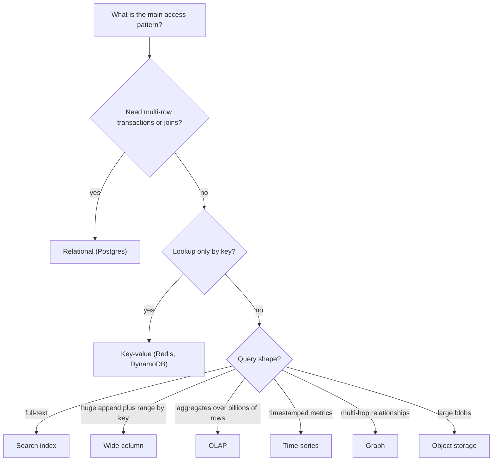

# Choosing a Database

## The problem it solves

Almost every design question has a moment where you say "and we store it in ___." Candidates often fill the blank with a brand ("Cassandra, because it scales") and then get stuck when the interviewer asks *why*. The right answer comes from the **access patterns**: what queries you run, how often, how much data, and how wrong you can afford to be. Brands are just implementations of a handful of data models, each good at some query shapes and bad at others.

Picking the wrong model is expensive. A relational database forced to absorb 500k writes/s of append-only events needs heroic sharding. A wide-column store asked for ad-hoc joins and multi-row transactions pushes that logic into application code, where it is usually buggy. This page gives you a repeatable way to choose and to defend the choice out loud.

## How it works

**Step 1: write down the access patterns before naming any product.** For each entity: the main reads (by key? by range? full-text? aggregates over billions of rows?), the main writes (insert-only? updates in place?), rough volumes, latency targets, and correctness needs.

**Step 2: ask the standard questions.**

| Question | Why it matters |
|---|---|
| Consistency needs | Money and inventory need strong consistency and transactions (see **ACID Transactions** and **ACID vs BASE**); likes and view counts don't |
| Query shape | Point lookups, range scans, joins, full-text, aggregations, graph traversals each favor a different model |
| Write vs read volume | Write-heavy append workloads favor LSM-tree stores; read-heavy ones favor B-trees plus caches |
| Data size and growth | Fits on one node (a few TB)? Or needs **sharding** from day one? |
| Joins | Many relationships queried together favor relational; few favor **denormalization** |
| Transactions | Multi-row, multi-entity atomic updates are hard to bolt on later |
| Latency | Single-digit ms at p99 often means key-value plus memory |
| Ops burden | Who runs it at 3 a.m.? Managed services trade money for sleep |

**Step 3: map to a data model.**

| Model | Strengths | Weaknesses | Typical examples |
|---|---|---|---|
| Relational | Joins, transactions, constraints, flexible ad-hoc queries | Horizontal write scaling is hard; schema changes on huge tables need care | Postgres, MySQL; distributed SQL like Spanner, CockroachDB |
| Key-value | Very fast point reads/writes, simple to scale | No queries beyond the key; no joins | **Redis**, DynamoDB, Memcached |
| Wide-column | Huge write throughput, partition-key plus clustering-key range scans, multi-region | Must design tables per query; limited transactions; no joins | **Cassandra**, ScyllaDB, Bigtable, HBase |
| Document | Flexible nested records, good for aggregate-shaped data | Cross-document joins and transactions weaker or costlier | MongoDB, Couchbase, Firestore |
| Search | Full-text, relevance ranking, faceting, fuzzy match | Not a source of truth; near-real-time refresh; heavy to operate | **Elasticsearch**, OpenSearch, Solr |
| Time-series | High-rate timestamped appends, downsampling, retention | Poor at general queries and updates | **Time-Series DB**: Prometheus, InfluxDB, TimescaleDB |
| Graph | Multi-hop relationship queries (friends of friends, fraud rings) | Hard to shard; niche skills | Neo4j, Neptune |
| Object storage | Cheap, durable, effectively unlimited blobs | High latency per request; no queries beyond prefix listing | S3, GCS, Azure Blob (see **Blob Storage**) |
| OLAP / columnar | Scans and aggregations over billions of rows | Slow point updates; not for OLTP | ClickHouse, Druid, Pinot, BigQuery, Snowflake (see **OLAP**) |

**Postgres until proven otherwise.** A single well-tuned Postgres node on modern hardware handles thousands to tens of thousands of writes per second and several TB of data, gives you transactions, joins, JSON columns, full-text search, and read replicas. Most products never outgrow it. Default to it, and leave only when a specific requirement breaks it:

- Sustained write volume beyond one primary, and sharding SQL yourself is worse than adopting a store built for it.
- Multi-region active-active writes with low latency.
- Data far larger than a node, mostly accessed by key.
- A query shape it is bad at: relevance-ranked search, sub-second analytics over billions of rows, deep graph traversals.

**Polyglot persistence** means using several stores, each for what it does best. It is normal at scale, but it has a cost: more systems to run, upgrade and secure; data copied between them (usually via **Change Data Capture** or Kafka) that can lag or drift; and no transactions across stores. Every extra database should earn its place.

## Worked example

Design: a ride-sharing app with trips, payments, a live driver map, trip search for support agents, and analytics dashboards.

| Data | Access pattern | Choice | Why |
|---|---|---|---|
| Users, trips, payments | Transactional updates, joins for receipts | Postgres (sharded by city or user later) | Money needs ACID; joins for support |
| Live driver locations | ~4 s updates per driver, "drivers near me" | Redis with geo commands | Ephemeral, hot, key and radius lookups |
| Trip event history | Append-only, read by trip ID in time order | Kafka topic, then Cassandra | High write rate, range by partition key |
| Support search | Free text over notes and addresses | Elasticsearch fed by CDC | Relevance search; Postgres stays source of truth |
| Business dashboards | Aggregates over all trips | ClickHouse or a warehouse | Columnar scans |

Rough volume check: 1M active drivers updating every 4 s is 250k writes/s. That alone rules out the transactional Postgres for locations; Redis (sharded) handles it in memory because only the latest position matters.

## Trade-offs

- **One store** is simpler: one backup story, one consistency model, transactions everywhere. It may hit a ceiling.
- **Specialized stores** win on their query shape but add operations cost and cross-store consistency problems.
- **Managed vs self-hosted:** managed services cost more per unit but remove on-call and upgrade work; for small teams that is usually the cheaper option overall.
- **Schema-on-write vs schema-on-read:** relational schemas catch bad data early; document stores move validation into the application.
- **Distributed SQL** (Spanner, CockroachDB) gives SQL and scale, but each write pays consensus latency, and cross-region writes pay round trips.

## When to use it (and when not)

- **Use this process** for every storage decision in an interview, and for each distinct data path, not once for the whole system.
- **Don't** pick a store for its popularity, a single feature you could get from Postgres (JSON, basic text search), or scale you don't have. Don't add a second database before you can name the query the first one can't serve.

## In an interview

Say: "Let me list the access patterns first. Trips and payments need transactions and joins, so Postgres, sharded by user ID if we outgrow one primary. Driver locations are 250k small writes per second where only the latest value matters, so Redis. Search and analytics are derived views, fed from Postgres through CDC into Kafka, so they can lag a few seconds without harming correctness." That sentence shows you derived the choice from requirements, named the source of truth, and acknowledged the cost of the extra stores.

## Common follow-up questions

### Why not use Cassandra for everything if it scales so well?
Because you must design each table around one query, you get no joins, and transactions are limited to lightweight compare-and-set on a single partition. For money or inventory you'd rebuild ACID guarantees in application code. Use it where its write throughput and partition-range reads match the workload.

### When would you leave Postgres?
When a measured requirement breaks it: writes beyond one primary even after batching and partitioning, data far beyond one node accessed mainly by key, multi-region low-latency writes, or a query shape (search, analytics, graph) it serves poorly. Often you add a derived store for that shape rather than migrate the source of truth.

### How do you keep several stores in sync?
Pick one source of truth and derive the others asynchronously, using CDC or an outbox into Kafka. Consumers are idempotent and can rebuild a derived store by replaying. Avoid dual writes from application code, which drift on partial failure.

### SQL or NoSQL for a new startup?
Usually SQL. Requirements change fast early on, and ad-hoc queries, constraints and transactions keep you flexible. Most "NoSQL for scale" decisions are premature at that stage.

### Where does Kafka fit? Is it a database?
Kafka is a durable, replayable log, and with compacted topics it can hold the latest value per key. But it doesn't support queries by anything other than offset or key-in-a-scan, so it sits between databases as the transport and history, not as the query layer.
