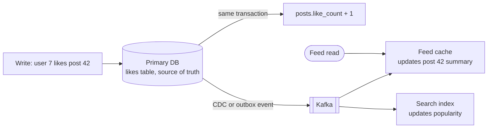

# Denormalization

## The problem it solves

In a normalized schema each fact lives in exactly one place. A post's like count is `SELECT COUNT(*) FROM likes WHERE post_id = ?`, and the author's name comes from a join to `users`. That is clean until the feed page shows 20 posts, each needing a count over a likes table with billions of rows, plus joins to users and media, at 50,000 page views per second. The reads become the most expensive thing in the system, and sharding makes the joins worse because the rows live on different machines.

Denormalization deliberately stores data redundantly, as precomputed counts, copied fields or whole pre-joined views, so the hot reads become single lookups. You pay for it on writes, which must update every copy.

## How it works

Common forms, from mild to heavy:

1. **Precomputed aggregates:** store `like_count` on the post row and increment it when a like is added, instead of counting at read time.
2. **Copied fields:** store `author_name` and `author_avatar_url` on each post or comment so rendering doesn't need a join.
3. **Embedding:** in a document store, keep an order's line items inside the order document.
4. **Duplicate tables per access pattern:** in Cassandra or DynamoDB, write a message to both `messages_by_conversation` and `messages_by_user`, each keyed for one query.
5. **Materialized views and read models:** a separate store built from the source of truth for one read pattern, like a precomputed timeline per user (fan-out on write), or a search index.



**Keeping copies in sync.** The cost of denormalization is all on the write side:

- **Same transaction:** update the base row and the counter or copied column together in one database transaction. Strongly consistent, works when everything lives in one database.
- **Asynchronous propagation:** publish a change event (via the transactional outbox or change data capture) and let consumers update the copies. Scales across stores and services, but copies are eventually consistent and consumers must be idempotent.
- **Periodic recomputation:** rebuild aggregates in a batch job and use it to correct drift in the incremental counts.

```sql
BEGIN;
INSERT INTO likes (user_id, post_id) VALUES (7, 42)
  ON CONFLICT DO NOTHING;              -- idempotent: a like counts once
-- only increment if the insert actually happened (check affected rows in app)
UPDATE posts SET like_count = like_count + 1 WHERE id = 42;
COMMIT;
```

**Hot counters.** A viral post can receive thousands of likes per second, all updating one row. Spread the counter across N sub-rows (`post42:shard0..15`) and sum them on read, or buffer increments in memory or Redis and flush every few seconds.

**Which copies to update when a source changes.** If a user renames themselves, every denormalized `author_name` is now stale. Either update them all asynchronously, accept staleness for display-only fields, or store only the immutable `author_id` and look the name up from a cache.

## Worked example

Feed page: 20 posts per view, 50,000 views per second. Likes table holds 10 billion rows.

| Approach | Read work per page view | Write work per like |
|---|---|---|
| Normalized: `COUNT(*)` over likes per post + join to users | 20 aggregate queries plus joins | 1 insert |
| `like_count` column and copied `author_name` on posts | 1 query fetching 20 rows | 1 insert + 1 counter update |

Reads: 50,000 × 20 = 1,000,000 per-post counts per second with the normalized model, versus 50,000 multi-row lookups that read a stored value. If likes run at 5,000 per second, denormalization adds 5,000 counter updates per second, a small price for removing a million aggregate queries per second.

## Trade-offs

- **Pros:** much faster, simpler reads; avoids cross-shard joins; read models can be scaled and stored independently.
- **Cons:** more write work and write amplification; copies can drift or be stale; more storage; schema changes and backfills touch every copy; correctness bugs are harder to see.
- **Alternatives:** caching the result of the normalized query (less invasive, but cache misses still run the expensive query); read replicas; database materialized views refreshed periodically; a columnar store for analytical aggregates.

## When to use it (and when not)

- **Use it** when reads vastly outnumber writes on the same data and the read is expensive: counters (likes, followers, views), feeds and timelines, product listings with seller names, chat inbox previews ("last message" on the conversation row), and any NoSQL model where joins don't exist.
- **Avoid it** when data changes frequently and is read rarely, when copies must be strictly consistent across services (balances, inventory counts at checkout), or early on, before you know which reads are actually hot.

## In an interview

Say: "I'll keep the likes table as the source of truth but store a denormalized like_count on each post, updated in the same transaction, and sharded into sub-counters for viral posts, so the feed never counts at read time." Then be ready to explain how copies stay in sync, what happens when a copied field changes, and how you'd repair drift.

## Common follow-up questions

### How do you keep denormalized data consistent?
Inside one database, update all copies in a single transaction. Across services or stores, emit change events with the outbox pattern or CDC and apply them idempotently, accepting eventual consistency. Periodic reconciliation jobs catch anything that slipped.

### What if the denormalized count drifts from the truth?
Treat the base table as the source of truth and recompute counts in a background job, correcting the stored value. For display counts like likes, small temporary drift is usually acceptable.

### Isn't this the same as caching?
They're close. A cache is a disposable copy you can rebuild on a miss, typically with a TTL. Denormalized data is part of the durable model and must be maintained on every write.

### How does denormalization relate to fan-out on write in a news feed?
Fan-out on write is denormalization at scale: when someone posts, the post ID is copied into each follower's precomputed timeline. Reads become one lookup, but a celebrity with millions of followers makes the write expensive, which is why hybrid approaches pull celebrity posts at read time.
