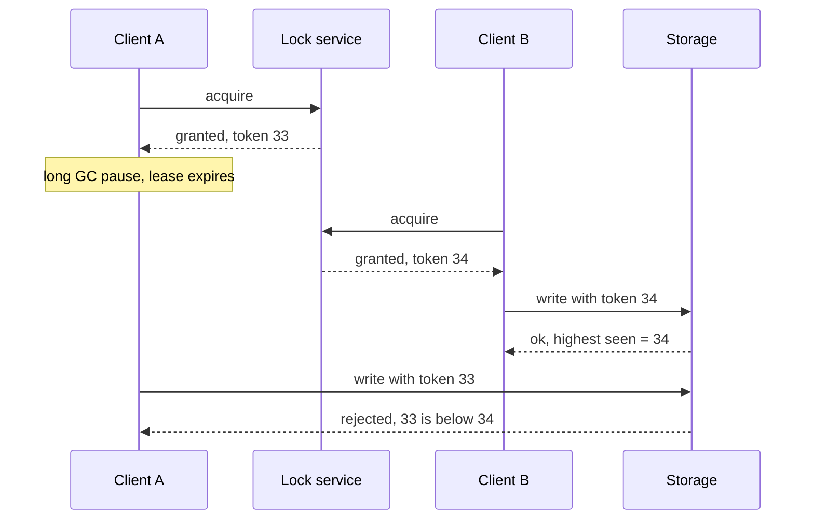

# Distributed Locks

## The problem it solves

You run 20 worker instances. A nightly job charges subscription renewals and must run exactly once. A user's "export my data" request must not start twice if they double-click. A scheduler must not hand the same task to two workers. A mutex inside one process doesn't help, because the contending code runs on different machines.

A distributed lock gives mutual exclusion across machines: at most one holder at a time, with automatic release if the holder crashes.

## How it works

**Redis, single instance.** Acquire with one atomic command that sets the key only if it doesn't exist and gives it an expiry:

```
SET lock:renewals <random-token> NX PX 30000
# NX: only if not exists    PX 30000: auto-expire after 30 s
# reply OK = acquired, nil = someone else holds it
```

The random token identifies the owner. Release must check the token, so you never delete a lock someone else acquired after yours expired. Do the check and delete atomically with a Lua script:

```
-- release.lua
if redis.call("GET", KEYS[1]) == ARGV[1] then
  return redis.call("DEL", KEYS[1])
else
  return 0
end
```

The TTL is the safety net: if the holder crashes, the lock frees itself after 30 seconds. For long jobs, the holder extends the TTL periodically (only if it still owns the token).

**Redlock.** To avoid depending on one Redis node, the Redlock algorithm acquires the same key on a majority of N independent Redis masters (e.g. 3 of 5) within a time limit shorter than the TTL. It has well-known caveats: Martin Kleppmann argued it depends on bounded network delay, process pauses and clock drift for safety, and doesn't produce fencing tokens. Redis's author disputed parts of that analysis. The practical takeaway: use Redis locks for efficiency (avoiding duplicate work), and don't rely on them alone for correctness.

**Consensus-backed locks.** ZooKeeper (ephemeral sequential znodes; lowest sequence number holds the lock, others watch their predecessor) and etcd (a key attached to a lease, created only if absent) run on consensus, so the lock state itself is consistent across failures. They also give a monotonically increasing number (zxid or revision) per acquisition.

**Fencing tokens.** Any lock with a timeout has the same flaw: the holder can pause (GC, VM freeze, slow network) past the expiry, another client acquires the lock, and then the first wakes up and writes anyway. The fix is a token that increases with each acquisition, which the protected resource checks:



The storage must enforce the check (for example, `UPDATE ... WHERE fence_token < :token`). That turns the lock from "probably exclusive" into "safe even if two clients think they hold it."

## Worked example

A renewal job takes ~20 seconds. Lock TTL is 30 seconds. Three instances wake at 00:00:00.

| Time | Instance 1 | Instance 2 | Instance 3 | Lock state |
|---|---|---|---|---|
| 00:00:00.000 | `SET NX` → OK, token t1 | `SET NX` → nil, skips | `SET NX` → nil, skips | held by t1, expires 00:00:30 |
| 00:00:20 | finishes, release script deletes key | | | free |
| Alternative: 00:00:05 | crashes | | | held by t1 until 00:00:30 |
| 00:00:30 | | | | expires |
| 00:01:00 | | next scheduled attempt acquires, token t2 | | held by t2 |

If instance 1 crashes, the job is delayed until the TTL expires and the next attempt runs. The job itself should also be idempotent (each renewal keyed by subscription and billing period), so a rare double run doesn't double-charge.

## Trade-offs

- **Pros:** simple mental model; prevents most duplicate work; Redis locks are fast and cheap; consensus-backed locks survive node failures safely.
- **Cons:** TTL choice is a trade-off (too short and it expires mid-work, too long and crashes stall progress); timeouts plus pauses mean two holders are possible without fencing; the lock service becomes a dependency; contention serializes work.
- **Alternatives:** database row locks (`SELECT ... FOR UPDATE`) if the data already lives in one database; optimistic concurrency with conditional writes; idempotent operations so duplicates are harmless; partitioning work so each key has a single owner (e.g. a Kafka partition per consumer); a queue that delivers each job to one worker.

## When to use it (and when not)

- **Use it** for singleton scheduled jobs, preventing duplicate processing of the same entity, short critical sections like holding a seat during checkout, and leader-like roles. Interview questions: distributed job scheduler, ticket booking (seat holds), web crawler (one fetcher per domain), payment processing (one in-flight charge per order).
- **Avoid it** where a database constraint, conditional write or idempotency key would do the job; those are usually simpler and safer. Never rely on a Redis lock alone when a double execution would corrupt data.

## In an interview

Say: "Workers take a Redis lock per order with `SET NX PX 30000` and a random token, released by a compare-and-delete script; because a paused worker could outlive its lock, the database write also checks a fencing token." Be ready to explain TTL choice, the Redlock debate, and why fencing or idempotency is still needed.

## Common follow-up questions

### Why not just use `SETNX` followed by `EXPIRE`?
They're two commands; if the client crashes between them, the key never expires and the lock is held forever. `SET key value NX PX ttl` does both atomically.

### Why does release need to check the token?
If your lock expired and another client acquired it, a plain `DEL` would remove their lock, letting a third client in. Comparing the token and deleting in one Lua script ensures you only release your own lock.

### Is Redlock safe?
It's debated. Its safety depends on timing assumptions (bounded pauses, delays and clock drift) that real systems can violate, and it doesn't produce fencing tokens. Use it for efficiency, and use a consensus system plus fencing when correctness depends on the lock.

### How do you choose the TTL?
Longer than the normal critical section, with margin, and short enough that a crash doesn't stall work for too long. For long-running work, use a shorter TTL and a background renewal that extends it while the holder is healthy.
