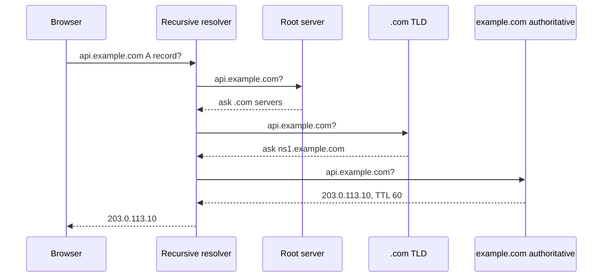

# DNS

## The problem it solves

Computers connect to IP addresses like `203.0.113.10`, but people and configuration files use names like `api.example.com`. Hardcoding IPs fails the moment a server moves, a region fails, or you add capacity. You also want users in Europe to reach your European servers and users in Asia to reach Asian ones, without shipping different apps.

The Domain Name System (DNS) is a distributed, cached directory that maps names to records. Because answers carry a TTL and can differ by who is asking, DNS is also one of the simplest tools for routing users across regions and failing over between them.

## How it works

**The resolution chain.** When a browser looks up `api.example.com`:

1. It checks its own cache and the operating system's cache.
2. It asks a **recursive resolver** (the ISP's, or a public one like 8.8.8.8 or 1.1.1.1).
3. If the resolver doesn't have it cached, it asks a **root server**, which refers it to the `.com` TLD servers.
4. The **TLD server** refers it to the **authoritative name servers** for `example.com`.
5. The **authoritative server** returns the record. The resolver caches it for the record's TTL and returns it to the client.

In practice the resolver almost always has the root and TLD referrals cached, so most lookups need one hop or none.

**Common record types:**

| Type | Maps | Example |
|---|---|---|
| A / AAAA | name to IPv4 / IPv6 address | `api.example.com A 203.0.113.10` |
| CNAME | name to another name | `cdn.example.com CNAME d123.cdnprovider.net` |
| MX | domain to mail servers | `example.com MX 10 mail.example.com` |
| NS | zone to its name servers | `example.com NS ns1.example.com` |
| TXT | arbitrary text (verification, SPF) | `example.com TXT "v=spf1 ..."` |
| SRV | service to host and port | `_sip._tcp.example.com SRV 10 5 5060 sip1` |

**TTL.** Each record says how long resolvers may cache it. A long TTL (hours) means fewer lookups and faster responses, but changes take hours to reach everyone. A short TTL (30 to 60 seconds) allows quick failover but more queries. Some resolvers and clients cache longer than the TTL, so failover via DNS is never instant for everyone.

**Geo-DNS and smarter routing.** Managed DNS services can return different answers depending on the query:

- **Geolocation:** answer based on the resolver's location (or the client subnet if the resolver sends EDNS Client Subnet).
- **Latency-based:** return the region with the lowest measured latency for that network.
- **Weighted:** send 90% of answers to one IP and 10% to another, useful for canary releases.
- **Failover:** health-check each endpoint and stop returning unhealthy ones.

**Round-robin DNS** returns several A records and lets clients pick, a crude form of load balancing with no awareness of server health.

## Worked example

You run in us-east and eu-west, with a 60-second TTL and health-checked failover that checks every 10 seconds and marks an endpoint unhealthy after 3 failures. At 10:00:00, eu-west fails.

| Time | Health check | DNS answer for EU users | EU traffic reaching eu-west |
|---|---|---|---|
| 10:00:00 | eu-west fails | eu-west IP | 100% (errors) |
| 10:00:30 | 3rd failed check, marked unhealthy | us-east IP | still high, cached answers |
| 10:01:30 | — | us-east IP | near 0% for resolvers that honor the TTL |
| later | — | us-east IP | a small tail from clients that cache past the TTL |

Worst case for well-behaved clients is detection time plus TTL: 30 + 60 = 90 seconds.

## Trade-offs

- **Pros:** universal; heavily cached so it scales enormously; simple geographic routing and failover with no extra infrastructure in the data path.
- **Cons:** caching makes changes slow and uneven; routing is based on the resolver's location, which may be far from the user; no per-request load awareness; DNS itself is a critical dependency, so authoritative servers must be highly available.
- **Alternatives:** anycast (one IP, routing done by BGP, faster failover); global L7 load balancers; client-side service discovery for internal traffic.

## When to use it (and when not)

- **Use it** for mapping public hostnames, pointing to a CDN with a CNAME, routing users to the nearest region in multi-region designs (global chat, video streaming, any "design for global users" prompt), and coarse regional failover.
- **Don't rely on it** for fast per-request load balancing or sub-second failover. Put load balancers behind the DNS name for that.

## In an interview

Say: "Users resolve `api.example.com` through latency-based DNS with a 60-second TTL, which sends them to the nearest healthy region, and a load balancer in each region spreads requests across servers." Then be ready to explain the resolution chain, why TTL limits failover speed, and how DNS differs from anycast.

## Common follow-up questions

### Why can't DNS give instant failover?
Answers are cached by resolvers, operating systems and applications for the TTL, and some cache longer. Lowering the TTL helps but increases query volume. Anycast or a global load balancer behind one stable IP gives faster failover.

### What is the difference between a CNAME and an A record?
An A record maps a name directly to an IPv4 address. A CNAME says this name is an alias for another name, and the resolver then looks that name up. CNAMEs can't exist at the zone apex (`example.com` itself), which is why providers offer ALIAS or CNAME-flattening features.

### How does geo-DNS know where the user is?
It sees the IP of the recursive resolver, not the user, and maps it to a location. If the resolver supports EDNS Client Subnet, it forwards part of the user's IP, which makes the location more accurate. Without it, users on a distant resolver can be misrouted.

### Is DNS a single point of failure?
It can be. Use a provider with many anycast name servers, or two providers, and keep reasonable TTLs so cached answers keep working during a short outage.
