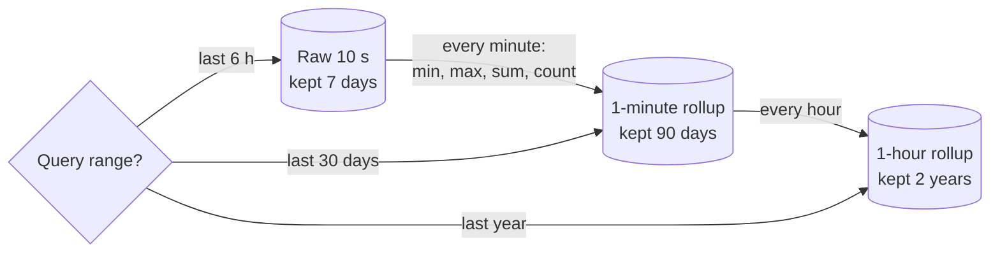

# Downsampling

## The problem it solves

You collect a metric every 10 seconds. That's 8,640 points per series per day and about 3.15 million per year. Nobody looks at last March's CPU graph at 10-second resolution; a year-long chart on a screen 1,500 pixels wide can only show about 1,500 points anyway. But keeping a year of raw data for a million series costs terabytes, and rendering that chart means reading 3 million points per series just to throw most of them away.

Downsampling (rollups) replaces old high-resolution data with coarser aggregates: 10-second points become 1-minute summaries after a week, then 1-hour summaries after a month. Storage and query cost drop by orders of magnitude, while recent data keeps full detail for debugging.

## How it works

1. **Define tiers** of resolution and retention, for example raw 10 s kept 7 days, 1-minute kept 90 days, 1-hour kept 2 years.
2. **Aggregate** each time bucket into summary values. One average is not enough; store several aggregates per bucket so different queries still work: `min`, `max`, `sum`, `count` (average is `sum / count`), and sometimes `last`.
3. **Run the rollup** continuously (a stream processor or the TSDB's continuous query) or in batch jobs after each bucket closes, writing to a separate table or store per resolution.
4. **Expire** the finer tier once its rollup is safely written.
5. **Route queries** to the coarsest tier that still gives enough points for the requested range.



```sql
-- build 1-minute rollups from raw points
INSERT INTO metrics_1m (series_id, minute, min_v, max_v, sum_v, count_v)
SELECT series_id, date_trunc('minute', ts), min(v), max(v), sum(v), count(*)
FROM metrics_raw
WHERE ts >= :start AND ts < :start + interval '1 minute'
GROUP BY series_id, date_trunc('minute', ts);

-- 1-hour rollups are built from 1-minute rollups, not raw data
INSERT INTO metrics_1h
SELECT series_id, date_trunc('hour', minute),
       min(min_v), max(max_v), sum(sum_v), sum(count_v)
FROM metrics_1m WHERE minute >= :h AND minute < :h + interval '1 hour'
GROUP BY series_id, date_trunc('hour', minute);
```

**Aggregates must be composable.** Min of mins, max of maxes, sum of sums and sum of counts are all correct when rolling up again. An **average of averages is wrong** when buckets have different counts, which is why you store sum and count. **Percentiles can't be averaged** at all: p99 of hourly p99s is not the daily p99. To keep percentiles, store a mergeable sketch per bucket (a histogram with fixed buckets, t-digest, or DDSketch) and merge sketches when rolling up.

**Counters vs gauges.** For gauges (temperature, CPU%), min/max/avg make sense. For monotonically increasing counters (total requests), store the increase over the bucket or the last value so rates can still be computed.

**Spikes.** Averages hide short spikes: a single 10-second CPU spike to 100% inside an otherwise 20% minute averages out to about 33% ((100 + 5 × 20) ÷ 6). Keeping `max` per bucket preserves it.

**Late data.** If points can arrive late, delay each rollup by a grace period (e.g. run the 1-minute rollup two minutes after the minute ends) or recompute recent buckets when late data shows up.

## Worked example

One gauge series sampled every 10 s. One minute of raw values (6 points): 20, 22, 21, 95, 23, 20.

| Bucket summary | Value |
|---|---|
| min | 20 |
| max | 95 |
| sum | 201 |
| count | 6 |
| avg (sum / count) | 33.5 |

Storage across tiers, 1M series, assuming ~1.5 bytes per raw point and ~20 bytes per rollup row (4 aggregates, compressed):

| Tier | Points per series per year | Per series | 1M series |
|---|---|---|---|
| Raw 10 s for a full year | 3,153,600 | ~4.7 MB | ~4.7 TB |
| Raw 10 s for 7 days | 60,480 | ~91 KB | ~91 GB |
| 1-minute for 90 days | 129,600 | ~2.6 MB | ~2.6 TB |
| 1-hour for 2 years | 17,520 | ~350 KB | ~350 GB |

Rollup rows are larger than compressed raw points, so the 1-minute tier is where the storage sits; teams that need it smaller shorten that tier to 30 days (43,200 rows, ~0.86 TB). A year-long chart from the 1-hour tier reads 8,760 rows per series instead of 3.15 million raw points, about 360× fewer.

## Trade-offs

- **Pros:** large storage savings for long retention; fast long-range queries; dashboards stay responsive; lets you keep years of trend data.
- **Cons:** detail is lost permanently (you can't investigate a 10-second spike from six months ago); percentiles need sketches; rollup jobs are another pipeline to run and monitor; late data and backfills complicate correctness; queries spanning tiers need stitching.
- **Alternatives:** keep raw data but move it to cheap tiered storage (S3) and query it slowly; sampling (keep 1 in N points, which loses spikes); keep raw data only for selected critical series.

## When to use it (and when not)

- **Use it** in metrics and monitoring systems (design Datadog or Prometheus long-term storage), IoT telemetry, analytics dashboards with long time ranges, and ad click or view counters reported per hour and per day.
- **Avoid it** when raw records are the product or a legal requirement (financial transactions, audit logs, billing events), or when future questions are unknown and raw data is cheap enough to keep in cold storage.

## In an interview

Say: "Raw 10-second points stay for 7 days; a rollup job writes min, max, sum and count per minute for 90 days and per hour for two years, and the query layer picks the coarsest tier that gives enough points for the requested range." Then be ready to explain why you store sum and count rather than averages, how you'd keep percentiles, and how late data is handled.

## Common follow-up questions

### Why not just store the average per bucket?
Averages can't be combined correctly when buckets have different counts, and they hide spikes. Storing sum and count gives exact averages at any level, and min and max keep the extremes visible.

### How do you downsample percentiles like p99 latency?
Store a mergeable summary per bucket, such as a fixed-bucket histogram, t-digest or DDSketch. Merging the sketches gives an approximate percentile for the larger window, which averaging percentiles cannot do.

### How does the query layer choose a tier?
Pick the coarsest resolution that still returns enough points for the chart, roughly range divided by pixel width. If the range crosses a tier boundary, combine the fine data for the recent part with the coarse data for the older part.

### What if data arrives after the rollup ran?
Wait a grace period before rolling up a bucket, and allow recomputation of recent buckets when late points arrive. Beyond the grace window, either drop the late data or accept slightly inaccurate rollups.
