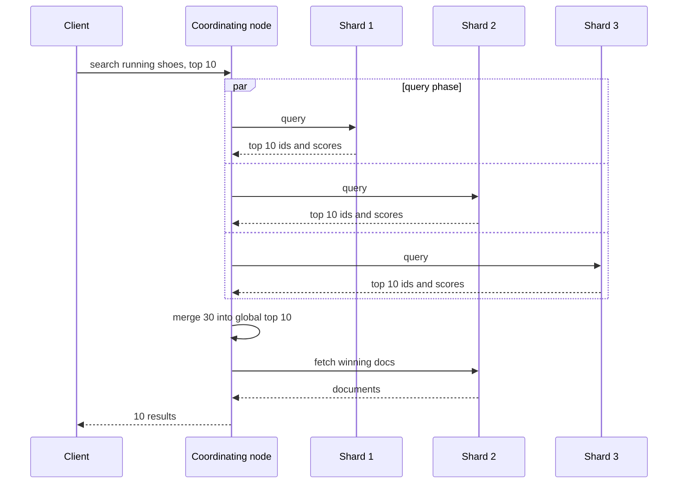

# Elasticsearch

## The problem it solves

A marketplace has 200M product listings in Postgres. Users type "red running shoes size 10" and expect relevant results in under 200 ms, with typo tolerance, filters for price and brand, counts per category beside the results, and new listings searchable within seconds. `WHERE title ILIKE '%running%'` scans every row, can't rank by relevance, and doesn't know that "shoe" and "shoes" are the same word. Building a sharded, replicated full-text search engine yourself is a multi-year project.

Elasticsearch is a distributed search and analytics engine built on Apache Lucene. It stores JSON documents, indexes every field (text into an inverted index, numbers, dates and geo points into structures suited to range and distance queries), and spreads data and queries across a cluster.

## How it works

**Documents, indexes and mappings.** You store JSON documents in an **index** (roughly a table). A **mapping** defines each field's type: `text` fields are analyzed for full-text search, `keyword` fields are stored as exact values for filtering, sorting and aggregations, plus `long`, `date`, `geo_point` and others.

**Analysis and the inverted index.** At index time, an **analyzer** turns text into terms (tokenize, lowercase, remove stop words, stem), and Lucene builds an **inverted index**: term → sorted list of document IDs containing it, with frequencies and positions. Queries are analyzed the same way, so "Running Shoes" matches a document containing "running shoe". Exact fields also get columnar **doc values** for fast sorting and aggregations.

**Shards and replicas.** An index is split into **primary shards** (each one is a complete Lucene index over a subset of documents) and each primary has **replica shards** on other nodes. A document's shard is chosen by `hash(_routing) mod number_of_primary_shards`, where routing defaults to the document ID. Because of that formula, the primary shard count is fixed at creation (changing it requires reindexing or the split/shrink APIs). Replicas provide failover and extra read throughput. A **master node** (elected) manages cluster state and shard placement; data nodes hold shards.

**Indexing and near-real-time search.**
1. The write goes to the primary shard, which adds it to an in-memory buffer and appends to the **translog** (a write-ahead log for durability).
2. The primary forwards the operation to its replicas, then acknowledges.
3. Every **refresh** (default 1 s on indexes that are being searched), the buffer is written into a new immutable **segment** and opened for search. Until then the document isn't visible to searches: this is why Elasticsearch is **near-real-time**.
4. A **flush** commits segments to disk and trims the translog. In the background, **segment merging** combines small segments and purges deleted documents (deletes and updates only mark old versions as deleted).

**Query flow (query then fetch).**
1. A **coordinating node** receives the search and sends it to one copy (primary or replica) of every shard.
2. **Query phase:** each shard finds matches, scores them with **BM25**, and returns its top N document IDs and scores (plus partial aggregation results).
3. The coordinator merges these into the global top N.
4. **Fetch phase:** it fetches the full documents for just those IDs from the shards that hold them and returns them.



A typical query combines scored full-text matching with unscored filters, which are cacheable:

```json
{
  "query": { "bool": {
    "must":   [{ "match": { "title": { "query": "running shoes", "fuzziness": "AUTO" } } }],
    "filter": [{ "term": { "brand": "acme" } },
               { "range": { "price": { "lte": 100 } } }]
  }},
  "aggs": { "by_category": { "terms": { "field": "category" } } },
  "size": 10
}
```

Elasticsearch also supports geo queries (`geo_distance`), autocomplete (completion suggester, edge n-grams) and vector search (`dense_vector` fields with HNSW-based kNN).

## Worked example

Sizing the 200M-product index. Assume an average document of 2 KB, and an on-disk index (source plus inverted index plus doc values) of roughly the same size, about 400 GB of primary data. A common guideline is to keep shards in the tens of gigabytes.

| Decision | Value | Arithmetic |
|---|---|---|
| Primary data | ~400 GB | 200M × 2 KB |
| Primary shards | 10 | 400 GB / 10 = 40 GB per shard |
| Replicas | 1 per primary | 10 more shards, 800 GB total |
| Data nodes | 5 | 20 shards / 5 = 4 shards (~160 GB) per node |
| One node fails | its 4 shards' copies on other nodes take over | replicas promoted to primary, new replicas rebuilt on the remaining 4 nodes |

A search fans out to 10 shards (one copy each). If each shard returns its top 10, the coordinator merges 100 candidates and fetches 10 documents. Paging to page 1,000 (results 10,000–10,010) would make every shard return 10,010 hits, which is why deep pagination uses `search_after` instead of large offsets.

## Trade-offs

- **Pros:** fast full-text search with relevance ranking, fuzzy matching and highlighting; rich filtering and aggregations (facets, dashboards); horizontal scaling via shards; replicas for availability; good at log and observability workloads; geo and vector search in the same engine.
- **Cons:** near-real-time, not immediately consistent; not a transactional system of record (no multi-document transactions, and it has had data-loss bugs in the past), so keep the source of truth elsewhere; primary shard count fixed at creation; memory-hungry (JVM heap plus OS page cache); mapping or analyzer changes require reindexing; heavy updates are costly because every update rewrites the document.
- **Alternatives:** **OpenSearch** (an open-source fork with the same architecture); **Solr** (also Lucene-based); **Postgres full-text search** for modest scale inside the primary DB; **Algolia/Typesense** for hosted instant search; **ClickHouse** or other OLAP stores for heavy analytics; dedicated vector databases for large-scale semantic search.

## When to use it (and when not)

- **Use it** for product search (e-commerce), tweet or post search, Yelp-style search with text plus geo filters, log analytics (the ELK stack: Elasticsearch, Logstash, Kibana), job and listing search with facets, autocomplete at moderate scale, and searching messages or documents in Slack- or Dropbox-style designs.
- **Avoid it** as the primary database, for strongly consistent reads right after writes (read from the source of truth instead), for simple key lookups, and for workloads dominated by frequent updates to the same documents.

## In an interview

Say: "Postgres stays the source of truth; changes flow through CDC into Kafka and an indexer writes them to Elasticsearch, where listings are spread over 10 primary shards with one replica each, so searches are BM25-ranked, filtered and faceted, and new listings are searchable within about a second." Be ready to explain the inverted index, shards vs replicas, refresh and near-real-time visibility, and the query-then-fetch flow.

## Common follow-up questions

### Why isn't a newly indexed document immediately searchable?
New documents sit in an in-memory buffer until the next refresh writes them into a searchable segment, by default about once a second. You can force a refresh or use `refresh=wait_for` on a write, but refreshing constantly creates many small segments and hurts indexing throughput.

### How do you keep Elasticsearch in sync with the main database?
Capture changes with CDC (e.g. Debezium) or an outbox table, publish them to Kafka, and have an indexer consume and write to Elasticsearch, using the database version as an external version so out-of-order updates don't overwrite newer data. Periodically reconcile, and be able to rebuild the index from scratch.

### How do you change a mapping or the number of shards?
Create a new index with the new settings, reindex into it (the `_reindex` API or a replay from the source of truth), then atomically switch an **alias** from the old index to the new one. Applications always query the alias, so there's no downtime.

### Why is deep pagination expensive?
Each shard must find and return its top `from + size` hits, and the coordinator merges all of them, so cost grows with the page offset. Use `search_after` with a sort key (and a point-in-time) to page efficiently, and cap how deep users can page.

### How do you scale for heavy search traffic versus heavy indexing?
Add replicas to scale reads, since any copy can serve a query. For indexing throughput, add primary shards (at index creation), more data nodes, bulk requests and a longer refresh interval. For time-based data like logs, roll over to a new index per day so old indexes become read-only and can move to cheaper nodes.
