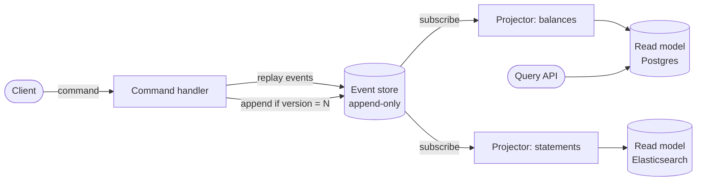

# Event Sourcing

## The problem it solves

A normal CRUD table stores only the current state. An `accounts` row says `balance = 420`, but not how it got there. When a customer disputes a charge, support asks "what was the balance on March 3rd, and which transaction changed it?" and the database can't answer, because every `UPDATE` overwrote the previous value. Teams bolt on audit tables, but those drift from the real data because they're written by separate code that someone eventually forgets to call.

Event sourcing flips the model: the **source of truth is an append-only log of events** (`Deposited 500`, `Withdrew 80`), and current state is derived by replaying them. History is never lost because nothing is ever overwritten.

## How it works

1. A command arrives (`Withdraw 80 from account 42`).
2. The service loads the aggregate's current state by replaying its events (or loading a snapshot plus later events).
3. It validates the command against that state (enough balance?).
4. If valid, it appends one or more new events to the event store with an **expected version** (optimistic concurrency). If another writer appended first, the append fails and the command is retried.
5. Projectors subscribe to the log and build **read models** (projections) shaped for queries: a balance table, a search index, a monthly statement.



Pseudocode for the write side:

```
def handle_withdraw(account_id, amount):
    events, version = store.load(account_id)
    state = fold(apply, Account.empty(), events)
    if state.balance < amount:
        raise InsufficientFunds
    store.append(account_id,
                 [Withdrew(amount)],
                 expected_version=version)   # fails on concurrent write
```

**Key pieces:**

- **Events are facts in the past tense** and immutable. To fix a mistake you append a compensating event (`DepositReversed`), not edit history.
- **Snapshots.** Replaying 50,000 events per request is slow, so periodically store the folded state at version N and replay only events after N.
- **Projections are disposable.** You can delete a read model and rebuild it from the log, or build a new one for a feature that didn't exist when the events were written.
- **CQRS** (command query responsibility segregation) usually comes along: writes go to the log, reads go to projections, and the two are eventually consistent.
- **Schema evolution.** Old events never change, so consumers must handle every version, often by "upcasting" old event shapes to the new one at read time.

## Worked example

Account 42, events in order:

| Version | Event | Balance after |
|---|---|---|
| 1 | `AccountOpened` | 0 |
| 2 | `Deposited 500` | 500 |
| 3 | `Withdrew 80` | 420 |
| 4 | `Withdrew 150` | 270 |
| 5 | `Deposited 60` | 330 |

Current balance: 0 + 500 − 80 − 150 + 60 = **330**. "What was the balance after version 3?" Replay events 1–3: **420**. That time-travel query is free.

Concurrency: two withdrawals of 300 arrive at the same time. Both load version 5 (balance 330) and both pass validation. The first appends at expected version 5 and succeeds, making version 6 (balance 30). The second's append at expected version 5 fails, it reloads, sees balance 30, and rejects the withdrawal. Without the version check both would succeed and the balance would go to −270.

With a snapshot every 100 events, an account with 10,250 events loads the snapshot at version 10,200 and replays 50 events instead of 10,250.

## Trade-offs

- **Pros:** complete audit trail for free; time-travel and debugging by replay; new read models can be built from old data; events naturally feed other services.
- **Cons:** more moving parts (store, projectors, snapshots); read models are eventually consistent, so a user may not see their own write immediately; event schema changes are permanent; "delete this user's data" (GDPR) is hard in an immutable log, often handled by encrypting personal data per user and deleting the key (crypto-shredding).
- **Alternatives:** a CRUD table plus an **audit/history table** written in the same transaction; **change data capture** on a normal database to get a change stream without making the log the source of truth; temporal tables in databases that support them.

## When to use it (and when not)

- **Use it** where history is the product or a legal requirement: ledgers, payment and wallet systems, order lifecycles, inventory, and collaborative documents. It shows up in "design a banking system", "design a payment system", and "design a stock exchange" (the order book is rebuilt by replaying the order log).
- **Not worth it** for simple CRUD where nobody asks about history (user profiles, settings), or when the team needs strong read-after-write everywhere and can't absorb CQRS complexity.

## In an interview

Say: "I'll make the ledger event-sourced: every balance change is an immutable event in an append-only log with per-account optimistic versioning, and balances are a projection we can rebuild at any time." Be ready to explain snapshots, how projections stay up to date, how you handle concurrent writes, and how you'd evolve event schemas.

## Common follow-up questions

### How do you prevent two writers from corrupting an aggregate?
Each append carries the version the writer last saw. The store accepts the append only if the aggregate is still at that version, so one writer wins and the other reloads and retries. This is optimistic concurrency, and it works because all events for one aggregate live in one ordered stream.

### How does a user see their own write if reads come from an eventually consistent projection?
Return the new state directly from the command handler, or return the event version and have the read API wait until the projection reaches that version. For a few critical screens you can also read by replaying the aggregate from the log.

### How do you change the shape of an event after it's been stored?
You never rewrite stored events. Add a version field, write new events in the new shape, and upcast old ones when reading. Sometimes a one-off migration copies the stream into a new stream with transformed events.

### What's the difference between event sourcing and change data capture?
In event sourcing the events are the source of truth and carry business meaning (`OrderShipped`). CDC derives row-level changes (`UPDATE orders SET status`) from a normal database's log after the fact. CDC is easier to adopt; event sourcing gives richer, intentional events.
