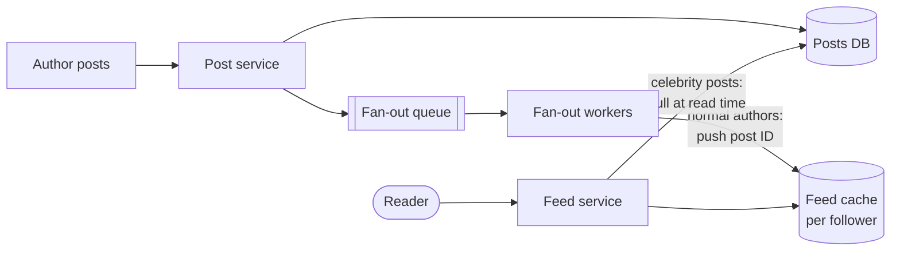

# Fan-out (Write vs Read)

## The problem it solves

A user opens their home timeline and expects the latest posts from the 300 accounts they follow, in under 200 ms. The naive approach queries posts from all 300 accounts, merges them by time and returns the top 50. Doing that on every refresh, for millions of users, means a huge number of multi-key queries, and latency grows with the number of accounts followed.

Fan-out is the choice of *when* you do that merging work: when a post is written (push it into every follower's precomputed feed) or when a feed is read (pull and merge on demand).

## How it works

**Fan-out on write (push).** When a user posts, a worker looks up their followers and inserts the post ID into each follower's feed list, typically a Redis list or sorted set capped at a few hundred entries. Reading a feed is then a single fast lookup.

**Fan-out on read (pull).** Store posts only once, by author. When a user opens their feed, fetch recent posts from each account they follow and merge them. Writes are cheap; reads do the work.

**Hybrid.** Push for normal accounts, pull for celebrities. At read time, merge the precomputed feed with recent posts from the few high-follower accounts the user follows. Twitter has publicly described using an approach like this for its home timeline.



Pseudocode for the hybrid:

```
on_post(author, post_id):
    save_post(author, post_id)
    if follower_count(author) < 100_000:
        for f in followers(author):              # done by async workers in batches
            ZADD feed:{f} post_ts post_id
            ZREMRANGEBYRANK feed:{f} 0 -801      # keep newest 800

get_feed(user):
    ids = ZREVRANGE feed:{user} 0 199
    for celeb in followed_celebrities(user):
        ids += recent_posts(celeb, limit=20)
    return hydrate(top_50_by_time(ids))
```

**Practical details.** Store post IDs in feeds, not full posts, and hydrate from a post cache, so edits and deletes don't need fan-out. Skip fan-out to inactive users and rebuild their feed on demand when they return. Fan-out runs asynchronously, so a new post appears in followers' feeds after a delay of seconds.

## Worked example

1,000 posts per second; the average author has 200 followers; 50,000 feed reads per second; users follow 300 accounts on average.

| Approach | Write work | Read work |
|---|---|---|
| Push only | 1,000 × 200 = 200,000 feed inserts/s | 50,000 single-key reads/s |
| Pull only | 1,000 post writes/s | 50,000 × 300 = 15M author lookups/s |
| Push, celebrity with 50M followers posts | One post = 50M inserts; at 100k inserts/s per worker pool that's 500 s to finish | |
| Hybrid (celebrities pulled) | ~200,000 inserts/s | 50,000 reads/s, each plus a handful of celebrity lookups |

Push makes reads cheap but a single celebrity post causes a burst of 50M writes and minutes of delay. Pull costs 15M lookups per second. The hybrid keeps both sides bounded.

## Trade-offs

- **Pros of push:** very fast, predictable reads; read path is simple.
- **Cons of push:** write amplification, especially for high-follower accounts; wasted work for inactive followers; feed storage for every user; delete and unfollow need cleanup or read-time filtering.
- **Pros of pull:** cheap writes; always fresh; no per-user feed storage.
- **Cons of pull:** slow, expensive reads that grow with the number of followed accounts.
- **Alternatives:** ranked feeds computed by an offline or nearline ranking pipeline; caching pull results for a short TTL; delivering via a pub/sub fan-out for real-time push notifications instead of stored feeds.

## When to use it (and when not)

- **Use push** when reads vastly outnumber writes and follower counts are bounded: news feeds, Instagram home feed for typical users, group chat message delivery to members' inboxes.
- **Use pull** for high-follower authors, rarely-read feeds, and search-like views where freshness matters.
- **Interview questions:** design Twitter, Instagram, Facebook news feed, a notification system (fan-out of one event to many devices), group chat in WhatsApp or Slack.
- **Not relevant** when each reader's view comes from one source, like a user's own profile page.

## In an interview

Say: "I'll fan out on write into per-user feed lists in Redis for normal accounts, and pull posts from accounts with more than ~100k followers at read time, merging them into the cached feed." Be ready to explain the write amplification math, how you handle celebrities and inactive users, and what happens on delete or unfollow.

## Common follow-up questions

### What happens when a post is deleted?
Feeds store only post IDs, so the post is marked deleted in the post store and the hydration step filters it out. You can also asynchronously remove it from feed lists, but read-time filtering is what guarantees it disappears.

### What happens when someone follows or unfollows an account?
On follow, backfill a few recent posts from that account into the follower's feed. On unfollow, filter that author at read time and optionally clean up the feed list in the background.

### How do you handle users who never log in?
Skip fan-out to users inactive for, say, 30 days, and let their feed cache expire. When they return, rebuild their feed with a pull-based query once, then resume push.

### Where does the threshold for celebrities come from?
It's a tuning choice based on how long fan-out takes and how much write load you can absorb. Pick the follower count where a single post's fan-out would take longer than your freshness target or create a noticeable spike, and revisit it with real metrics.
