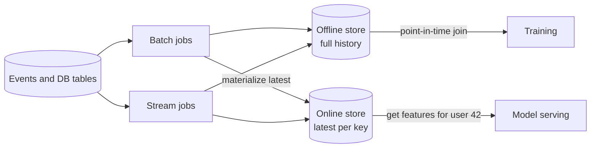

# Feature Store

## The problem it solves

A recommendation model uses a feature like "number of videos this user watched in the last 7 days." The data science team computes it in a Spark job over the warehouse for training. The serving team reimplements it in Java against a Redis counter so the model can use it at request time. The two implementations disagree slightly (one counts partial views, one uses UTC days, the other local days), and the model that scored well offline performs worse in production. This is **training-serving skew**, and it is one of the most common reasons ML models underperform after launch.

There's a second problem: **data leakage**. If you train on today's value of a feature for an event that happened three months ago, the model sees information from the future and looks better offline than it can ever be in production.

A feature store defines each feature once and serves the same values to both training and online inference.

## How it works

1. **Feature definitions.** A feature is defined once (source, transformation, entity key such as `user_id`, freshness) in a registry, versioned like code.
2. **Computation.** Batch pipelines (Spark, SQL) compute slow-changing features daily; streaming pipelines (Flink, Kafka Streams) compute fresh ones like "clicks in the last 5 minutes."
3. **Offline store.** Full history of feature values with timestamps, kept in a warehouse or data lake (Parquet, BigQuery, Snowflake). Used to build training sets.
4. **Online store.** Only the latest value per entity, in a low-latency key-value store (Redis, DynamoDB, Cassandra). Used at inference time with single-digit millisecond lookups.
5. **Point-in-time joins.** To build a training set, for each labeled event at time t, the store fetches the feature values as they were at or before t, never after.



A training-set query in pseudocode:

```
labels = [(user_id, event_ts, clicked), ...]
for each label:
    row = latest feature row WHERE entity = user_id AND feature_ts <= event_ts
```

Online lookup at request time:

```
features = online_store.get(entity="user:42",
                            features=["watch_count_7d", "avg_session_min", "country"])
score = model.predict(features + request_features)
```

Open-source Feast and platforms like Tecton, plus managed offerings in cloud ML platforms, follow this split between offline and online stores.

## Worked example

Training a click model with label events for user 42. The feature `watch_count_7d` was recomputed daily.

| Feature snapshot time | watch_count_7d |
|---|---|
| Mar 1 00:00 | 3 |
| Mar 2 00:00 | 5 |
| Mar 3 00:00 | 12 |

| Label event | Correct value (point-in-time) | Naive join on latest value |
|---|---|---|
| Mar 1 15:00, clicked = no | 3 | 12 (leaks the future) |
| Mar 2 09:00, clicked = yes | 5 | 12 (leaks the future) |

The naive join gives every historical event the value 12, which the model never actually sees at that point in production. The point-in-time join uses only values that existed when the event happened, so training matches serving.

## Trade-offs

- **Pros:** one definition for training and serving removes skew; features are reused across teams; point-in-time correctness prevents leakage; monitoring of freshness and drift in one place.
- **Cons:** another platform to run with two storage systems that must stay in sync; streaming features add operational complexity; online store cost grows with entities times features.
- **Alternatives:** compute features inline in the serving path from raw data (fine for a few simple features); log the exact features used at serving time and train on those logs, which avoids skew by construction but only for features you already serve.

## When to use it (and when not)

- **Use it** when several models share features, when models need fresh features at low latency, or when skew has already bitten you. Interview questions: design a recommendation system (news feed ranking, YouTube recommendations), fraud detection, ad click prediction, ETA prediction.
- **Not needed** for a single model with a handful of features computed from the request itself, or for purely batch scoring where training and scoring use the same offline pipeline.

## In an interview

Say: "I'll use a feature store so features are defined once: a stream job updates an online store in Redis for serving, and the offline store keeps timestamped history for point-in-time-correct training sets." Be ready to explain training-serving skew, point-in-time joins, and how fresh each feature needs to be.

## Common follow-up questions

### What is training-serving skew and how does a feature store prevent it?
It's when the feature values a model sees in production differ from those it was trained on, usually because two code paths compute them. A feature store runs one transformation and writes the results to both the offline and online stores, so both sides read the same numbers.

### How fresh do features need to be?
It depends on the feature. A user's country can be refreshed daily in batch, but fraud signals like "transactions in the last 10 minutes" need streaming updates within seconds. Classify features by freshness and only pay for streaming where it changes predictions.

### What happens if the online store is missing a value?
Serving falls back to a default (zero, a global average, or a "missing" indicator the model was trained with). The training data should include the same missing-value handling so the model has learned what a missing value means.

### Why not just query the warehouse at serving time?
Warehouse queries take seconds and aren't built for thousands of point lookups per second. The online store holds only the latest values keyed by entity, so a lookup takes milliseconds.
