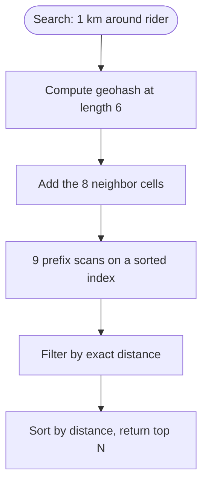

# Geohash

## The problem it solves

"Find drivers within 2 km of me" sounds like a simple query, but a normal database index sorts on one column. An index on latitude finds a thin horizontal band that wraps around the whole planet, and you still scan every row in that band to check longitude. With 1M drivers sending a location every 5 seconds (200k writes/s) and thousands of nearby searches per second, a two-column range query like `lat BETWEEN ... AND lng BETWEEN ...` is too slow.

A geohash turns a 2D point into a 1D string where **a shared prefix means nearby**, so an ordinary sorted index (a B-tree, a Redis sorted set) can answer proximity queries with prefix or range scans.

## How it works

1. Start with the longitude range [−180, 180]. If the point is in the upper half, write 1, otherwise 0, and keep that half.
2. Do the same for latitude [−90, 90].
3. Keep alternating (longitude bits in even positions, latitude bits in odd), halving the box each time. Each bit cuts the cell in half.
4. Group the bits 5 at a time and write each group as a base32 character from `0123456789bcdefghjkmnpqrstuvwxyz` (no a, i, l, o).

Each character adds 5 bits, so the cell shrinks about 32× per character:

| Geohash length | Cell size (approx.) | Typical use |
|---|---|---|
| 4 | 39 km × 20 km | Region |
| 5 | 4.9 km × 4.9 km | Neighborhood |
| 6 | 1.2 km × 0.6 km | Nearby drivers |
| 7 | 153 m × 153 m | Street block |

**Querying:** to find points within radius r, pick the precision whose cell is at least r wide, compute the target's geohash at that length, and scan for stored geohashes starting with it.

**The edge problem:** two points 10 m apart can sit on opposite sides of a cell border and share no prefix at all (the worst case is the equator or the prime meridian, where even the first character differs). So you always query the **target cell plus its 8 neighbors**, then filter candidates by exact distance (haversine).



```
cells = [gh] + neighbors(gh)                     # 9 cells
candidates = []
for c in cells:
    candidates += index.range_scan(c, c + "~")    # all keys with prefix c
return sorted(p for p in candidates if haversine(p, me) <= r)
```

Redis GEO does exactly this: `GEOADD` stores members in a sorted set whose score is a 52-bit interleaved geohash, and `GEOSEARCH ... BYRADIUS` runs the 9-cell lookup and distance filtering for you.

## Worked example

Encode San Francisco's center (lat 37.7749, lng −122.4194) to 2 characters (10 bits: 5 longitude, 5 latitude).

| Bit | Axis | Range before | Midpoint | Point is | Bit |
|---|---|---|---|---|---|
| 1 | lng | [−180, 180] | 0 | below | 0 |
| 2 | lat | [−90, 90] | 0 | above | 1 |
| 3 | lng | [−180, 0] | −90 | below | 0 |
| 4 | lat | [0, 90] | 45 | below | 0 |
| 5 | lng | [−180, −90] | −135 | above | 1 |
| 6 | lat | [0, 45] | 22.5 | above | 1 |
| 7 | lng | [−135, −90] | −112.5 | below | 0 |
| 8 | lat | [22.5, 45] | 33.75 | above | 1 |
| 9 | lng | [−135, −112.5] | −123.75 | above | 1 |
| 10 | lat | [33.75, 45] | 39.375 | below | 0 |

The bits are `01001 10110`. `01001` = 9 → `9`; `10110` = 22 → `q` (index 22 in the alphabet). So the point starts with **`9q`**, a cell 11.25° of longitude × 5.625° of latitude (roughly 1,000 km × 625 km at this latitude) covering much of California; continuing gives `9q8yy…`. Every restaurant in central San Francisco shares the prefix `9q8y`, so a prefix scan finds them together.

## Trade-offs

- **Pros:** works with any sorted key-value index (B-trees, Redis sorted sets, DynamoDB sort keys, Cassandra clustering columns); cheap updates, since moving a point is just rewriting one key; easy to shard by prefix.
- **Cons:** edge effects force 9-cell queries; cells are rectangles that get narrower toward the poles; fixed precision levels don't adapt to density (a cell in Manhattan may hold 10,000 points and one in Nevada none).
- **Alternatives:** **quadtrees** (adaptive cell sizes, better for uneven static data); **Google S2** (cells on a cube projected onto a sphere, ordered by a Hilbert curve, less distortion); **Uber H3** (hexagons with equidistant neighbors, good for heatmaps and surge pricing); **PostGIS R-tree/GiST indexes** for general shapes and polygons.

## When to use it (and when not)

- **Use it** for "nearby" searches over many frequently moving points: Uber/Lyft driver matching, food delivery couriers, Find My Friends, Tinder-style proximity. Also for Yelp-style search when you want a simple sorted-index solution.
- **Not ideal** for highly uneven density with strict "return the 20 closest" queries (a quadtree adapts better), for polygon queries like "which delivery zone contains this point" (use an R-tree or PostGIS), or when uniform neighbor distances matter (H3).

## In an interview

Say: "I'll store each driver's location in Redis GEO, which keys a sorted set by geohash; a nearby search looks up the target cell and its 8 neighbors and filters by exact distance, and updates are just one `GEOADD` overwrite." Be ready to explain how the bits interleave, why neighbors are needed, and how to pick the precision for a given radius.

## Common follow-up questions

### Why do you need to search the 8 neighboring cells?
A point near a cell border can be meters away from points in the next cell, which have a completely different prefix. Searching only the target cell would miss them. Querying the 3 × 3 block of cells guarantees coverage as long as the cell is at least as wide as the search radius.

### How do you choose the precision?
Pick the longest geohash whose cell is still at least as large as the search radius, so the 9-cell block covers the circle. For a 1 km radius, length 6 (1.2 km × 0.6 km) is too narrow in latitude, so length 5 is the safe choice, at the cost of more candidates to filter.

### How do you shard a geohash index?
By prefix, for example by the first 3–4 characters, or by city or region. Dense prefixes like Manhattan become hot shards, so split hot prefixes further or shard by a finer prefix in dense areas.

### What if the radius search returns too few results?
Expand: drop one character of precision (cells grow 32×) or widen the ring of neighbors, and query again. Apps like "nearest 20 restaurants" do this iteratively until they have enough candidates.
