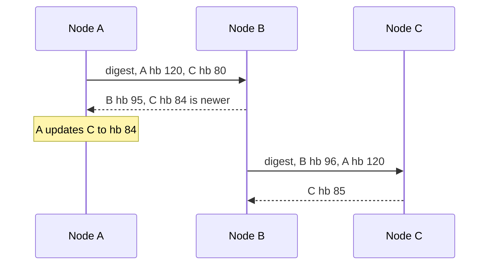

# Gossip Protocol

## The problem it solves

A cluster of 1,000 database nodes needs every node to know which other nodes are alive, what token ranges they own, and their current load. A central registry is a single point of failure and a bottleneck. All-to-all heartbeats mean each node sends 999 messages per interval, about 1 million messages per second across the cluster at one heartbeat per second, and that grows with N².

Gossip spreads information the way rumors spread: each node periodically talks to a few random peers and exchanges what it knows. Information reaches the whole cluster in a number of rounds that grows roughly with log N, and per-node load stays constant.

## How it works

1. **Each node keeps a membership table:** for every known node, a heartbeat counter (or version), status (alive, suspect, dead), and metadata such as address and token ranges.
2. **Every gossip interval** (e.g. one second), a node increments its own heartbeat counter and picks one or a few random peers.
3. **The two nodes exchange state.** For each entry, the higher heartbeat or version wins. Push, pull and push-pull variants exist; push-pull converges fastest.
4. **Failure detection.** If a node's heartbeat hasn't increased for a timeout, mark it suspect, then dead. Better detectors adapt to network conditions; the **phi accrual failure detector** (used by Cassandra and Akka) outputs a suspicion level based on the observed distribution of heartbeat arrival times instead of a fixed timeout.
5. **Dead entries are kept for a while** (as tombstones) so a stale node doesn't reintroduce a removed member.

**SWIM.** The SWIM protocol (used by HashiCorp's memberlist, which powers Consul and Serf) separates failure detection from dissemination. A node pings a random peer; if no reply, it asks k other nodes to ping it indirectly, which avoids false positives from one bad network path. Suspected nodes get a chance to refute the suspicion. Membership changes piggyback on ping messages.

**What gossip is used for:** membership and failure detection, spreading cluster metadata (token ownership, schema versions), and anti-entropy, where replicas compare data summaries (e.g. Merkle trees) and repair differences.

**Properties:** decentralized and fault tolerant, since any node can fail and gossip continues; eventually consistent, since different nodes can briefly disagree about membership; bandwidth per node is constant regardless of cluster size.

## Worked example

1,000 nodes; each node gossips with one random peer per second using push. Node 1 learns that node 500 has died.

| Round (seconds) | Nodes that know (approx.) |
|---|---|
| 0 | 1 |
| 1 | 2 |
| 2 | 4 |
| 5 | ~31 |
| 8 | ~215 (doubling slows as more peers already know) |
| 10 | ~560 |
| 12 | ~880 |
| 15 | ~990 |

Early rounds roughly double the informed set; later rounds slow because many messages go to nodes that already know. Spread time is O(log N), so a 10,000-node cluster needs only a few more rounds. Compare message cost: all-to-all heartbeating is 1,000 × 999 ≈ 1M messages per second; gossip is about 1,000 messages per second.

## Trade-offs

- **Pros:** no single point of failure; scales to thousands of nodes; constant per-node load; robust to message loss because information arrives by many paths.
- **Cons:** eventual, probabilistic convergence (seconds, not instant); nodes temporarily disagree about membership; hard to debug; failure detection has a trade-off between speed and false positives; not suitable for decisions that need agreement.
- **Alternatives:** a central coordination service (ZooKeeper, etcd) with ephemeral nodes or leases, which gives a single consistent view of membership but needs a strongly consistent cluster; simple heartbeats to a monitor, fine for small clusters.

## When to use it (and when not)

- **Use it** for membership and failure detection in large peer-to-peer clusters (Cassandra, Consul, Serf, ScyllaDB), spreading low-stakes metadata, and anti-entropy between replicas. Interview questions: design a distributed key-value store (Dynamo-style), design a distributed cache, design a service discovery system.
- **Don't use it** when you need a single agreed answer, like choosing one leader or committing a configuration change. Gossip can tell everyone that a node seems dead, but deciding who takes over its role needs consensus.

## In an interview

Say: "Nodes discover each other and detect failures with gossip: every second each node exchanges heartbeat tables with a random peer, so news reaches all nodes in O(log N) rounds without a central registry." Be ready to explain convergence time, how failure detection avoids false positives, and why leader election still needs consensus.

## Common follow-up questions

### How does a new node join?
It's configured with a few seed nodes, contacts one, and receives the current membership table. Its own entry then spreads through normal gossip rounds.

### How do you avoid declaring a slow node dead?
Use an adaptive detector like phi accrual, or SWIM's indirect pings through other nodes plus a suspicion phase in which the node can refute the claim. False positives still happen under heavy load, so the system should tolerate a node being marked dead and coming back.

### Can gossip guarantee every node gets an update?
Not deterministically, but the probability of a node being missed drops very quickly with each round. Periodic full-state exchange and anti-entropy catch anything that slipped through.

### How is gossip different from consensus?
Gossip spreads information and converges eventually, with no guarantee that nodes agree at any instant. Consensus (Raft, Paxos) makes a majority agree on one value before it's considered decided, which is slower but safe for leadership and configuration.
