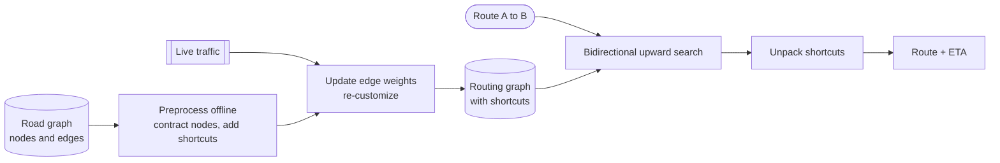

# Graph Routing

## The problem it solves

A maps app must answer "fastest route from here to the airport" in well under a second. A road network is a graph: intersections are nodes, road segments are edges weighted by travel time. A continental network has tens of millions of nodes. Plain Dijkstra on a cross-country query can settle a large fraction of all those nodes, which takes on the order of seconds per query. Multiply by millions of users and live traffic changes, and naive search isn't viable.

Graph routing algorithms find shortest paths, from simple BFS for unweighted graphs up to preprocessing techniques like contraction hierarchies that answer continental queries in milliseconds.

## How it works

**BFS (unweighted graphs).** Explore level by level with a queue. The first time you reach a node, you've found a path with the fewest edges. O(V + E). Used for "degrees of separation" in a social graph or the fewest hops in a network.

**Dijkstra (non-negative weights).** Keep a tentative distance for every node (∞ except the source at 0) and a min-heap of nodes keyed by distance.

1. Pop the node u with the smallest tentative distance. Its distance is now final ("settled").
2. For each edge u → v with weight w, if dist[u] + w < dist[v], update dist[v], record u as v's predecessor and push v.
3. Repeat until the target is popped. Follow predecessors back to get the path.

O((V + E) log V) with a binary heap. It requires non-negative weights: a settled node is final only because no later path can get shorter.

```
def dijkstra(graph, src, dst):
    dist = {src: 0}; prev = {}; pq = [(0, src)]
    while pq:
        d, u = heappop(pq)
        if u == dst: break
        if d > dist[u]: continue                # stale heap entry
        for v, w in graph[u]:
            if d + w < dist.get(v, inf):
                dist[v] = d + w; prev[v] = u
                heappush(pq, (d + w, v))
    return dist[dst], path_from(prev, dst)
```

**A\* (goal-directed).** Dijkstra expands in a circle around the source. A\* orders the heap by `dist[u] + h(u)`, where h is a **heuristic** estimate of the remaining distance, such as straight-line distance divided by the maximum speed. If h never overestimates (it's *admissible*), A\* still finds the optimal path, while exploring a narrow ellipse toward the target instead of a full circle.

**Contraction hierarchies (CH).** A preprocessing technique that makes queries extremely fast on road networks:

1. **Preprocess:** rank nodes by "importance" (minor residential streets low, highway junctions high). Contract nodes from least to most important: remove a node, and wherever the shortest path between two of its neighbors went through it, add a **shortcut** edge with the combined weight.
2. **Query:** run a bidirectional Dijkstra where both searches only move to **higher-ranked** nodes. They meet near the top of the hierarchy (on the highways), and each settles only hundreds of nodes instead of millions.
3. **Unpack** shortcuts back into real road segments to draw the route.



Plain CH needs re-preprocessing when weights change. **Customizable** variants (customizable route planning, customizable contraction hierarchies) split preprocessing into a slow topology phase and a fast weight phase that can be re-run in seconds when traffic changes.

## Worked example

Dijkstra from A to E on this graph (undirected, weights in minutes): A–B 4, A–C 2, C–B 1, B–D 5, C–D 8, C–E 10, D–E 2.

| Step | Pop (settle) | A | B | C | D | E | What changed |
|---|---|---|---|---|---|---|---|
| 0 | | 0 | ∞ | ∞ | ∞ | ∞ | start |
| 1 | A (0) | 0 | 4 | 2 | ∞ | ∞ | B = 0 + 4, C = 0 + 2 |
| 2 | C (2) | 0 | **3** | 2 | 10 | 12 | B via C = 2 + 1 = 3 beats 4; D = 2 + 8; E = 2 + 10 |
| 3 | B (3) | 0 | 3 | 2 | **8** | 12 | D via B = 3 + 5 = 8 beats 10 |
| 4 | D (8) | 0 | 3 | 2 | 8 | **10** | E via D = 8 + 2 = 10 beats 12 |
| 5 | E (10) | | | | | | target settled, stop |

Shortest path: A → C → B → D → E = 2 + 1 + 5 + 2 = **10 minutes**. The direct-looking route A → C → E costs 12, and A → B costs 4 directly but only 3 via C. Each "beats" shows Dijkstra correcting an earlier tentative distance before settling it.

## Trade-offs

| Algorithm | Preprocessing | Query cost | Handles live weight changes |
|---|---|---|---|
| BFS | None | O(V + E) | Unweighted only |
| Dijkstra | None | Settles everything closer than the target | Yes, trivially |
| A\* | None | Fewer nodes, depends on heuristic quality | Yes |
| Contraction hierarchies | Minutes to hours | Hundreds of nodes, around a millisecond | Needs re-customization |

- Dijkstra and A\* are simple and always current but too slow for long continental queries at scale.
- CH is fast but needs preprocessing and extra memory for shortcuts; traffic updates require a customizable variant.
- **Negative weights** (rare in routing) need Bellman-Ford, O(V × E).
- Other options: **ALT** (A\* with landmark-based heuristics), **transit node routing**, and partitioning the map into regions with precomputed boundary-to-boundary distances.

## When to use it (and when not)

- **Use it** in "design Google Maps", Uber/Lyft ETA and routing, delivery route planning, network packet routing (OSPF uses Dijkstra), and "degrees of separation" on LinkedIn (BFS, often bidirectional).
- **Not the whole answer** for multi-stop delivery optimization (that's the traveling salesman / vehicle routing problem, solved with heuristics) or for friend recommendations, which use graph features and ranking rather than shortest paths.

## In an interview

Say: "Routing runs bidirectional search over a contraction hierarchy of the road graph, so a cross-country query settles a few hundred nodes instead of millions; edge weights come from live traffic and we re-customize the weights every few minutes without redoing the full preprocessing." Be ready to walk through Dijkstra on a small graph, explain why A\*'s heuristic must not overestimate, and describe what a shortcut is.

## Common follow-up questions

### Why doesn't Dijkstra work with negative edge weights?
Dijkstra treats a popped node's distance as final because any other path must go through nodes with larger distances and can only add more. A negative edge breaks that, since a longer path could later become shorter. Bellman-Ford handles negative weights at a higher cost.

### What makes a good A\* heuristic for road routing?
Straight-line distance divided by the highest possible speed never overestimates travel time, so it's admissible and A\* stays optimal. It's weak on winding road networks, so landmark-based heuristics (ALT), which use precomputed distances to a few landmark nodes and the triangle inequality, give much tighter estimates.

### How do you account for live traffic?
Edge weights become current travel times computed from GPS probes of drivers. With customizable route planning or customizable CH, the expensive structure depends only on the road topology, and new weights are applied in a quick customization pass every few minutes.

### How do you scale routing for millions of queries?
The preprocessed graph is read-only between updates, so replicate it across many routing servers, each holding the graph in memory, and load balance queries. Partition by region for very large maps, and cache popular routes such as airport to downtown.
