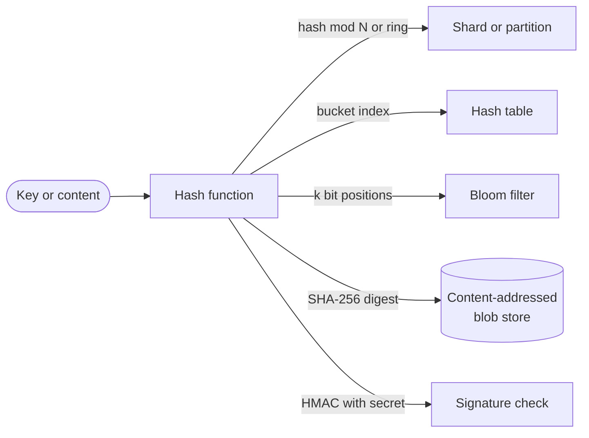

# Hashing

## The problem it solves

Many system design problems need to turn an arbitrary key into a fixed-size number quickly: which shard holds `user:8812`? Have we already stored this 2 GB file? Was this message tampered with in transit? Is this URL already in the crawler's seen set? Comparing whole values is slow and storing them all is expensive. A store with 1 billion files can't compare each new upload byte by byte against every existing file.

A **hash function** maps input of any size to a fixed-size output (a hash or digest) deterministically: same input, same output, every time. A good one spreads outputs uniformly, so it can be used for lookup, partitioning, deduplication and integrity checks. Picking the right kind of hash for each job is the important design skill.

## How it works

**Two families with different goals:**

| | Non-cryptographic | Cryptographic |
|---|---|---|
| Examples | MurmurHash3, xxHash, CityHash, FNV, CRC32 (checksum) | SHA-256, SHA-3, BLAKE2/BLAKE3 |
| Goal | Speed and good distribution | Infeasible to find collisions or reverse the hash |
| Speed | Very fast, often several GB/s per core | Slower, though BLAKE3 and hardware-accelerated SHA-256 are fast |
| Safe against an attacker choosing inputs? | No: collisions can be constructed | Yes, for unbroken algorithms |
| Typical uses | Hash tables, sharding, Bloom filters, consistent hashing, in-memory dedup | Content addressing, file dedup across users, signatures, integrity, HMAC |

**MD5 and SHA-1 are broken for collision resistance** (practical collisions have been demonstrated), so don't use them where an attacker could benefit from a collision. They still appear as fast non-security checksums.

**Passwords need a third kind:** deliberately slow, salted **password hashing** functions such as bcrypt, scrypt or Argon2. A fast hash like SHA-256 lets an attacker with a stolen database try billions of guesses per second on GPUs; a slow, memory-hard function with a unique salt per user makes that far more expensive and defeats precomputed tables.

**Keyed hashes:**

- **HMAC** (e.g. HMAC-SHA256) proves a message came from someone holding a secret key; used for webhook signatures and signed tokens.
- **SipHash** is a fast keyed hash used by several languages' hash tables to resist **hash flooding**, where an attacker sends keys that all collide and turn O(1) lookups into O(n).

**Common uses in system design:**

- **Partitioning:** `shard = hash(user_id) mod N`, or consistent hashing to limit movement on resize. Use a stable hash (not a language's randomized built-in hash) so every service computes the same shard.
- **Deduplication and content addressing:** store files by `SHA-256(content)`; identical uploads map to the same key and are stored once. Git and many backup tools address content by hash.
- **Integrity:** compare checksums after transfer; CRC32 catches accidental corruption, cryptographic hashes catch tampering.
- **Probabilistic structures:** Bloom filters, Count-Min Sketch and HyperLogLog all rely on fast, well-distributed hashes.
- **Short IDs:** hash a long URL and take the first few characters, then handle collisions (see base62).

**Collisions.** Any hash with a fixed output size has collisions, since there are more inputs than outputs. The **birthday bound** says that with n items and a b-bit hash, the chance of any collision is about `n² / 2^(b+1)`, and collisions become likely around `n ≈ 2^(b/2)`. Hash tables handle collisions by chaining or probing; systems using hashes as IDs must either use enough bits to make collisions negligible or detect and resolve them.

## Worked example

Approximate collision probability, `p ≈ n² / 2^(b+1)`:

| Hash size | Items (n) | Calculation | Chance of at least one collision |
|---|---|---|---|
| 32 bits | 77,000 | n² / 2^33 ≈ 0.69, too big for the shortcut, so use 1 − e^(−0.69) | about 50% |
| 32 bits | 1,000,000 | far above 2^16 | essentially certain |
| 64 bits | 1,000,000,000 | 10^18 / 2^65 ≈ 10^18 / 3.69 × 10^19 | about 2.7% |
| 128 bits | 1,000,000,000 | 10^18 / 2^129 | about 1.5 × 10^-21, negligible |
| 256 bits (SHA-256) | 10^15 | 10^30 / 2^257 | negligible |

So a 32-bit hash can't be a unique ID for a million users, a 64-bit hash is risky as a unique ID at a billion items, and a 128-bit or larger hash is safe for content addressing.

Partitioning check: four shards, `shard = hash mod 4`. Keys with hashes 17, 42, 8 and 31 land on shards 1, 2, 0 and 3. With a good hash, 10 million users split close to 2.5 million per shard.

## Trade-offs

- **Pros:** O(1) lookup and partitioning; fixed-size fingerprints for comparing large content; integrity and authenticity checks; foundations for Bloom filters, sketches and consistent hashing.
- **Cons:** collisions always exist and must be planned for; non-cryptographic hashes are exploitable when attackers control input; hashing destroys order, so range queries over hashed keys need a scatter-gather; changing the hash function later means remapping every key.
- **Alternatives:** **range partitioning** when you need ordered scans; **sequential or Snowflake IDs** when you need unique IDs (guaranteed unique, unlike hashes); **direct comparison** when data is small.

## When to use it (and when not)

- **Use it** for sharding keys ("design a key-value store", "design a distributed cache"), file dedup ("design Dropbox"), URL dedup in "design a web crawler", short code generation in "design a URL shortener", signed webhooks and tokens, password storage, and Bloom filters.
- **Avoid** fast hashes for passwords, non-cryptographic hashes where attackers choose inputs, and truncated hashes as unique IDs without collision handling.

## In an interview

Say: "I'll shard by a stable non-cryptographic hash of the user ID like xxHash or Murmur, dedupe uploaded blocks by SHA-256, and store passwords with Argon2 and a per-user salt." Be ready to explain the difference between hash families, the birthday bound, and how you'd detect and resolve collisions.

## Common follow-up questions

### Why not use SHA-256 for password storage?
SHA-256 is designed to be fast, so an attacker with a stolen hash database can test billions of guesses per second. Password hashing functions like Argon2 or bcrypt are tunably slow and memory-hard, and a unique salt per user stops precomputed tables and identical passwords sharing a hash.

### How likely is a collision with a 64-bit hash?
By the birthday bound, collisions become likely around 2^32, about 4 billion items, and at 1 billion items the chance is already a few percent. For unique identifiers at that scale use 128 bits or more, or check for collisions on insert.

### Why can't you use a language's built-in hash for sharding?
Many runtimes randomize their built-in string hash per process to resist hash flooding, so different servers would compute different shards for the same key. Use an explicit, stable algorithm such as Murmur3 or xxHash with a fixed seed.

### What is hash flooding?
An attacker sends many keys crafted to collide in a server's hash table, degrading lookups from O(1) to O(n) and burning CPU. Keyed hashes like SipHash with a secret per-process key make such collisions impossible to predict.
