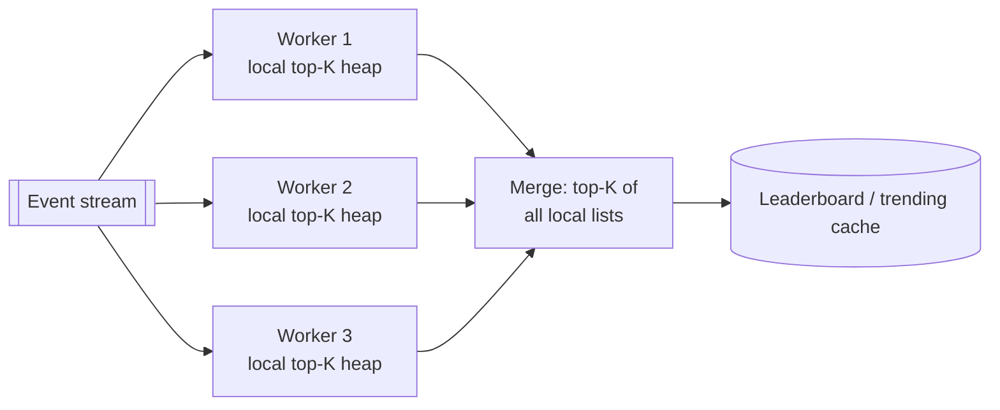

# Heap / Top-K

## The problem it solves

You need the 100 most-viewed videos out of 1B view events today, or the 10 closest drivers out of 5,000 candidates, or the next job to run out of a million scheduled ones. Sorting everything costs O(n log n) time and holds all n items in memory, just to keep 100 of them. Repeatedly scanning for the maximum costs O(n) per query. In a stream, you can't sort at all, because the data never ends.

A heap keeps the smallest (or largest) element available in O(1), with O(log n) inserts and removals. A **min-heap of size K** finds the top K of a stream in O(n log K) time and O(K) memory.

## How it works

**Binary heap.** A complete binary tree stored in an array, where every parent is ≤ its children (min-heap). For the node at index i, the children are at 2i + 1 and 2i + 2 and the parent is at (i − 1) / 2, so there are no pointers.

- **Peek:** the minimum is always at index 0. O(1).
- **Push:** append at the end, then **sift up**: swap with the parent while smaller than the parent. O(log n).
- **Pop:** take index 0, move the last element to index 0, then **sift down**: swap with the smaller child while larger than it. O(log n).
- **Heapify:** build a heap from n items in O(n) by sifting down from the last parent to the root.

```
def push(h, x):
    h.append(x); i = len(h) - 1
    while i > 0 and h[(i - 1) // 2] > h[i]:
        h[i], h[(i - 1) // 2] = h[(i - 1) // 2], h[i]
        i = (i - 1) // 2
```

**Top-K with a min-heap (the counterintuitive part).** To keep the K *largest*, use a *min*-heap of size K. Its root is the smallest of your current top K, the "bar to beat". Each new item is compared with the root: if it's bigger, replace the root and sift down; otherwise discard it.

```
def top_k(stream, k):
    h = []
    for x in stream:
        if len(h) < k:
            heappush(h, x)
        elif x > h[0]:
            heapreplace(h, x)        # pop min, push x, one sift-down
    return sorted(h, reverse=True)
```

Each item costs at most O(log K), and memory stays at K regardless of stream length.



**Distributed top-K:** partition the stream **by item key** so each item's full count lives on one worker; each worker keeps a local top-K, and a merger takes the top K of the combined W × K candidates. Partitioning by key matters: if counts for one item were split across workers, a globally popular item could fall short of every local top-K.

## Worked example

Find the top 3 of the stream 5, 1, 8, 3, 9, 2, 7 with a size-3 min-heap.

| Item | Action | Heap (min first) | Root = bar to beat |
|---|---|---|---|
| 5 | heap not full, push | [5] | 5 |
| 1 | push | [1, 5] | 1 |
| 8 | push | [1, 5, 8] | 1 |
| 3 | 3 > 1, replace root | [3, 5, 8] | 3 |
| 9 | 9 > 3, replace root | [5, 8, 9] | 5 |
| 2 | 2 < 5, discard | [5, 8, 9] | 5 |
| 7 | 7 > 5, replace root | [7, 8, 9] | 7 |

Result: 9, 8, 7. At scale, top 100 of 1B events costs at most about 1B × log₂ 100 ≈ 1B × 7 = 7B comparisons, and in practice far fewer because most items fail the first comparison with the root. Sorting would need about 1B × log₂ 1B ≈ 30B comparisons and memory for all 1B items.

## Trade-offs

- **Pros:** O(1) access to the min or max; O(log n) updates; compact array storage; top-K in O(K) memory over unbounded streams.
- **Cons:** no fast search for arbitrary elements (O(n)); changing an item's priority needs an index map from item to position (an "indexed heap"); only partially ordered, so returning all K sorted costs an extra O(K log K).
- **Alternatives:** **quickselect** for a one-off top-K on an in-memory array (O(n) average); **Redis sorted sets** (a skip list ordered by score, with `ZINCRBY` and `ZREVRANGE` for live leaderboards that support updates and rank queries); **balanced BSTs** when you need ordered iteration and deletes; **count-min sketch + heap** when exact counts don't fit in memory.

## When to use it (and when not)

- **Use it** for top-K questions (trending hashtags, most-played songs, top-K heavy hitters), k-nearest results (closest drivers after a geo query), schedulers and timers (job scheduler, delayed queues: the next due item is the root), merging K sorted streams (log merging, LSM compaction), and Dijkstra's priority queue.
- **Not the right tool** for leaderboards where scores change constantly and users ask "what's my rank?" (use a Redis sorted set), or when you need lookups by key.

## In an interview

Say: "Each counting worker owns a partition of video IDs and keeps a min-heap of its top 100; the root is the score to beat, so most events are discarded in one comparison, and a merger combines the per-partition lists every minute." Be ready to explain why it's a min-heap for top-K largest, the O(n log K) cost, and why the stream must be partitioned by key.

## Common follow-up questions

### Why a min-heap to find the largest K?
You need to quickly find and evict the weakest member of your current top K whenever a better item arrives. The min-heap's root is exactly that weakest member, available in O(1). A max-heap would need all n items to pop the top K.

### How would you do top-K over a sliding window, such as the last hour?
Keep counts per small time bucket (e.g. per minute) per item, add the newest bucket and subtract the expired one, then recompute top-K from the updated counts periodically. Heaps don't support efficient arbitrary decrements, so recomputing from counts every few seconds is simpler than updating the heap in place.

### How does a heap help merge K sorted lists?
Put the first element of each list into a min-heap along with its list ID. Pop the smallest, output it, and push the next element from the same list. Each output costs O(log K), so merging N total elements is O(N log K).

### When would you use a Redis sorted set instead?
When scores change in place and you need rank queries, like a game leaderboard with "what's my rank?". A sorted set supports `ZINCRBY`, `ZRANK` and range reads in O(log n), and it's shared across servers.
