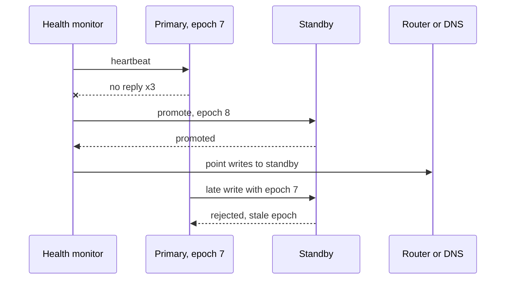

# High Availability & DR

## The problem it solves

Hardware fails, deploys go wrong, a whole availability zone loses power, and occasionally someone runs `DROP TABLE` in production. **High availability (HA)** keeps the system serving through the common failures (a node, a disk, a zone) with little or no human action. **Disaster recovery (DR)** is the plan for the rare, large failures (a region outage, data corruption, ransomware) where you restore service from somewhere else, accepting some downtime and maybe some data loss.

Both are about making explicit, costed choices: how much downtime and data loss can the business tolerate, and how much will you pay to reduce them?

## How it works

**Availability math.** Availability = uptime / total time, usually stated in "nines":

| Availability | Downtime per year | Downtime per 30 days |
|---|---|---|
| 99% | 3.65 days | 7.2 hours |
| 99.9% | 8.76 hours | 43.2 minutes |
| 99.99% | 52.6 minutes | 4.32 minutes |
| 99.999% | 5.26 minutes | 25.9 seconds |

- **Serial components** (a request needs *all* of them) multiply: A = A₁ × A₂ × … Three 99.9% services in a chain give 0.999³ ≈ 99.7%. Every hard dependency lowers your ceiling.
- **Parallel redundant components** (any one is enough) fail only if all fail: A = 1 − (1 − A₁)(1 − A₂)… Two independent 99% replicas give 1 − 0.01² = 99.99%. The catch is *independent*: two replicas on the same rack, power feed or bad config fail together.

**Find and remove single points of failure (SPOFs).** Walk the request path and ask "what if this one thing dies?": the load balancer, the primary database, a single NAT gateway, DNS, a config service, a certificate that expires, one person who knows how to deploy. Fix each with redundancy, automatic failover, or by making the component non-critical.

**Active-passive vs active-active.**

- **Active-passive:** one primary serves traffic; a standby receives replicated data and takes over on failure. Simple consistency (one writer), but failover takes time and the standby's capacity sits idle.
- **Active-active:** all sites serve traffic. No failover delay and no idle capacity, but concurrent writes in multiple places need conflict handling (partitioning users by home region, last-writer-wins, CRDTs) or a consensus-based database. See the **replication** and **consistency** concepts.

**Failover and split-brain.** Failover = detect failure, pick a new primary, redirect traffic. The danger is **split-brain**: a network partition makes the standby think the primary is dead, both accept writes, and the data diverges. Prevent it with a quorum (majority vote, see **leader election** and **quorum**), **fencing tokens** (a monotonically increasing epoch so storage rejects writes from the old leader), or STONITH-style fencing that cuts the old primary off. Kafka's controller and partition-leader epochs are an example of the epoch approach.

**Multi-AZ vs multi-region.**

| | Multi-AZ | Multi-region |
|---|---|---|
| Protects against | Node, rack, data-center failure | Region-wide outage, regional disaster |
| Latency between sites | ~1–2 ms | Tens to 100+ ms |
| Synchronous replication | Practical | Usually too slow for writes |
| Cost | Moderate (cross-AZ data transfer, ~2–3× instances) | High (duplicate stacks, cross-region egress, complexity) |

Multi-AZ is the default for anything production. A Kafka cluster typically spreads brokers across three AZs with replication factor 3, `min.insync.replicas=2` and rack awareness, so losing one AZ loses no acknowledged data. Multi-region usually means asynchronous replication (e.g. MirrorMaker 2 or a vendor's cluster linking) with a non-zero RPO.

**Replication is not a backup.** Replication copies *every* change, including the bad ones: a buggy migration or an accidental delete is faithfully replicated to every replica within milliseconds. Backups are **point-in-time** copies kept separately (ideally in another account, immutable) so you can go back to before the mistake. You need both. A backup you have never restored is a hope, not a backup.

**RPO and RTO.**

- **RPO (Recovery Point Objective):** how much data you can lose, measured in time. "RPO 5 minutes" means at most the last 5 minutes of writes may vanish.
- **RTO (Recovery Time Objective):** how long until service is back.

**DR tiers**, from cheapest to most expensive:

| Tier | Second site has | Typical RTO | Typical RPO |
|---|---|---|---|
| Backup and restore | Only backups | Hours to a day | Hours (since last backup) |
| Pilot light | Replicated data, core infra off or minimal | Tens of minutes to hours | Minutes |
| Warm standby | A scaled-down full copy, running | Minutes | Seconds to minutes |
| Active-active | Full capacity, serving traffic | Near zero | Near zero to seconds |

## Worked example

A 2 TB Postgres database for an order system.

**Option 1: nightly snapshot to object storage.** Worst case, the disaster happens just before the next snapshot, so **RPO ≈ 24 hours**. Restore speed is 200 MB/s: 2 TB = 2,000,000 MB, / 200 MB/s = 10,000 s ≈ **2.8 hours**, plus provisioning, verification and DNS changes, so RTO ≈ 4 hours.

**Option 2: add continuous WAL archiving every 1 minute.** Now you can restore the snapshot and replay WAL to any point, so **RPO ≈ 1 minute**. RTO grows a bit with replay time: if the day's WAL is 100 GB at 100 MB/s, that's 1,000 s ≈ 17 minutes more.

**Option 3: warm standby replica in another region, async replication.** Replication lag is usually ~1 s, so **RPO ≈ seconds**. Failover (promote, repoint) takes ~5–15 minutes with a runbook, or ~1 minute automated. You still keep option 2 for corruption, because the replica will have replicated the corruption too.

Availability check for the whole path: load balancer 99.99% × app tier (3 instances, each 99.5%, any one sufficient: 1 − 0.005³ ≈ 99.99999%) × database 99.95% ≈ 0.9999 × 0.9999999 × 0.9995 ≈ **99.94%**. The database is the weakest link, so that is where HA money goes first.

## Trade-offs

- **More nines cost exponentially more.** Each extra nine roughly needs another layer of redundancy, automation and testing.
- **Synchronous replication** gives RPO = 0 but adds write latency and can block writes if the replica is unreachable. **Asynchronous** is fast but loses the in-flight tail on failover.
- **Active-active** removes failover time but forces conflict resolution and makes every change harder to reason about.
- **Automatic failover** cuts RTO but risks flapping and false failovers; **manual failover** is safer but slower and needs someone awake.
- **Redundancy adds complexity**, and complexity causes outages. Many big incidents are triggered by the failover machinery itself.

## When to use it (and when not)

- **Use multi-AZ** for essentially every production stateful system. **Use multi-region** when the business needs to survive a region outage (payments, core platform infrastructure, regulated workloads) or to serve users with low latency globally.
- **Don't** build active-active multi-region for an internal tool whose users can wait an hour. Match RPO/RTO to business impact: a 99.9% target with 4-hour DR is often perfectly right.

## In an interview

State the targets first: "I'll aim for 99.95% availability, RPO under a minute and RTO under 15 minutes." Then: "Everything is spread across three AZs; Kafka uses replication factor 3 with min ISR 2 and acks=all, so an AZ loss loses no acknowledged writes. We replicate asynchronously to a warm standby region, take point-in-time backups to a separate account because replication isn't a backup, and run quarterly game days to test failover." Mention split-brain and how you fence the old primary.

## Common follow-up questions

### Why is replication not a backup?
Replication propagates every change, including deletes, bugs and corruption, to all copies almost immediately. A backup is an older, independent point-in-time copy you can roll back to. You need replication for availability and backups for recoverability.

### How do you prevent split-brain during failover?
Require a majority quorum to elect a leader, so a minority partition can't promote itself, and use fencing: each leader gets a higher epoch or token, and storage or followers reject writes carrying an older one.

### What's the difference between RPO and RTO?
RPO is how much recent data you can lose (time since the last safe copy). RTO is how long the service can be down. Backups every hour give RPO ≤ 1 hour regardless of how fast you restore; restore speed determines RTO.

### What is a game day?
A planned exercise where you deliberately inject failures in production or a production-like environment (kill a broker, black-hole an AZ, fail over a region) to verify that alerts fire, automation works and runbooks are correct. It turns DR plans into tested procedures and is a core part of chaos engineering.

### How would you make a Kafka-based pipeline survive a region loss?
Replicate topics asynchronously to a second region's cluster, keep consumer offsets translated or synced so consumers can resume near where they left off, and make consumers idempotent because some messages will be reprocessed. Accept an RPO equal to replication lag, and practice failing producers and consumers over.
