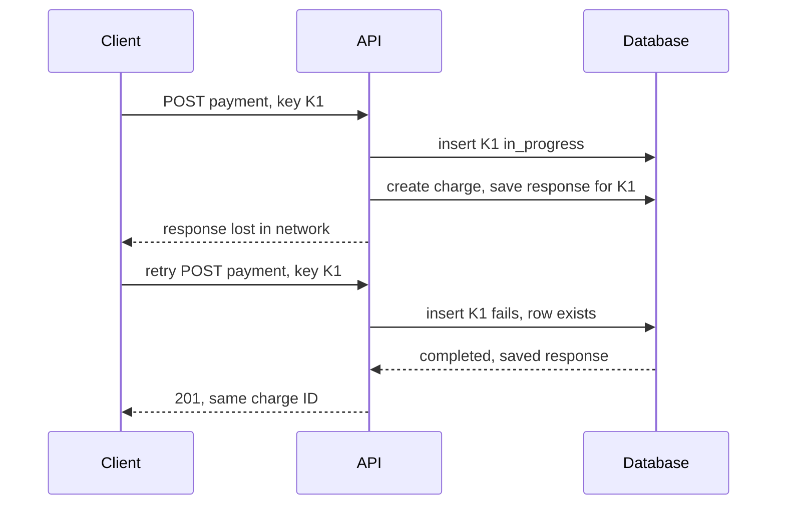

# Idempotency

## The problem it solves

A mobile app sends `POST /payments` to charge $40. The server charges the card, but the response is lost when the phone switches from Wi-Fi to cellular. The app sees a timeout and does the sensible thing: it retries. The customer is charged $80. Every distributed system has this ambiguity: after a timeout, the client can't tell whether the request never arrived, failed, or succeeded with a lost reply. Message queues add the same problem from the other side, because at-least-once delivery means consumers will see some messages twice.

An operation is idempotent if doing it twice has the same effect as doing it once. Making operations idempotent turns "retry on any failure" from dangerous into safe.

## How it works

**Naturally idempotent operations.** `PUT /users/42 {email: ...}` (set to a value), `DELETE /items/9`, and `UPDATE ... SET status = 'shipped'` give the same result when repeated. `POST` that creates something, "increment by 1," and "charge $40" do not.

**Idempotency keys.** For non-idempotent operations, the client generates a unique key (a UUID) per logical operation and sends it with every attempt, including retries:

```
POST /v1/payments
Idempotency-Key: 6f1c2a9e-3b7d-4e51-9a0f-2d8c4b7e1a33
{"amount_cents": 4000, "card": "card_123"}
```

The server stores the key with the request's outcome:

```sql
CREATE TABLE idempotency_keys (
  key            TEXT        NOT NULL,
  client_id      TEXT        NOT NULL,      -- scope keys per API client
  request_hash   TEXT        NOT NULL,      -- detect same key, different body
  status         TEXT        NOT NULL,      -- 'in_progress' | 'completed'
  response_code  INT,
  response_body  JSONB,
  created_at     TIMESTAMPTZ NOT NULL DEFAULT now(),
  PRIMARY KEY (client_id, key)
);
-- expire rows after e.g. 24 hours with a cleanup job
```

Request handling:

```
on request(client, key, body):
    inserted = INSERT INTO idempotency_keys (key, client_id, request_hash, status)
               VALUES (key, client, hash(body), 'in_progress')
               ON CONFLICT DO NOTHING
    if not inserted:
        row = SELECT ... WHERE client_id = client AND key = key
        if row.request_hash != hash(body): return 422   # key reused for a different request
        if row.status == 'in_progress':     return 409   # original still running, retry later
        return row.response_code, row.response_body       # replay saved result
    result = do_the_work()                                # ideally in the same DB transaction
    UPDATE idempotency_keys SET status='completed', response_code=..., response_body=...
    return result
```



**Important details:**

- Write the business result and the key's final state in **one database transaction**, so a crash can't leave a charge without its key record, or the reverse.
- When the work calls an external system (a card network), pass an idempotency key downstream too, so the external call is also safe to retry. Stripe's API supports `Idempotency-Key` headers for this reason.
- **Consumer deduplication** for queues works the same way: store processed message IDs (or a natural key like `order_id + event_type`) with a unique constraint, in the same transaction as the side effect.
- **Natural keys** often work better than random ones: a unique constraint on `(subscription_id, billing_period)` makes a renewal charge idempotent no matter who triggers it.

## Worked example

A client sends a $40 payment with key K1. The first response is lost; the client retries twice.

| Attempt | Key table before | Server action | Charges created | Response |
|---|---|---|---|---|
| 1 | (empty) | Inserts K1, charges card, saves 201 + ch_9 | 1 | Lost in network |
| 2 (after 2 s) | K1 completed | Insert conflicts, replays saved response | 1 | 201, ch_9 |
| 3 (user taps again) | K1 completed | Replays saved response | 1 | 201, ch_9 |
| Same key, $50 body | K1 completed, hash of $40 body | Hash mismatch | 1 | 422 error |

Without the key, three attempts would create three charges totaling $120. With it, the customer pays $40 once, and every attempt gets the same answer.

## Trade-offs

- **Pros:** safe automatic retries for clients, gateways and queue consumers; makes at-least-once delivery behave like exactly-once processing; simple to reason about.
- **Cons:** extra storage and a write per request; keys must be retained long enough to cover retry windows; concurrent duplicates need the in-progress state; side effects outside the transaction (emails, external APIs) need their own deduplication.
- **Alternatives:** design operations to be naturally idempotent (set values, not increments); unique constraints on natural business keys; exactly-once features of specific systems (Kafka transactions), which only cover their own boundary.

## When to use it (and when not)

- **Use it** for payments and transfers, order creation, booking, sending notifications, webhook handlers, and every queue consumer with side effects. Interview questions: payment system, digital wallet, e-commerce checkout, notification service (don't send the push twice), ticket booking, any design with Kafka or SQS consumers.
- **Not needed** for reads, or for writes that are already idempotent, like setting a profile field to a value.

## In an interview

Say: "Clients send an `Idempotency-Key` with each payment; the server records the key and the response in the same transaction as the charge, so a retry after a timeout returns the original result instead of charging twice." Be ready to show the key table schema, explain the in-progress race, and say how long keys are retained.

## Common follow-up questions

### Who generates the idempotency key?
The client, once per logical operation, before the first attempt, and it reuses that key for every retry. If the server generated it, a lost response would leave the client without the key it needs to retry safely.

### How long do you keep keys?
Longer than any realistic retry window: 24 hours is a common choice for APIs. For queue consumers, keep processed IDs at least as long as the queue's retention or redelivery window.

### What if two identical requests arrive at the same moment?
The primary key on the key table lets only one insert succeed. The other sees an in-progress row and returns a conflict or waits, so the work runs once.

### How do you make a queue consumer idempotent?
Record each processed message ID, or a natural business key, under a unique constraint in the same transaction as the consumer's database write. If the insert conflicts, the message was already handled, so acknowledge it and skip.
