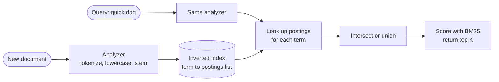

# Inverted Index

## The problem it solves

You store 1B tweets and a user searches "world cup final". A SQL `WHERE text LIKE '%world cup%'` can't use a B-tree index (the wildcard is at the start), so it scans every row: hundreds of gigabytes of text per query, taking minutes. Even if it were fast, it wouldn't rank results by relevance, handle "Cup" vs "cup", or match "running" when the user typed "run".

An inverted index flips the relationship: instead of document → words, it stores **word → list of documents containing it**. A query looks up a few short lists and intersects them, touching only the documents that actually match.

## How it works

1. **Analyze** each document into terms: tokenize ("World Cup final!" → `world`, `cup`, `final`), lowercase, optionally remove stop words ("the", "a") and stem (`running` → `run`). The same analyzer runs on queries, so query terms match index terms.
2. **Build postings lists:** for each term, a sorted list of document IDs that contain it, often with term frequency and positions (needed for phrase queries like `"world cup"`).
3. **Query:** look up each query term's postings list. For AND, **intersect** the lists; for OR, union them. Because lists are sorted by doc ID, intersection is a linear merge, and **skip pointers** let the merge jump ahead in long lists.
4. **Rank** matching documents with a relevance score. The standard is **BM25**, a refinement of TF-IDF: a term counts more if it appears often in this document (term frequency, with diminishing returns) and if it's rare across the collection (inverse document frequency), normalized for document length.
5. **Compress:** store gaps between sorted IDs instead of the IDs ([100, 105, 230] → [100, 5, 125]) and encode the small numbers in few bits. Postings lists often shrink several-fold this way.



```
def search_and(terms, k):
    lists = sorted((index[t] for t in terms), key=len)   # shortest first
    result = lists[0]
    for p in lists[1:]:
        result = intersect(result, p)                     # linear merge
    return top_k(result, key=lambda d: bm25(d, terms), k=k)
```

**Updates.** Inverted indexes are expensive to modify in place, so engines like Lucene (under Elasticsearch and Solr) write new documents into small immutable **segments** and merge segments in the background. Deletes are marked in a bitmap and removed during merges. This is why Elasticsearch search is near-real-time: new documents become searchable when the next segment is opened (by default about every second).

**Scaling.** Partition by document (each shard indexes a subset of documents; a query goes to all shards and results are merged) or by term (each shard owns some terms; a query hits only the relevant shards but multi-term queries cross shards). Document partitioning is the common choice because it balances load and keeps indexing local.

## Worked example

Three documents:
- D1: "The quick brown fox"
- D2: "Quick brown dogs"
- D3: "The lazy dog"

After lowercasing, removing "the" and stemming "dogs" → "dog":

| Term | Postings (doc IDs) | Document frequency |
|---|---|---|
| brown | 1, 2 | 2 |
| dog | 2, 3 | 2 |
| fox | 1 | 1 |
| lazy | 3 | 1 |
| quick | 1, 2 | 2 |

- Query **quick AND dog**: intersect [1, 2] and [2, 3] → **[2]**. D2 matched even though it says "dogs", because both sides were stemmed.
- Query **quick OR dog**: union → [1, 2, 3]. D2 contains both terms, so it scores highest; D1 and D3 each match one term.
- Query **fox**: one lookup → [1]. Rare terms like "fox" (in 1 of 3 docs) carry more weight in BM25 than common ones like "brown" (in 2 of 3).

At scale, a term like "cup" might appear in 2M of 1B tweets. The query reads 2M postings (a few megabytes compressed) instead of scanning 1B documents.

## Trade-offs

- **Pros:** query cost proportional to matching documents, not total documents; supports relevance ranking, phrase and proximity queries, faceting; compresses well.
- **Cons:** extra storage (often a substantial fraction of the original text, more with positions); writes are costlier and visibility is near-real-time, not immediate; analysis choices (stemming, tokenization per language) shape results and are hard to change without reindexing; very common terms have huge postings lists.
- **Alternatives:** **database full-text indexes** (Postgres `tsvector` with GIN, MySQL FULLTEXT) for moderate scale inside your primary DB; **tries** for prefix autocomplete; **vector search** for semantic similarity ("cheap flights" matching "budget airfare"); many systems combine inverted and vector indexes (hybrid search).

## When to use it (and when not)

- **Use it** for keyword search: tweet search, product search on Amazon, log search (ELK), document search in Dropbox or Google Drive, Slack message search, job listings with filters.
- **Not needed** for exact-key lookups (use a primary key), for small data sets where `ILIKE` on a few thousand rows is fine, or when meaning matters more than keywords (vector search).

## In an interview

Say: "Search goes to Elasticsearch, which keeps an inverted index from each term to the sorted list of tweet IDs containing it; a query intersects the postings lists and ranks with BM25, and new tweets become searchable within about a second." Be ready to explain analysis, postings intersection, how the index is sharded, and how updates flow from the primary database.

## Common follow-up questions

### How are phrase queries like "world cup" answered?
Store term positions in the postings. Intersect the lists for "world" and "cup", then keep only documents where some position of "cup" equals a position of "world" plus one. Positions add storage, which is why some fields disable them.

### Why intersect the shortest postings list first?
The result can't be larger than the smallest list, so starting with it keeps every intermediate result small. With skip pointers, merging a 1,000-entry list against a 10M-entry list jumps through the long list instead of reading all of it.

### How do you keep the search index in sync with the primary database?
Publish changes through change data capture or an outbox table into a queue (Kafka), and have indexers consume it and write to the search cluster. The index is eventually consistent, usually seconds behind, and can be rebuilt from the source of truth if needed.

### How do you shard an inverted index?
Usually by document: each shard holds a full inverted index for its subset of documents, a query fans out to all shards, and a coordinator merges the per-shard top results. This balances load well and keeps writes local, at the cost of every query touching every shard.
