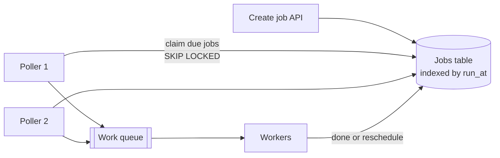

# Job Scheduling

## The problem it solves

A product needs to send a reminder email 24 hours before each appointment, retry a failed payment in 3 days, expire unpaid seat holds after 10 minutes, and rebuild a report every night at 2:00. A `cron` entry on one server handles the nightly report until that server dies and nobody notices for a week. For millions of one-off delayed tasks, you can't create a cron entry per task, and `sleep()` in a process loses everything on restart.

A **job scheduler** durably stores tasks with the time they should run, and reliably triggers each one at (or shortly after) that time, exactly once in effect, across a fleet of machines that can fail.

## How it works

**Two kinds of jobs:**

- **Delayed (one-off):** "run `send_reminder(appt 77)` at 2026-11-02 09:00".
- **Recurring:** a cron expression like `0 2 * * *` (02:00 every day). After each run, compute the next run time and store it.

**A common durable design:**

1. **Store** jobs in a database table indexed by run time.
2. **Pollers** repeatedly claim due jobs with a lease, so two pollers never grab the same job.
3. **Dispatch** claimed jobs to a work queue; workers execute them.
4. **Complete:** mark done, or for recurring jobs set `next_run_at` to the next cron time. On failure, reschedule with backoff.
5. **Recover:** if a worker dies, the lease expires and the job becomes claimable again.

```
CREATE TABLE jobs (
  id           BIGINT PRIMARY KEY,
  run_at       TIMESTAMPTZ NOT NULL,
  status       TEXT NOT NULL,          -- pending, running, done, failed
  lease_until  TIMESTAMPTZ,
  attempts     INT DEFAULT 0,
  payload      JSONB
);
CREATE INDEX ON jobs (run_at) WHERE status = 'pending';

-- poller: claim up to 500 due jobs without blocking other pollers
UPDATE jobs SET status = 'running', lease_until = now() + interval '5 min'
WHERE id IN (
  SELECT id FROM jobs
  WHERE status = 'pending' AND run_at <= now()
  ORDER BY run_at
  LIMIT 500
  FOR UPDATE SKIP LOCKED)
RETURNING id, payload;
```

A separate sweep resets `running` jobs whose `lease_until` has passed back to `pending`.



**Other approaches:**

- **Time-bucketed storage** for very high volume: partition jobs by minute (`bucket = floor(run_at / 60s)`), so each poller reads one bucket per minute; shard buckets across pollers.
- **Redis sorted set** with score = run timestamp: `ZRANGEBYSCORE jobs -inf now LIMIT 0 100`, then remove atomically in a Lua script. Fast, but durability depends on Redis persistence.
- **Delay queues:** SQS delays messages up to 15 minutes; RabbitMQ uses TTL plus dead-letter exchanges. Fine for short delays only.
- **Hierarchical timing wheels** for in-memory timers at huge scale (used inside Kafka for request timeouts).
- **Managed and workflow tools:** Kubernetes CronJobs, Airflow for batch pipelines with dependencies, Temporal for durable timers inside workflows, EventBridge Scheduler.

**Correctness essentials:** at-least-once execution plus idempotent jobs (a reminder job checks "already sent?" keyed by job ID); store times in UTC and compute cron in the user's time zone when needed (daylight saving time can skip or repeat an hour); and for recurring jobs, decide what happens after downtime: run all missed occurrences, or only the latest.

## Worked example

A reminder service schedules 10 million reminders per day. Average is 10,000,000 / 86,400 ≈ 116 jobs/s, but users pick round times. Suppose 2 million are set for exactly 09:00.

| Design | Behavior at 09:00 |
|---|---|
| One poller, claiming 500 jobs per query, 20 queries/s | 10,000 jobs/s claimed, so the 2,000,000 take 200 s; the last reminder is 3 min 20 s late |
| 10 pollers with SKIP LOCKED, same rate each | 100,000 jobs/s, so 20 s to claim them all |
| Plus 1,000 workers each sending 50 emails/s | 50,000 sends/s, so 40 s to send all 2,000,000 |

Sending is now the bottleneck (40 s versus 20 s to claim), so you either add workers or accept up to about 40 seconds of lateness. Pre-fetching jobs a minute early into the queue with a short delay smooths the spike further.

## Trade-offs

- **Pros:** durable, survives restarts; horizontally scalable claiming with leases; built-in retries and visibility into what's pending, running and failed.
- **Cons:** polling adds latency (up to the poll interval) and database load; hot spots at popular times; at-least-once means jobs must be idempotent; recurring jobs bring time zone and missed-run edge cases.
- **Alternatives:** plain **cron** on one box for a handful of internal tasks; **delay queues** for short delays; **workflow engines** (Temporal) when the delay is a step in a longer process; **TTL expiry** in Redis or DynamoDB for simple "expire this" cases, noting DynamoDB TTL deletion can lag considerably, so it's unsuitable for precise timing.

## When to use it (and when not)

- **Use it** for "design a distributed job scheduler" or "design a cron service", reminders and notifications at a future time ("design Google Calendar"), seat-hold expiry in "design Ticketmaster", retrying payments or webhooks later, scheduled social posts, and nightly batch pipelines.
- **Overkill** when the work should happen right away (use a message queue), or when a single cron entry for a non-critical internal task is enough.

## In an interview

Say: "Jobs live in a table indexed by run_at; several pollers claim due jobs with `FOR UPDATE SKIP LOCKED` and a 5-minute lease, push them to a queue, and workers execute idempotently; expired leases are reclaimed so a dead worker's job runs again." Be ready to discuss hot times, time zones, scaling pollers by sharding time buckets, and exactly-once concerns.

## Common follow-up questions

### How do you prevent two schedulers running the same job?
Claim jobs atomically: a conditional update or `SELECT ... FOR UPDATE SKIP LOCKED` lets each row go to only one poller. A lease with an expiry handles crashed workers, and since a slow worker can outlive its lease, jobs must still be idempotent.

### How do you scale to billions of scheduled jobs?
Partition by time bucket and shard each bucket's jobs across poller instances by job ID hash. Keep far-future jobs in cheap storage and move them into a hot store as their time approaches.

### What happens to a recurring job if the scheduler is down for an hour?
That's a policy choice. For billing you may run each missed occurrence; for a "refresh cache" job you run once and skip the rest. Store the last successful run time so you can tell which occurrences were missed.

### How precise can the timing be?
With polling, jobs run within the poll interval plus queue and worker delay, typically a second or a few. For sub-second precision, load near-term jobs into in-memory timers (a timing wheel) on the scheduler nodes.
