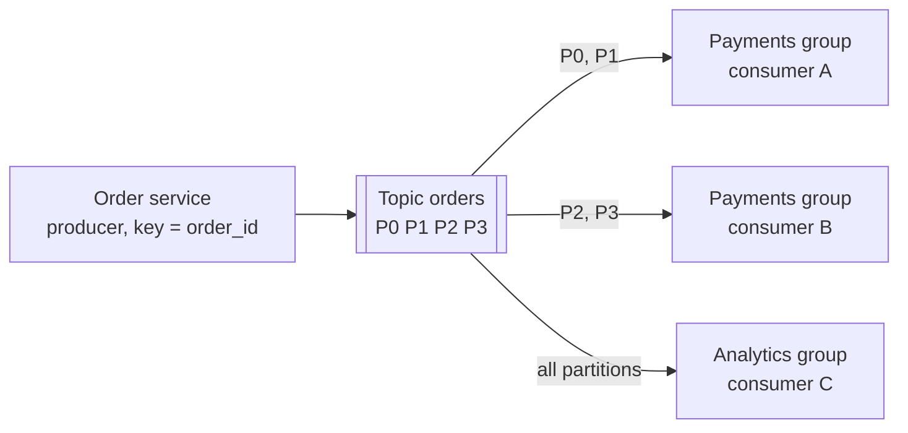

# Kafka

## The problem it solves

An e-commerce site emits an "order placed" event that six systems care about: payments, inventory, email, analytics, fraud detection and search indexing. If the order service calls each one directly, it waits on all six, fails when any is down, and needs a code change for every new consumer. A traditional message queue decouples them, but deletes each message once it's consumed, so a new analytics job can't replay last week's events, and a consumer that was down for an hour depends on the queue having buffered everything.

Kafka is a distributed, durable, partitioned **log**. Producers append events; any number of consumer groups read them independently at their own pace, and events stay for a configured retention period, so consumers can fall behind, catch up or replay from the past. A modest cluster can handle hundreds of thousands to millions of messages per second.

## How it works

**Topics, partitions, offsets.** A **topic** (e.g. `orders`) is split into **partitions**. Each partition is an append-only, ordered log stored on disk; each record gets a sequential **offset** within its partition. Ordering is guaranteed **only within a partition**.

**Producers and keys.** A producer chooses the partition by hashing the record's **key** (`hash(key) mod partitions`, murmur2 by default). All events with the same key (e.g. `order_id` or `user_id`) go to the same partition and stay in order. Records with no key are spread across partitions. Changing the partition count changes which partition a key maps to, so pick it with headroom.

**Consumer groups.** Consumers that share a `group.id` split a topic's partitions among themselves: each partition is read by exactly one consumer in the group, so parallelism is capped by the partition count. Different groups each get every record. Consumers track progress by **committing offsets** to an internal topic (`__consumer_offsets`); after a crash or **rebalance**, a consumer resumes from the last committed offset. Committing after processing gives at-least-once delivery, so consumers should be idempotent.

**Brokers, replication and ISR.** Partitions are spread across **brokers**. Each partition has a replication factor (typically 3): one **leader** handles all reads and writes, and **followers** copy from it. Followers that are caught up form the **in-sync replica set (ISR)**. If the leader fails, the controller elects a new leader from the ISR. Cluster metadata is managed by **KRaft**, Kafka's built-in Raft-based controller quorum, which replaced ZooKeeper in recent versions.

**Producer acks** set the durability trade-off:
- `acks=0`: don't wait. Fastest, can lose data silently.
- `acks=1`: the leader wrote it. Lost if the leader dies before followers copy it.
- `acks=all`: every replica in the ISR has it. With `min.insync.replicas=2` and replication factor 3, a write succeeds only when at least 2 copies exist, so one broker can fail with no data loss.

**Retention and compaction.** Records are deleted by time or size (e.g. 7 days, the default), regardless of whether anyone has read them. A **compacted** topic instead keeps at least the **latest record per key**, which makes it a durable changelog of current state (used for consumer offsets and for rebuilding tables).

**Why it's fast:** sequential disk appends, batching and compression on the producer, the OS page cache for reads, and zero-copy transfer from page cache to the network socket.



```
# producer config for durability
acks=all
enable.idempotence=true        # retries can't create duplicates within a partition
# topic config
replication.factor=3
min.insync.replicas=2
retention.ms=604800000         # 7 days
```

**Exactly-once.** The idempotent producer deduplicates retries per partition using a producer ID and sequence numbers. **Transactions** let a stream processor atomically write output records and commit its input offsets, giving exactly-once processing within Kafka (Kafka Streams and Flink use this). Side effects outside Kafka, such as charging a card, still need idempotency keys.

## Worked example

Topic `orders` has 4 partitions. The `payments` consumer group processes records; each row is a moment in time.

| Time | Event | Consumer → partitions | Committed offsets P0 / P1 / P2 / P3 |
|---|---|---|---|
| t0 | Group starts with consumers A and B | A: P0, P1; B: P2, P3 | 0 / 0 / 0 / 0 |
| t1 | Each partition receives 1,000 records; all processed | same | 1,000 / 1,000 / 1,000 / 1,000 |
| t2 | Consumer C joins, rebalance | A: P0, P1; B: P2; C: P3 | 1,000 / 1,000 / 1,000 / 1,000 |
| t3 | 500 more records per partition; B processes P2 up to 1,400 then crashes before committing | | 1,500 / 1,500 / **1,200** / 1,500 (B last committed at 1,200) |
| t4 | Rebalance: P2 moves to C | A: P0, P1; C: P2, P3 | C resumes P2 at 1,200 |
| t5 | C reprocesses P2 records 1,200–1,399, then continues | same | 1,500 / 1,500 / 1,500 / 1,500 |

The 200 records between B's last commit and its crash were processed twice: that's at-least-once delivery, and why consumers must be idempotent (e.g. dedupe on `order_id`). Adding a fifth consumer would leave one idle, because 4 partitions allow at most 4 active consumers per group.

## Trade-offs

- **Pros:** very high throughput; durable and replayable; many independent consumers on the same data; per-key ordering; decouples producers from consumers; good foundation for stream processing and event sourcing.
- **Cons:** ordering only within a partition; partition count limits consumer parallelism and is hard to change for keyed data; operationally heavy (brokers, partitions, rebalances, monitoring consumer lag); no per-message routing, priorities or delayed delivery; a hot key overloads one partition.
- **Alternatives:** **RabbitMQ / SQS** for task queues with per-message acks, retries, dead-letter queues and routing, where replay isn't needed; **Kinesis** or **Pub/Sub** as managed log services; **Pulsar** (separates compute from storage, built-in tiered storage); **Redis Streams** for small-scale streams.

## When to use it (and when not)

- **Use it** for event-driven architectures (order events to many services), activity and click streams (YouTube views, ad clicks), log and metrics pipelines, change data capture from databases into search indexes or warehouses, Uber location streams to analytics, fan-out in news feed and notification systems, and buffering spiky writes in front of slower stores.
- **Don't use it** for request-response calls, for small job queues where each task needs individual acknowledgment and retry scheduling (SQS is simpler), or for low-volume systems where running a cluster isn't worth it.

## In an interview

Say: "The order service publishes to a Kafka `orders` topic keyed by `order_id`, so each order's events stay in order on one partition; payments, email and analytics are separate consumer groups, and we use `acks=all` with replication factor 3 and `min.insync.replicas=2` so a broker failure loses nothing." Be ready to explain partitions vs consumer parallelism, offset commits and at-least-once delivery, and how ISR and acks work together.

## Common follow-up questions

### How do you choose the number of partitions?
Take the target throughput divided by what one consumer can process, and add headroom, because adding partitions later remaps keys and breaks per-key ordering for in-flight data. Too many partitions add overhead in metadata, open files and leader elections, so don't create thousands without need.

### How does Kafka guarantee ordering?
Only within a partition: records are appended and read in offset order. To keep all events for an entity in order, use the entity ID as the key so they share a partition. With retries, enable the idempotent producer so a retried batch can't be reordered or duplicated.

### What happens when a broker dies?
For each partition it led, the controller elects a new leader from the ISR, and producers and consumers redirect to it after a short pause. With `acks=all` and `min.insync.replicas=2`, every acknowledged write is on at least one surviving replica. Under-replicated partitions catch up when the broker returns or is replaced.

### What is consumer lag and why does it matter?
Lag is the gap between a partition's latest offset and the group's committed offset. Growing lag means consumers can't keep up; if it exceeds retention, unread data is deleted. Fix it by adding consumers (up to the partition count), speeding up processing, or adding partitions.

### Kafka or SQS for a background job queue?
SQS fits when each job is independent, needs per-message visibility timeouts and retries, and replay isn't needed. Kafka fits when many consumers need the same events, ordering per key matters, or you want to replay history. One slow or poison message in Kafka blocks its whole partition unless you route failures to a retry topic.
