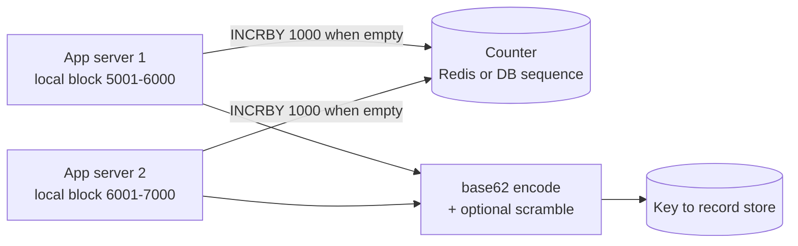

# Key Generation

## The problem it solves

A URL shortener, a paste bin or an order system needs a short, unique key for every new record, generated by many servers at once. The naive options break quickly. A random 7-character code is short, but once you hold 1B codes out of 62⁷ ≈ 3.5 trillion, each new random code still has a small collision chance, and the birthday effect means collisions start appearing well before the space is full, so every insert needs a check-and-retry. A database auto-increment is unique and simple, but a single primary handling **every** write becomes the bottleneck, and sequential codes let anyone enumerate your links.

Key generation is the set of techniques for minting unique keys at high rate without collisions, retries or a single hot spot.

## How it works

There are three families, and interviews usually walk through them in this order.

**1. Hash the content.** Take `MD5` or `SHA-256` of the input (the long URL), base62-encode it and keep the first 7 characters. The same input always gives the same key, which is free deduplication. But truncating a hash makes collisions possible, so you must check the store and, on a collision, rehash with a salt and try again.

**2. Counter + base62.** A central counter (Redis `INCR`, a database sequence) returns a unique integer, and you encode it in base62 (`0-9a-zA-Z`). Uniqueness is guaranteed, so there are no retries. To remove the bottleneck, each app server **reserves a block** of IDs (`INCRBY 1000`) and hands them out from memory, so the counter sees 1/1000 of the traffic.

**3. Pre-generated key pool (key generation service, KGS).** A background job generates random unused keys ahead of time and stores them in an "unused" table. App servers fetch batches of keys into memory and hand them out. Once a key is fetched, it's marked used, so no two servers ever get the same one.



The block allocator in pseudocode:

```
class IdAllocator:
    def next(self):
        if self.cur >= self.end:                  # block used up
            self.end = redis.incrby("url:id", 1000)
            self.cur = self.end - 1000
        self.cur += 1
        return base62(scramble(self.cur))
```

**Hiding the sequence.** Sequential integers give sequential codes. Before encoding, pass the integer through a **bijection** on [0, 62⁷), such as a multiply-by-a-coprime-mod-62⁷ step or a small format-preserving cipher. A one-to-one mapping keeps uniqueness while making neighboring codes look unrelated.

## Worked example

Two app servers share a Redis counter that starts at 0 and reserve blocks of 1,000.

| Step | Event | Redis counter | Server A range | Server B range |
|---|---|---|---|---|
| 1 | A starts, `INCRBY 1000` returns 1000 | 1,000 | 1–1,000 | none |
| 2 | B starts, `INCRBY 1000` returns 2000 | 2,000 | 1–1,000 | 1,001–2,000 |
| 3 | A issues 1,000 keys | 2,000 | used up | 1,001–2,000 |
| 4 | A `INCRBY 1000` returns 3000 | 3,000 | 2,001–3,000 | 1,001–2,000 |
| 5 | A crashes after issuing 2,001–2,400 | 3,000 | lost: 2,401–3,000 | 1,001–2,000 |

Redis handled 3 calls for what may become 3,000 keys. The crash in step 5 wastes 600 IDs, which is harmless: keys are never reused, so a gap only costs some unused space. Encoding ID 1,000,000 in base62 gives `4c92` (4×62³ + 12×62² + 9×62 + 2 = 953,312 + 46,128 + 558 + 2 = 1,000,000), padded to 7 characters as `0004c92`.

## Trade-offs

| Approach | Uniqueness | Coordination | Notes |
|---|---|---|---|
| Hash + truncate | Collisions possible, needs check-and-retry | None | Free dedupe of identical inputs; retries get worse as the space fills |
| Counter + base62 | Guaranteed | One counter, cheap with block reservation | Sequential unless scrambled; counter must never go backwards |
| Pre-generated pool | Guaranteed | A KGS plus an unused-keys table | Random-looking keys; extra service to run; keys in a crashed server's memory are lost |
| Snowflake-style IDs | Guaranteed | Machine ID only | 64-bit numbers, ~11 base62 characters: too long for a short link |
| UUIDv4 | Effectively unique | None | 128 bits, 22 base62 characters, not sortable |

The main risk with counters is durability: if a Redis failover loses the last few `INCRBY`s, the counter can reissue a block. Start from max(id seen) plus a safety gap after failover, or allocate blocks from a strongly consistent database sequence.

## When to use it (and when not)

- **Use counter + base62 or a key pool** for short public identifiers: URL shortener (TinyURL, bit.ly), Pastebin, invite codes, coupon codes.
- **Use content hashing** when deduplication is the point: content-addressed storage (Dropbox chunks, Git objects), where the full hash is the key and collisions are negligible.
- **Don't** hand-roll this for internal row IDs where length doesn't matter. Snowflake IDs or UUIDs need no allocator at all.

## In an interview

Say: "Each write server reserves a block of 1,000 IDs from a Redis counter and base62-encodes them, scrambled with a bijection, so codes are 7 characters, guaranteed unique and not enumerable, and Redis sees a thousandth of the write traffic." Be ready to explain base62 math, why 7 characters is enough, and what happens when the counter node fails.

## Common follow-up questions

### Why base62 and not base64?
Base64 uses `+` and `/`, which have special meanings in URLs and need escaping. Base62 uses only letters and digits, so codes are URL-safe as is. The cost is tiny: 7 base62 characters give 3.5 trillion codes versus 4.4 trillion for base64.

### What happens if an app server crashes with unused IDs in its block?
Those IDs are simply never issued. Gaps are fine because uniqueness, not density, is the requirement. With 3.5 trillion codes available, losing a few thousand per crash is irrelevant.

### How does a key generation service avoid handing the same key to two servers?
It moves keys from the unused table to a used table (or flips a flag) inside one transaction before returning a batch. Only one KGS instance can claim a given row, for example with `SELECT ... FOR UPDATE SKIP LOCKED`. Run a standby KGS for availability.

### How would you support custom aliases like /my-sale?
Treat them as a separate path: check that the alias is unused with a unique constraint on insert, and reject on conflict. Keep custom aliases out of the generated namespace (different length or a reserved prefix) so a generated code can never collide with one.
