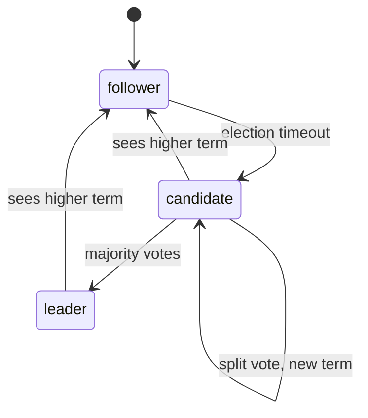

# Leader Election

## The problem it solves

Some jobs must be done by exactly one node: the scheduler that assigns tasks, the database primary that accepts writes, the cron runner that sends the nightly invoice email. Hard-code one machine and the job stops when it dies. Run it on every machine and customers get the invoice three times. And if two nodes both believe they're the database primary after a network blip (split brain), they accept conflicting writes that can't be cleanly merged.

Leader election lets a group of nodes agree on a single leader, replace it automatically when it fails, and make sure an old leader can't keep acting after being replaced.

## How it works

**Option 1: use a coordination service.** ZooKeeper, etcd or Consul run consensus internally, so you can build election on them:

- **etcd:** each candidate tries to create a key like `/election/scheduler` attached to a lease with a TTL (e.g. 10 seconds), in a transaction that succeeds only if the key doesn't exist. The winner keeps the lease alive with heartbeats. If it dies, the lease expires, the key disappears, and watchers try again.
- **ZooKeeper:** each candidate creates an ephemeral sequential znode under `/election`. The lowest sequence number is the leader. Each other node watches the node just before it, so only one node wakes up on each change. Ephemeral nodes vanish when the session expires.

**Option 2: consensus inside your system (Raft).**

1. **Terms.** Time is divided into numbered terms. Each term has at most one leader.
2. **Heartbeats.** The leader sends periodic heartbeats (empty AppendEntries) to followers.
3. **Election timeout.** A follower that hears nothing for a randomized timeout (e.g. 150–300 ms) becomes a candidate, increments the term, votes for itself and sends RequestVote to everyone.
4. **Voting.** Each node grants at most one vote per term, and only to a candidate whose log is at least as up to date as its own. That rule ensures a new leader has every committed entry.
5. **Majority wins.** A candidate with votes from a majority (3 of 5) becomes leader. Randomized timeouts make split votes rare; if one happens, a new term starts.
6. **Higher term wins.** Any node seeing a higher term steps down to follower. A stale leader learns it's been replaced the moment it contacts anyone.

**Leases.** Leadership is usually time-bound: the leader holds a lease and must renew it before it expires. Others won't elect a new leader until the old lease has expired, which lets the leader serve some reads locally. This depends on bounded clock drift between nodes.

**Fencing tokens.** Election alone doesn't stop an old leader that was paused (long GC, VM migration) from waking up and writing. So each leadership grant comes with a monotonically increasing token (the Raft term, an etcd revision, a ZooKeeper zxid). The leader sends the token with every write, and storage rejects any write carrying a token lower than the highest it has seen.

## Worked example

A 5-node Raft cluster, term 7, node A is leader. A's network link fails at t = 0.

| Time | Event | Term |
|---|---|---|
| 0 ms | A partitioned from B, C, D, E | 7 |
| 210 ms | C's randomized timeout fires first; C becomes candidate | 8 |
| 215 ms | B, D, E vote for C (C's log is up to date) | 8 |
| 216 ms | C has 4 of 5 votes (majority is 3), becomes leader | 8 |
| 900 ms | A, still thinking it leads term 7, tries a write with token 7 | |
| 901 ms | Storage has seen token 8 from C and rejects A's write | 8 |
| later | Partition heals; A sees term 8 and becomes a follower | 8 |

A couldn't commit anything during the partition anyway, because it couldn't reach a majority, and the fencing token stops it from writing to external storage.

## Trade-offs

- **Pros:** automatic failover; a single writer simplifies consistency; consensus-based election is safe against split brain.
- **Cons:** election takes time (heartbeat timeout plus voting, typically hundreds of milliseconds to seconds of unavailability); needs a majority, so a 5-node group tolerates only 2 failures; the leader can become a throughput bottleneck; lease-based tricks depend on clock assumptions.
- **Alternatives:** leaderless designs (quorum writes, CRDTs) avoid election entirely; sharding work so each shard has its own leader spreads load; a manual failover runbook for systems that rarely fail over.

## When to use it (and when not)

- **Use it** for database primaries, job schedulers, partition leaders in Kafka, the controller of a cluster, singleton cron jobs, and any component that must not run twice. Interview questions: design a distributed job scheduler, design a key-value store, design Kafka, design a distributed lock service.
- **Avoid it** when the work can be partitioned or made idempotent so many nodes can safely run it at once. That's usually simpler and has no failover gap.

## In an interview

Say: "Scheduler instances elect a leader through an etcd lease with a 10-second TTL; the leader gets a fencing token from the etcd revision and the job store rejects writes with an older token." Be ready to explain Raft terms and majority votes, what happens during a partition, and why fencing is needed even with a correct election.

## Common follow-up questions

### Why do clusters use an odd number of nodes?
A majority of 5 is 3 and a majority of 6 is 4, so both tolerate only 2 failures. The sixth node adds cost and another voter without improving fault tolerance.

### What happens during the election?
There's no leader for that period, so writes, or whatever the leader does, are unavailable. Its length is roughly the election timeout plus one voting round, which is why timeouts are tuned to balance quick failover against false elections from brief hiccups.

### Why isn't a lease alone enough to prevent two leaders?
The old leader may be paused and resume after its lease expired, still believing it's the leader, or its clock may run slow. A fencing token checked by the resource it writes to is the only reliable guard.

### Can a minority partition elect its own leader?
No. A candidate needs votes from a majority of the full cluster, and the minority side can't get them. It stays leaderless and unavailable for writes until the partition heals.
