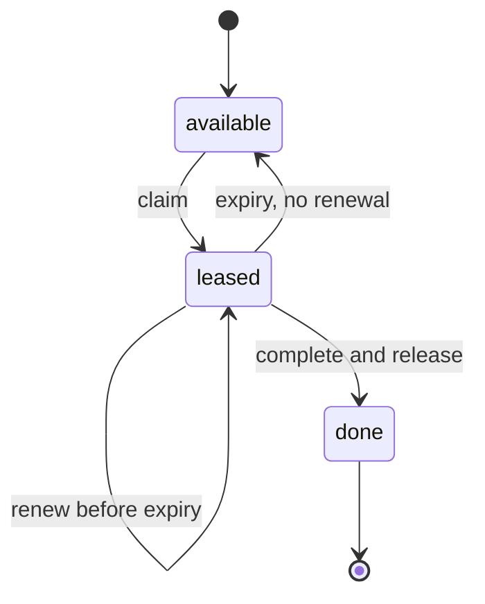

# Leases

## The problem it solves

A video transcoding service has 10,000 jobs in a table and 50 workers. A worker claims job 812 and then its machine loses power. If "claimed" is a permanent flag, job 812 is stuck forever, and someone has to find and reset it by hand. The same problem shows up for leaders, lock holders and cache entries: ownership granted to a node that later disappears without saying goodbye.

A lease is ownership with an expiry time. The holder must renew it before it runs out; if it doesn't, the resource frees itself and someone else can take it. Crashes become self-healing.

## How it works

1. **Grant.** A client asks for a resource and receives a lease: an owner ID, an expiry (e.g. now + 30 s), and ideally a monotonically increasing lease number.
2. **Renew.** While working, the holder renews periodically, typically at a third to a half of the lease duration, so one missed renewal doesn't lose the lease.
3. **Release.** When done, the holder releases early.
4. **Expire.** If the holder stops renewing, the lease expires and the resource can be granted to someone else.
5. **Self-check.** The holder must stop acting before its lease expires, measured on its own clock with a safety margin. If a renewal fails, it stops working on the resource.

Job claiming with a database lease:

```sql
-- claim one available job
UPDATE jobs
SET    owner = 'worker-17',
       lease_until = now() + interval '30 seconds',
       lease_no = lease_no + 1
WHERE  id = (
  SELECT id FROM jobs
  WHERE  status = 'pending' AND (lease_until IS NULL OR lease_until < now())
  ORDER  BY created_at
  LIMIT  1
  FOR UPDATE SKIP LOCKED)
RETURNING id, lease_no;

-- renew every 10 s
UPDATE jobs SET lease_until = now() + interval '30 seconds'
WHERE  id = :id AND owner = 'worker-17' AND lease_no = :lease_no;
-- 0 rows: lease lost, stop working
```



**Where leases appear:**

- **Work queues:** Amazon SQS's visibility timeout is a lease on a message; if the consumer doesn't delete it in time, it becomes visible again. Kafka consumer group membership expires when heartbeats stop.
- **Leadership:** etcd leases attached to an election key; Raft-based systems use leader leases so the leader can serve reads without contacting a majority, assuming bounded clock drift.
- **Locks:** a distributed lock's TTL is a lease.
- **Caching:** the original lease paper (Gray and Cheriton, 1989) used leases for file cache consistency: a server promises not to change a cached file without notice until the lease expires.

**Clocks and fencing.** Lease safety depends on the holder knowing when its lease has expired. Clocks drift, and processes pause. A paused holder can resume after expiry, believing it still owns the resource. Protect against this with a margin (stop at, say, 80% of the duration) and a fencing token: the lease number is sent with every write, and storage rejects numbers lower than the latest it has seen.

## Worked example

Lease duration 30 s, renewal every 10 s. Worker A claims job 812 at t = 0 with lease number 5.

| Time | Event | lease_until | Owner |
|---|---|---|---|
| 0 s | A claims (lease_no 5) | 30 s | A |
| 10 s | A renews | 40 s | A |
| 20 s | A renews | 50 s | A |
| 22 s | A's machine loses power | 50 s | A (stale) |
| 50 s | Lease expires | | none |
| 51 s | B claims (lease_no 6) | 81 s | B |
| 75 s | B completes, marks done | | |

The job was delayed by up to one lease duration (29 s between crash and expiry here), then recovered automatically. If A had instead frozen and resumed at 60 s, its renewal would match 0 rows (lease_no 5 is no longer current), and any write carrying lease number 5 would be rejected.

## Trade-offs

- **Pros:** automatic recovery from crashed or disconnected holders; no manual cleanup; bounded time that a resource can be stuck; works with simple storage (a row with a timestamp).
- **Cons:** choosing the duration (short means renewal traffic and risk of losing the lease during brief hiccups; long means slow recovery); relies on clocks being roughly right; a paused holder can act after expiry without fencing; work may run twice, so tasks should be idempotent.
- **Alternatives:** session-based ownership in ZooKeeper (ephemeral nodes tied to a session, which is itself a lease); explicit heartbeats to a coordinator; message queues with acknowledgements, which implement leases for you.

## When to use it (and when not)

- **Use it** for job queues and schedulers, leader election, distributed locks, seat or cart holds ("this seat is yours for 10 minutes"), and partition ownership in stream processing. Interview questions: distributed job scheduler, Ticketmaster seat holds, web crawler URL frontier, distributed cron, Uber driver assignment (offer expires if not accepted).
- **Not needed** when ownership is fixed (a static partition assignment) or when any worker can safely do any task concurrently.

## In an interview

Say: "Workers claim jobs with a 30-second lease and renew every 10 seconds; if a worker dies, the lease expires and another worker picks the job up, and the lease number acts as a fencing token on writes." Be ready to discuss duration choice, clock assumptions, and why jobs still need to be idempotent.

## Common follow-up questions

### How long should a lease be?
Long enough to survive a few missed renewals from normal hiccups, and short enough that recovery after a crash is acceptable. Renewing at about a third of the duration is a common rule of thumb, so a lease survives two consecutive failed renewals.

### What if the holder's clock is slow?
It may think it still holds the lease after the grantor has expired it. Mitigate with a safety margin on the holder side, measure durations with a monotonic clock rather than wall time, and use fencing tokens so late writes are rejected.

### How is a lease different from a lock?
A lease is a lock with a built-in expiry, which is what you want in a distributed system where holders can crash. A lock without expiry needs a separate failure detector to release it.

### What happens to work done by a holder whose lease expired?
It may be duplicated or partially applied. Make the work idempotent (keyed by job ID), commit results with a fencing check, and design the task so a fresh owner can safely start over or resume from a checkpoint.
