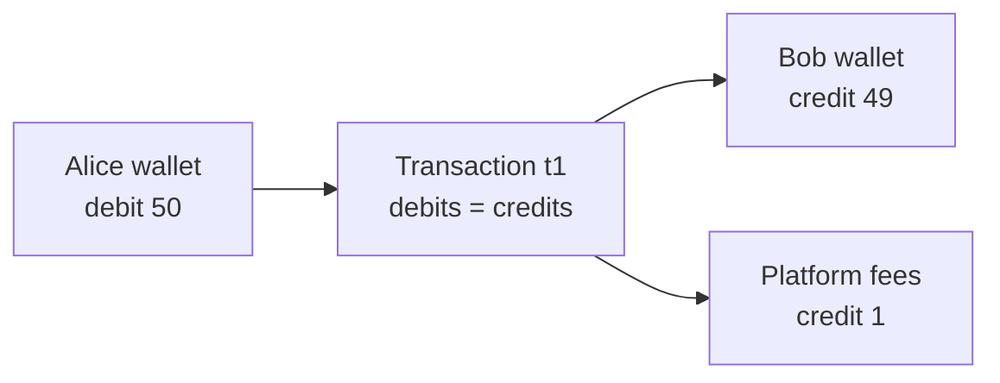

# Double-entry Ledger

## The problem it solves

The naive way to build a wallet is a `balances` table with `UPDATE balances SET amount = amount - 50 WHERE user_id = 1`. It works until something goes wrong. A retry runs the update twice, a bug credits the receiver without debiting the sender, or support asks "why is this balance $312.40?" and there's no history to answer with. Once money is created or destroyed by accident, you can't tell where, and auditors and regulators will ask.

A double-entry ledger records every movement of money as an immutable set of entries where debits equal credits. Balances become derived values you can recompute and verify at any time.

## How it works

1. **Accounts.** Every place money can sit is an account: each user's wallet, the company's revenue, a payment processor's clearing account, fees, refunds payable.
2. **Transactions with entries.** Each transaction has two or more entries. Each entry debits or credits one account. The rule: **the sum of debits equals the sum of credits** in every transaction. Money only moves; it is never created from nothing.
3. **Append-only.** Entries are never updated or deleted. A mistake is fixed with a new reversing transaction.
4. **Balances are derived.** An account's balance is the sum of its entries. For speed you also keep a cached balance, updated in the same database transaction as the entries.



A note on signs: in accounting, debits increase asset and expense accounts and credits increase liability, equity and revenue accounts. Many engineering ledgers simplify this to signed amounts (negative leaves, positive arrives) with the invariant that each transaction's amounts sum to zero. That's the convention used below.

```sql
CREATE TABLE ledger_transactions (
  id              UUID PRIMARY KEY,
  idempotency_key TEXT UNIQUE NOT NULL,
  created_at      TIMESTAMPTZ NOT NULL,
  description     TEXT
);

CREATE TABLE ledger_entries (
  id             BIGSERIAL PRIMARY KEY,
  transaction_id UUID NOT NULL REFERENCES ledger_transactions(id),
  account_id     BIGINT NOT NULL,
  amount_cents   BIGINT NOT NULL      -- negative = money leaves, positive = arrives
);

-- Invariant, checked on write and by a nightly job:
-- SELECT transaction_id FROM ledger_entries GROUP BY transaction_id
-- HAVING SUM(amount_cents) <> 0;   -- must return no rows
```

Writing a transfer in one ACID transaction:

```
BEGIN;
  SELECT balance FROM accounts WHERE id = alice FOR UPDATE;   -- lock, check funds
  INSERT ledger_transactions (...);
  INSERT ledger_entries: (alice, -5000), (bob, +4900), (fees, +100);
  UPDATE accounts SET balance = balance - 5000 WHERE id = alice;
  UPDATE accounts SET balance = balance + 4900 WHERE id = bob;
  UPDATE accounts SET balance = balance + 100  WHERE id = fees;
COMMIT;
```

Store amounts as integers in the smallest unit (cents), never floating point.

## Worked example

Alice starts with $100 funded from a card. She sends Bob $50 with a $1 fee, then the transfer is disputed and reversed.

| Txn | Alice | Bob | Fees | Card clearing | Sum |
|---|---|---|---|---|---|
| t0: top-up | +100 | | | −100 | 0 |
| t1: transfer | −50 | +49 | +1 | | 0 |
| t2: reversal of t1 | +50 | −49 | −1 | | 0 |
| **Balance** | **100** | **0** | **0** | **−100** | **0** |

Every row sums to zero, so the sum of all balances is always zero. The reversal doesn't erase t1; the history shows both the transfer and why it was undone. The clearing account's −100 represents money owed by the card processor until settlement.

## Trade-offs

- **Pros:** money can't silently appear or vanish; full audit trail; balances can be recomputed and reconciled against bank statements; corrections are explicit.
- **Cons:** more rows per operation; reading a balance needs a cached balance or snapshot to avoid summing millions of entries; hot accounts (a platform fee account touched by every transaction) become lock contention points.
- **Alternatives:** a single mutable balance column (simple, unauditable); event sourcing in general (a ledger is a specific, strict form of it); a purpose-built ledger database such as TigerBeetle, designed specifically for double-entry accounting.

## When to use it (and when not)

- **Use it** whenever you store money or money-like value: payment systems, digital wallets, Venmo or PayPal-style transfers, stock brokerages, marketplace payouts, in-game currency, loyalty points. Interview questions: design a payment system, design a digital wallet, design Robinhood, design an online auction's settlement.
- **Not needed** for counters where mistakes don't matter much, like likes or view counts.

## In an interview

Say: "Balances aren't the source of truth; I'll keep an append-only double-entry ledger where every transaction's entries sum to zero, and a cached balance updated in the same database transaction." Be ready to explain how a transfer is written atomically, how idempotency keys stop duplicate charges, and how reconciliation catches drift from external processors.

## Common follow-up questions

### How do you read a balance quickly if it's the sum of entries?
Keep a materialized balance on the account row, updated in the same transaction as the entries, or take periodic snapshots and sum only the entries after the latest snapshot. A background job recomputes balances from entries and alerts on any mismatch.

### How do you handle a hot account like platform fees?
Split it into several sub-accounts (fees-0 to fees-15) and pick one at random per transaction, summing them for reporting. Alternatively, record entries without updating its cached balance synchronously and aggregate asynchronously, since nobody checks the fee account for sufficient funds.

### What happens with transfers across shards or services?
A single database transaction can't span them, so you use a saga with a holding or suspense account: debit the sender into "in transit," then credit the receiver from it. If the second step fails, a compensating transaction moves money back, and the ledger still balances at every step.

### How do you reconcile with an external processor like Stripe or a bank?
Import their settlement reports and match each external record to ledger transactions by reference ID and amount. Anything unmatched on either side goes to a queue for investigation; this daily process catches bugs, missing webhooks and fees you didn't expect.
