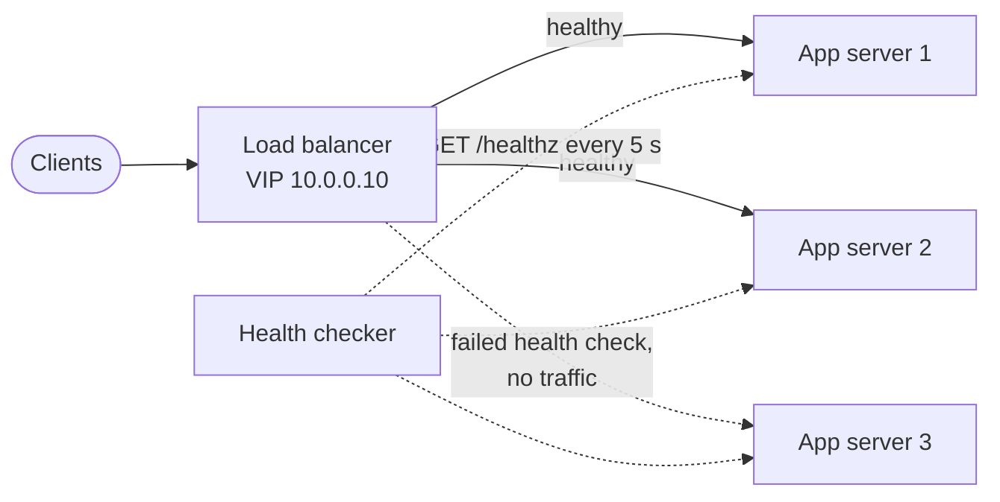

# Load Balancing

## The problem it solves

One application server handles maybe 2,000 requests per second. Your traffic peaks at 15,000. You add eight servers, but clients still need one address to call, and something has to decide which server gets each request. It also has to stop sending traffic to a server that crashed at 3 a.m., or about one in eight requests fails until someone notices.

A load balancer sits in front of a pool of servers, exposes one address, spreads requests across healthy servers, and removes failed ones automatically. It is what makes horizontal scaling and rolling deploys possible.

## How it works



**L4 vs L7.**

- **Layer 4 (transport)** balances TCP or UDP connections using IPs and ports only. It never reads the request, so it is very fast and protocol-agnostic, but every request on a connection goes to the same server. Examples: AWS NLB, IPVS, HAProxy in TCP mode.
- **Layer 7 (application)** terminates the connection, parses HTTP, and routes each request by path, host, header or cookie (`/api/*` to the API pool, `/static/*` elsewhere). It can terminate TLS, retry, rewrite headers and do canary splits. It costs more CPU per request. Examples: AWS ALB, Nginx, Envoy, HAProxy in HTTP mode.

**Algorithms:**

- **Round robin:** server 1, 2, 3, 1, 2, 3. Simple and fine when servers and requests are uniform.
- **Weighted round robin:** a server with weight 2 gets twice the requests of weight 1. Useful for mixed instance sizes or canary releases at 5%.
- **Least connections:** send to the server with the fewest active connections. Better when request durations vary a lot (long uploads, WebSockets).
- **Least response time / power of two choices:** pick two servers at random and send to the less loaded one. Close to least-connections quality without global state.
- **Hashing (IP hash or consistent hashing):** the same client or key always goes to the same server. Used for sticky sessions, cache locality, or routing a user's WebSocket to one chat server. Consistent hashing keeps most mappings stable when servers change.

**Health checks.** Active checks probe each server (`GET /healthz` every 5 s; mark down after 3 failures, up after 2 successes). Passive checks watch real traffic and eject servers that return errors or time out. A good health endpoint checks that the process can serve, not every downstream dependency, or one slow database makes the whole pool look dead.

**Avoiding the balancer as a single point of failure.** Run balancers in pairs with a floating IP (keepalived/VRRP), use a managed cloud balancer that scales itself, or put several balancers behind DNS or anycast.

```
upstream api {
    least_conn;
    server 10.0.1.11:8080 weight=2;
    server 10.0.1.12:8080;
    server 10.0.1.13:8080 max_fails=3 fail_timeout=10s;
}
```

## Worked example

Three servers, round robin vs least connections. Requests are mostly 10 ms, but every fifth request is a 2-second report export.

| Algorithm | What happens over 60 s | Result |
|---|---|---|
| Round robin | Each server gets exactly 1/3 of requests, regardless of how many slow exports it is already holding | One server can end up holding many exports at once while others sit idle |
| Least connections | A server busy with exports has more open connections, so new requests go elsewhere | Active work stays roughly equal across servers |

Capacity math for the earlier case: 15,000 req/s ÷ 2,000 per server = 7.5, so 8 servers at full load. To survive losing one server with headroom, run 10: then 9 survivors handle 15,000 ÷ 9 ≈ 1,667 req/s each, about 83% of capacity.

## Trade-offs

- **Pros:** horizontal scaling; automatic failover; zero-downtime deploys by draining servers; one place for TLS and routing rules (L7).
- **Cons:** an extra hop and component to run; L7 adds latency and CPU cost; sticky routing creates uneven load and complicates failover; the balancer itself must be redundant.
- **Alternatives:** DNS round robin (no health awareness, slow to change); client-side load balancing where each client picks a server from a service registry (used with gRPC and service meshes); anycast for global distribution.

## When to use it (and when not)

- **Use it** in front of any stateless tier with more than one server, which is nearly every design question: URL shortener, news feed, chat (with consistent hashing for connection stickiness), payment APIs.
- **Use L4** for raw TCP, very high throughput, or non-HTTP protocols. **Use L7** when you need path routing, TLS termination or per-request decisions.
- **Not needed** for a single-instance internal tool, or between services that already use client-side balancing through a mesh.

## In an interview

Say: "An L7 load balancer terminates TLS and spreads requests across stateless app servers with least connections, and health checks take a server out within about 15 seconds of failing." Then be ready to explain L4 vs L7, why the app tier must be stateless, how you avoid the balancer being a single point of failure, and when you'd want sticky routing.

## Common follow-up questions

### How do you handle sticky sessions?
Prefer to avoid them by keeping session state in Redis or a signed token so any server can serve any request. If you need stickiness (WebSockets, in-memory state), use a cookie set by the L7 balancer or consistent hashing on user ID, and accept that a server failure loses those sessions.

### What is connection draining?
Before removing a server for a deploy, the balancer stops sending it new requests but lets in-flight requests finish, usually with a timeout like 30 seconds. This makes rolling deploys invisible to users.

### Why is least connections better than round robin for WebSockets?
WebSocket connections last minutes or hours, so round robin balances new connections but not accumulated load. A server added during a spike would receive only its share of new connections and stay underused. Least connections steers new connections to the emptiest servers.

### How does a load balancer itself scale?
Managed cloud balancers scale horizontally behind the scenes. Self-hosted, you run several balancer nodes, often L4 in front of L7, and spread clients across them with DNS, ECMP routing or anycast.
