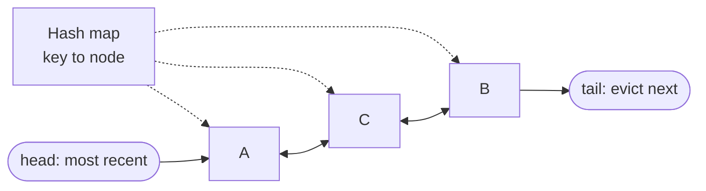

# LRU Eviction

## The problem it solves

A cache server has 64 GB of RAM and the data set is 2 TB. When memory is full and a new item arrives, something must go. Evicting at random throws out hot items as often as cold ones. Scanning every entry for the oldest access time costs O(n) per eviction, which at 10M keys and 100k writes per second is impossible.

Least recently used (LRU) eviction removes the item that hasn't been touched for the longest time, betting that recent use predicts future use. With a hash map plus a doubly linked list, every get, put and eviction is O(1).

## How it works

Two structures, kept in sync:

- A **hash map** from key → list node, so finding an item is O(1).
- A **doubly linked list** ordered by recency: most recently used at the head, least recently used at the tail. Because nodes have both `prev` and `next` pointers, unlinking any node is O(1).

Operations:

1. **get(key):** look up the node in the map. On a miss, return nothing. On a hit, unlink the node and move it to the head, then return the value.
2. **put(key, value):** if the key exists, update the value and move it to the head. Otherwise create a node at the head and add it to the map. If the size now exceeds capacity, **evict the tail**: unlink it and delete its key from the map (which is why each node stores its key).



```
class LRUCache:
    def __init__(self, cap):
        self.cap, self.map = cap, {}
        self.head, self.tail = Node(), Node()      # sentinels
        self.head.next, self.tail.prev = self.tail, self.head

    def get(self, key):
        node = self.map.get(key)
        if not node: return None
        self._unlink(node); self._push_front(node)
        return node.value

    def put(self, key, value):
        if key in self.map:
            self._unlink(self.map[key])
        node = Node(key, value)
        self.map[key] = node; self._push_front(node)
        if len(self.map) > self.cap:
            lru = self.tail.prev
            self._unlink(lru); del self.map[lru.key]
```

Sentinel head and tail nodes remove the empty-list edge cases. In a multi-threaded server, every get mutates the list, so the structure needs a lock; high-throughput caches shard the cache into many independently locked segments.

**Approximate LRU in real systems.** Redis doesn't maintain a global list. With `maxmemory-policy allkeys-lru` it samples a few keys (`maxmemory-samples`, default 5) and evicts the least recently used of the sample, using a per-key access clock. That saves the list's memory and gets close to true LRU. Linux's page cache and many databases use **CLOCK**, a circular buffer with a "referenced" bit per entry that approximates LRU without moving nodes on every hit.

## Worked example

Capacity 3. The list is shown head (most recent) → tail (least recent).

| Step | Operation | Result | List after | Map size |
|---|---|---|---|---|
| 1 | put A | insert | [A] | 1 |
| 2 | put B | insert | [B, A] | 2 |
| 3 | put C | insert | [C, B, A] | 3 |
| 4 | get A | hit, move to head | [A, C, B] | 3 |
| 5 | put D | insert, size 4 > 3, evict tail **B** | [D, A, C] | 3 |
| 6 | get B | miss (evicted in step 5) | [D, A, C] | 3 |
| 7 | get C | hit, move to head | [C, D, A] | 3 |
| 8 | put E | insert, evict tail **A** | [E, C, D] | 3 |

Step 4 is what makes LRU work: A was inserted first, but because it was read recently it survived step 5, and B, untouched since step 2, was evicted instead. Every row is O(1): one map lookup and a few pointer changes.

## Trade-offs

- **Pros:** O(1) everything; simple; adapts to shifting popularity; strong hit rates on workloads with temporal locality (recently used items get reused).
- **Cons:** two pointers plus a map entry per item (memory overhead); a single sequential scan (a batch job reading every key once) flushes the whole hot set; every read is a write to the list, so it needs locking under concurrency; ignores frequency, so a key used 1,000 times an hour ago loses to one used once just now.
- **Alternatives:** **LFU** (evict the least frequently used; better for stable popularity, but slow to forget old favorites; Redis offers an approximate LFU with decay); **TTL-based expiry** (evict by age regardless of use); **FIFO** (simplest, ignores access); **segmented LRU / 2Q / ARC** (separate "seen once" and "seen repeatedly" lists to resist scans); **W-TinyLFU** (used by Caffeine: a frequency sketch decides whether a new item is worth admitting).

## When to use it (and when not)

- **Use it** as the default eviction policy for application caches (Redis/Memcached in front of a database), CDN edge caches, database buffer pools, browser caches, and in the classic "design an LRU cache" coding question or "design a distributed cache" system design question.
- **Reconsider** for scan-heavy workloads (analytics passes would flush it, use a scan-resistant variant), for workloads with stable popularity where LFU wins, or when items have hard freshness requirements (use TTLs alongside).

## In an interview

Say: "The cache is a hash map from key to a node in a doubly linked list ordered by recency; a hit moves the node to the head and eviction pops the tail, so everything is O(1). In production I'd shard it into locked segments, or use Redis's approximate LRU." Be ready to trace a few operations, explain why the list must be doubly linked, and compare LRU with LFU.

## Common follow-up questions

### Why a doubly linked list and not a singly linked one?
Moving a node to the head requires unlinking it from the middle, which needs its predecessor. With only `next` pointers you'd have to walk the list to find the predecessor, which is O(n). The `prev` pointer makes unlinking O(1).

### Why does each node store its key?
When you evict the tail, you must also delete its entry from the hash map, and the node is all you have. Storing the key in the node lets you do `del map[node.key]` in O(1).

### How do you make an LRU cache thread-safe without killing throughput?
A single lock serializes every get, because gets reorder the list. Split the cache into N segments by key hash, each with its own map, list and lock, so threads rarely contend. Some caches also buffer access records and apply list reordering in batches.

### When is LFU better than LRU?
When popularity is stable over time and occasional one-off accesses shouldn't displace proven hot items, for example a catalog where the same top products are read all day. LFU needs aging (decaying counts) so items that were popular last week eventually leave.
