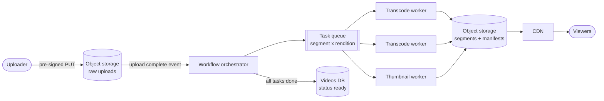

# Media Processing

## The problem it solves

A user uploads a 1-hour 4K video from their phone. Viewers need it in several resolutions so it plays on a slow mobile connection and on a TV, in a streaming format that starts quickly and seeks without downloading the whole file, plus thumbnails. Transcoding one hour of video on one machine can take hours of CPU time. Doing it inside the upload request is impossible: the request would time out, a crash would lose all progress, and a burst of uploads would starve the API servers.

**Media processing** pipelines run transcoding, resizing and analysis as asynchronous jobs: the upload is stored first, then a workflow splits the work into many independent tasks that run in parallel on a worker fleet, and the results are written to object storage and served through a CDN.

## How it works

1. **Upload directly to object storage.** The API issues a pre-signed URL (often multipart upload for large files), so bytes go straight to S3 or GCS instead of through app servers.
2. **Trigger.** An upload-complete event (storage notification or API callback) creates a job record (`status = processing`) and enqueues it.
3. **Validate and probe.** Check type, size, duration, and codecs (e.g. with `ffprobe`); reject malformed or malicious files early. Run untrusted media decoders in a sandbox.
4. **Split.** Cut the source into segments (for example a few seconds each, at keyframe boundaries).
5. **Fan out.** Create one task per (segment, rendition): 1080p, 720p, 480p and so on. Workers transcode in parallel.
6. **Fan in.** When all tasks for a rendition finish, stitch segments and write manifests for adaptive bitrate streaming (**HLS** `.m3u8` or **DASH** `.mpd`), which list the renditions so the player can switch quality as bandwidth changes.
7. **Side outputs:** thumbnails, preview sprites, audio normalization, captions, content moderation.
8. **Publish.** Mark the video ready, notify the uploader, and serve segments through a CDN.



An example transcode of one segment to 720p H.264:

```
ffmpeg -i seg_0042.mp4 -vf scale=-2:720 -c:v libx264 -preset medium \
       -b:v 3M -c:a aac -b:a 128k out/720p/seg_0042.ts
```

**Design points:**

- **Idempotent tasks with deterministic output paths** (`/video/991/720p/seg_0042.ts`), so a retried task overwrites rather than duplicates.
- **Orchestration** tracks which tasks are done: a DAG in a workflow engine (Temporal, Step Functions) or a counter per job decremented atomically as tasks complete.
- **Priorities and cost:** transcode the most-watched renditions first (publish 480p and 720p quickly, add 4K later), use spot instances or GPUs/hardware encoders for throughput, and skip renditions above the source resolution.
- **Images** follow the same pattern at smaller scale: generate fixed sizes on upload, or resize on demand at the edge and cache the result.

## Worked example

A 1-hour video split into 10-second segments, transcoded into 5 renditions. Assume each (segment, rendition) task takes 20 seconds of worker time.

| Quantity | Calculation | Result |
|---|---|---|
| Segments | 3,600 s / 10 s | 360 |
| Tasks | 360 × 5 renditions | 1,800 |
| Total CPU time | 1,800 × 20 s | 36,000 s = 10 hours |
| Wall time on 1 worker | 36,000 s | 10 hours |
| Wall time on 200 workers | 36,000 / 200 | 180 s = 3 minutes (plus split and stitch overhead) |

Storage, assuming bitrates of 5, 3, 1.5, 0.8 and 0.4 Mbps for the five renditions: total 10.7 Mbps × 3,600 s = 38,520 Mbit = 4,815 MB, about 4.8 GB per hour of video, on top of the original.

## Trade-offs

- **Pros:** uploads return fast; parallel segments turn hours of processing into minutes; failures retry only the failed task; the worker fleet scales independently and can use cheap spot capacity; adaptive bitrate gives smooth playback on any connection.
- **Cons:** the video isn't viewable until processing finishes (mitigate by publishing low renditions first); many renditions multiply storage cost; segment boundaries need keyframe alignment to avoid glitches; orchestration of fan-out and fan-in adds complexity; decoders processing untrusted files are an attack surface.
- **Alternatives:** **managed services** (AWS Elemental MediaConvert, cloud transcoder APIs) instead of a self-run fleet; **just-in-time packaging or transcoding** at request time for rarely watched content; **on-the-fly image resizing** at the CDN edge instead of precomputing every size.

## When to use it (and when not)

- **Use it** for "design YouTube" or "design Netflix" (transcoding and ABR streaming), "design Instagram" (image resizing, filters, video), "design TikTok", podcast and audio platforms, and document thumbnailing in "design Dropbox".
- **Overkill** for small images that a synchronous resize handles in milliseconds, or for internal tools with a few files a day.

## In an interview

Say: "Clients upload straight to S3 with a pre-signed URL; an upload event starts a workflow that splits the video into keyframe-aligned segments, fans out one transcode task per segment and rendition to a worker queue, then writes HLS manifests and flips the video to ready." Be ready to explain the fan-out and fan-in, adaptive bitrate streaming, retries and idempotency, and how you'd cut storage and compute cost.

## Common follow-up questions

### Why split a video into segments before transcoding?
Segments are independent tasks, so hundreds of workers can process one video in parallel, and a failure retries only one small task rather than the whole hour. Streaming formats like HLS deliver video as segments anyway.

### How does adaptive bitrate streaming work?
The video is encoded at several bitrates, each cut into short segments, and a manifest lists them. The player measures throughput and buffer level and picks the rendition for each next segment, dropping quality on a slow network instead of stalling.

### How do you know when all tasks for a video are done?
Store the expected task count with the job and atomically decrement or mark tasks complete; when the count reaches zero, the orchestrator runs the stitch and publish step. A workflow engine can model this as a parallel step that waits for all branches.

### How would you reduce storage cost?
Skip renditions higher than the source, encode popular videos with more efficient codecs (which cost more compute but save bandwidth), and move rarely watched renditions to colder storage or regenerate them on demand.
