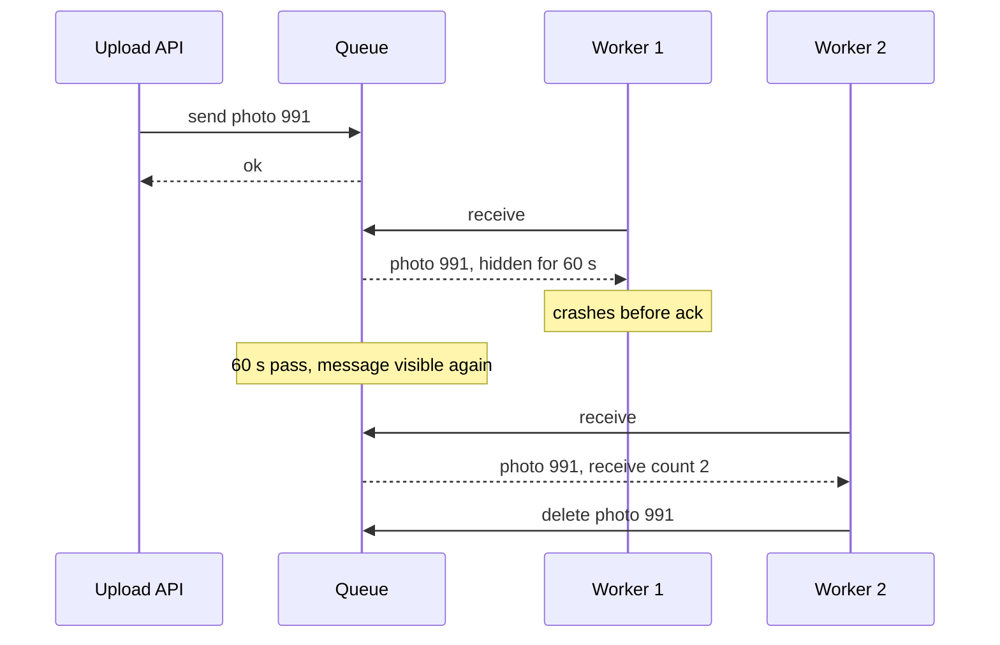

# Message Queues

## The problem it solves

A photo app generates thumbnails when users upload. Doing it inside the upload request adds 2 seconds of latency, and when a celebrity post triggers 10x normal uploads, the web servers run out of CPU and start failing requests, including ones that have nothing to do with photos. If a thumbnail worker crashes halfway, the job is simply lost.

A **message queue** sits between the producer (the upload API) and the consumers (thumbnail workers). The API drops a message on the queue and returns immediately. Workers pull messages at their own pace, the queue absorbs bursts, and a message that isn't acknowledged is redelivered, so crashes don't lose work.

## How it works

1. The producer sends a message (`{photo_id: 991}`) to the queue. The broker persists it, usually replicated.
2. A consumer receives (pulls) a message. The broker hides it from other consumers.
3. The consumer does the work and **acknowledges** (deletes) the message.
4. If the consumer crashes or doesn't ack in time, the message becomes visible again and another consumer gets it.

**Queue vs log.** Two different models hide behind "message queue":

| | Queue (SQS, RabbitMQ) | Log (Kafka, Kinesis, Pulsar) |
|---|---|---|
| Consumption | Message deleted once acked | Messages kept for a retention period; consumers track an offset |
| Scaling consumers | Add workers freely; any worker takes any message | Parallelism capped by partition count; one consumer per partition per group |
| Replay | Not possible after deletion | Rewind the offset and reprocess |
| Ordering | None (standard) or per group (FIFO) | Strict within a partition |
| Per-message retry | Natural: unacked message comes back | Awkward: a failing message blocks its partition, so you skip it to a retry topic |
| Best for | Task distribution | Event streams, multiple independent readers, replay |

**Visibility timeout.** In SQS, a received message is invisible for the visibility timeout (30 seconds by default). Set it longer than the job's worst-case time, or extend it while working, otherwise a slow job gets redelivered and runs twice in parallel.

**Delivery semantics.**

- **At most once:** ack before processing. A crash loses the message. Acceptable for metrics you can afford to drop.
- **At least once:** ack after processing. A crash after the work but before the ack causes redelivery. This is the normal default.
- **Exactly once:** not achievable end to end over an unreliable network in general. In practice you get **effectively once** with at-least-once delivery plus idempotent processing (dedupe on a message ID, or make the write naturally idempotent). Kafka transactions give exactly-once for read-process-write within Kafka.

**Ordering.** Standard SQS doesn't guarantee order. SQS FIFO queues order messages within a **message group ID**, and Kafka orders within a partition chosen by key. Use the entity ID (user, order) as the key so events for the same entity stay in order while different entities process in parallel.

**Poison messages.** A message that always fails would be retried forever. After N receives, move it to a **dead-letter queue** for inspection.

## Worked example

Normal load is 1,000 uploads/s and a thumbnail takes 200 ms of worker time, so one worker handles 5 per second. 300 workers give 1,500/s capacity. A viral event pushes uploads to 5,000/s for 10 minutes.

| Phase | Arrivals/s | Processed/s | Backlog change | Backlog at end |
|---|---|---|---|---|
| Normal | 1,000 | 1,000 | 0 | 0 |
| Burst, 600 s | 5,000 | 1,500 | +3,500/s × 600 s | 2,100,000 |
| Drain | 1,000 | 1,500 | −500/s | 0 after 2,100,000 / 500 = 4,200 s (70 min) |

Without the queue, 3,500 requests per second would have failed during the burst. With it, uploads succeed instantly and thumbnails are late. Autoscaling workers on queue depth would shorten the 70-minute drain.

## Trade-offs

- **Pros:** decouples producers from consumers; absorbs spikes (load leveling); retries crashed work automatically; lets you scale workers independently; isolates failures.
- **Cons:** asynchronous, so the user doesn't get the result immediately (you need status polling or notifications); duplicates under at-least-once; another system to run and monitor; ordering and exactly-once take deliberate design; backlogs can hide problems until they're huge, so alert on queue age.
- **Alternatives:** **synchronous calls** when the work is fast and the caller needs the result; **pub/sub** when several services each need every message; a **database table as a queue** (`SELECT ... FOR UPDATE SKIP LOCKED`) at low volume; **stream processing** when you need windows and aggregations.

## When to use it (and when not)

- **Use it** for background jobs (emails, thumbnails, video transcoding in "design YouTube"), smoothing write spikes ("design Ticketmaster" order processing), fan-out work in "design a news feed", web crawler URL frontiers, and any task taking more than a few hundred milliseconds.
- **Don't use it** for requests the user is waiting on synchronously and that are fast, or as a database: queues aren't good at lookups by key.

## In an interview

Say: "The API enqueues a job and returns 202; workers pull from SQS with a visibility timeout longer than the p99 job time, ack after finishing, and dedupe on job ID because delivery is at-least-once; after five failures a message goes to a DLQ." Be ready to compare queues with logs, explain visibility timeouts and delivery semantics, and size the worker pool.

## Common follow-up questions

### Can a message queue give exactly-once delivery?
Not end to end in general, because an ack can be lost after the work is done. Use at-least-once delivery and make processing idempotent: record processed message IDs in the same transaction as the side effect, or use upserts and conditional writes.

### When would you choose Kafka over SQS?
Choose Kafka when several consumers need the same stream, you need replay, strict per-key ordering, or very high throughput. Choose SQS or RabbitMQ for task distribution where you want per-message acks, retries and dead-lettering without managing partitions.

### What happens if a job takes longer than the visibility timeout?
The message becomes visible and another worker starts it, so two workers process it at once. Set the timeout above the worst-case duration, or have the worker periodically extend it (heartbeat) while it's still working.

### How do you know when to add workers?
Watch the age of the oldest message and the queue depth, not just CPU. If the oldest message is getting older, consumers aren't keeping up, so autoscale on depth or age divided by per-worker throughput.

### How do you keep one user's messages in order?
Use a FIFO queue with the user ID as the message group ID, or a Kafka partition key. Messages with the same key are delivered in order to one consumer at a time, while different users still process in parallel.
